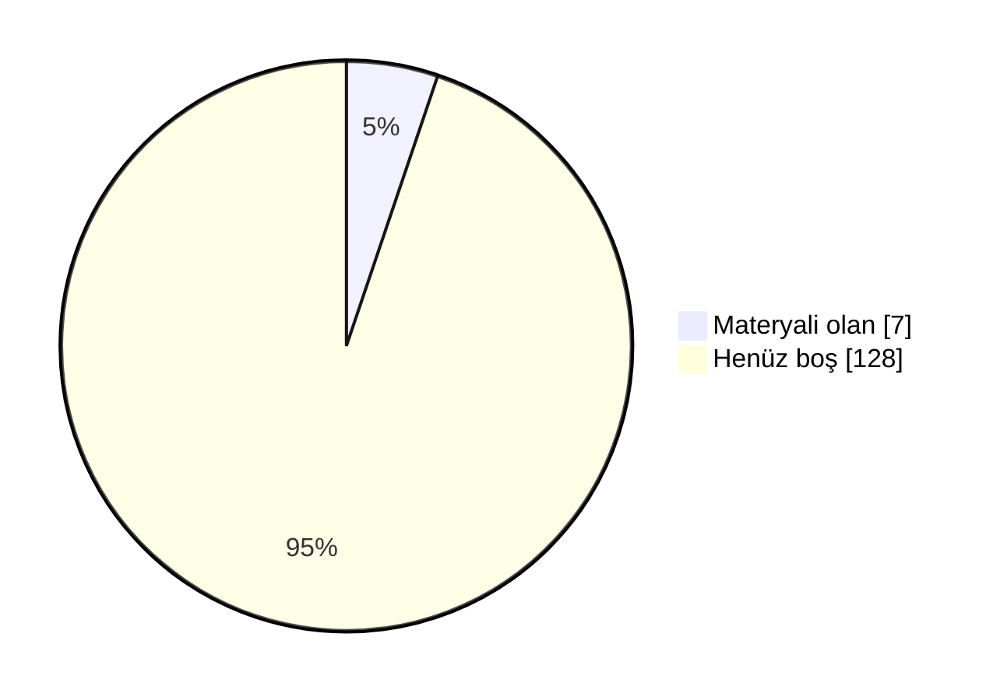

# 📖 Marmara Makine Mühendisliği Arşiv

Marmara Üniversitesi Teknoloji Fakültesi Makine Mühendisliği öğrencileri için düzenli, sürdürülebilir ve değer üreten bir akademik arşiv. Ders notları, ödev çözümleri, slaytlar, çıkmış sorular ve çalışma rehberleri tek bir yerde toplandı.

 ## 🗣️ Geri Bildirimde Bulunun

📬 Öğrenciler ve hocalar, derslerle ilgili hakaret içermeyen geri bildirimlerinizi aşağıdaki linkler aracılığıyla anonim olarak paylaşabilirsiniz.

- [✍️ **Hocalar için yorum linki**](https://docs.google.com/forms/d/e/1FAIpQLScyRyZKV8GD4rl-Ukx7DzUiQCzcf8tQWyq5TrxG5bGrzYT5HA/viewform)
- [✍️ **Dersler için yorum linki**](https://docs.google.com/forms/d/e/1FAIpQLScJM4fn94jg3bCgoC3w8CTKN3Y-LeGkqRSHg4VWLofhfcx9uw/viewform)
- [⭐ **Dersler için oylama linki**](https://docs.google.com/forms/d/e/1FAIpQLSf-rdCk7HVFSGk0pkV_yy_Qw83oUWjNr6jAYbMoE-yvEWJroQ/viewform)

## 🤝 Katkıda Bulunun

Elinde ders notu, slayt, çıkmış soru ya da ödev çözümü varsa arşive eklemek çok kolay:

- 📁 **GitHub kullanmıyorsan:** [Google Drive klasörümüze](https://drive.google.com/drive/folders/1KRobMRVHpJxUKcCZdCEippSZ5SmgpkZq?usp=sharing) yükle. Önce BENİOKU dosyasını oku, sonra **Makine-Teknoloji** klasöründe kendi adınla bir klasör aç.
- 🌐 **GitHub hesabın varsa:** Repoyu fork'la, dosyayı ilgili ders klasörüne yükle ve pull request gönder. Kurulum gerekmez, her şey tarayıcıdan yapılır.
- 📖 **Adım adım rehber:** [CONTRIBUTING.md](CONTRIBUTING.md)

Pull request ile katkıda bulunanların adı sayfanın en altındaki **Katkıda Bulunanlar** listesine otomatik eklenir.

### 📺 Video Rehberler
- 🎬 **Repoya nasıl katkı yapılır?** (~10 dk): *yakında*
- 🎬 **Repo nasıl kullanılır?** Klasör yapısı, ders README'leri ve aradığını bulma: *yakında*

<b>🛠 Repo Kullanımı</b>

## 🛠 Repo Kullanımı

### ⚙️ Açıklamalar:
- 📋 Bölümde bilinen ve güvenilir bir kaynak olmak.
- 📋 Akademik network oluşturmak ve iş birliklerini kolaylaştırmak.
- 📋 Dışarıdan bakan biri için temiz, düzenli ve profesyonel bir imaj sunmak.
- 📋 İçerikler: ders slaytları, kişisel ders notları ve özetler, ödev çözümleri, atölye çalışmaları, çıkmış sorular ve analizleri, proje dosyaları ve örnekleri.

### 📝 Talimatlar:
- 👉 Repo içindeki README.md'leri ders bazlı takip edin.
- 👉 Ödevleri çalıştırmak için ilgili klasörlerdeki .py veya .cpp dosyalarını kullanabilirsiniz.
- 👉 Ders özetleri, kısa ve okunabilir şekilde markdown olarak hazırlanmıştır.
- 👉 Özet ve ödevleri birleştirip kendi öğrenme sürecinize uyarlayabilirsiniz.

<b>🔍 Kavramlar</b>

## 🔍 Kavramlar

📌 Bölümle ilgili sık karşılaşılan terimlerin kısa açıklamaları. Not: tarih/şart gibi somut rakamlar dönemden
döneme değişebilir, kesin ve güncel bilgi için bölüm/fakülte öğrenci işlerine danışın.

- 💡 **Bütünleme Sınavı**
  - 📘 **S: Bütünleme sınavı nedir?** **C:** Final sınavının ardından yapılan, dersten başarısız olanların
    (ve şartlı geçenlerin isterlerse) girebildiği ek bir sınavdır. Bütünlemeye giren bir öğrencinin notu,
    final notunun yerini alır — geri dönüş yoktur.
- 💡 **Çan Eğrisi**
  - 📘 **S: Çan eğrisi nedir?** **C:** Bir sınıfın sınav sonuçlarının ortalama ve standart sapmasına göre
    harf notlarının belirlendiği bağıl bir değerlendirme yöntemidir. Her hoca kullanmak zorunda değildir;
    bazı dersler mutlak (bareme dayalı) notlandırılır.
- 💡 **DC Notu / Şartlı Geçme**
  - 📘 **S: DC nedir?** **C:** Şartlı geçme notudur — dersi geçmiş sayılırsınız ama not ortalamanız
    (GANO) yeterince yüksek değilse dersi tekrar almanız istenebilir. Bütünlemeye isteğe bağlı girilebilir.
- 💡 **GANO / AGNO**
  - 📘 **S: GANO nedir?** **C:** Genel Ağırlıklı Not Ortalaması — o ana kadar alınan tüm derslerin kredi
    ağırlıklı not ortalamasıdır. Mezuniyet, ÇAP/yandal başvurusu gibi şartlarda kullanılır.
- 💡 **YANO**
  - 📘 **S: YANO nedir?** **C:** Yarıyıl Ağırlıklı Not Ortalaması — yalnızca ilgili dönemde alınan derslerin
    kredi ağırlıklı not ortalamasıdır. Her dönem sıfırdan hesaplanır; GANO ise tüm dönemleri kapsar.
- 💡 **Mazeret Sınavı**
  - 📘 **S: Mazeret sınavı nedir?** **C:** Sağlık raporu, resmi belgeli bir mazeret vb. nedenle vize/finale
    giremeyen öğrenciler için düzenlenen, geçerli belgeyle başvurulan ek sınavdır.
- 💡 **ÇAP / Yandal**
  - 📘 **S: ÇAP nedir?** **C:** Çift Anadal Programı — uygun GANO'ya sahip öğrencilerin, okurken ikinci bir
    bölümden de lisans diploması almasını sağlayan program.
  - 📘 **S: Yandal nedir?** **C:** Diploma vermeyen, ikinci bir alanda sertifika niteliğinde daha hafif bir
    program.
- 💡 **Staj 1 / Staj 2**
  - 📘 **S: Staj 1/2 nedir?** **C:** Müfredatta 3. ve 4. yıllarda yer alan, işletmede kısa süreli uygulamalı
    çalışmayı zorunlu kılan derslerdir. Hangi dönemde olduklarını dönem sayfalarında görebilirsin.
- 💡 **İş Yeri Eğitimi**
  - 📘 **S: İş Yeri Eğitimi nedir?** **C:** Staj'dan daha kapsamlı, bir dönem boyunca işletmede tam zamanlı
    çalışmayı içeren müfredat dersi (Teknoloji Fakültesi'nde 7. yarıyılda, 28 AKTS ile oldukça yüklü bir ders).
- 💡 **Bitirme Projesi**
  - 📘 **S: Bitirme Projesi nedir?** **C:** Son dönemde bir danışman hoca eşliğinde yürütülen, mezuniyet
    şartı olan bitirme çalışmasıdır.
- 💡 **Mesleki Seçmeli / Üniversite Seçmeli**
  - 📘 **S: Aralarındaki fark ne?** **C:** Mesleki Seçmeli dersler bölüm içi teknik derslerdir. Üniversite Seçmeli dersler ise bölüm dışı, daha genel/sosyal
    içeriklidir (örn. Girişimcilik, Osmanlı Tarihi). Bkz. [Seçmeli Dersler](#-seçmeli-dersler).

<!-- DOLULUK_BASLANGIC -->

<b>📊 Arşiv Doluluk Durumu</b>

## 📊 Arşiv Doluluk Durumu

Arşivdeki **135** dersin **7** tanesinde en az bir materyal var (genel doluluk **%5**).

| Dönem | Doluluk | Materyali olan ders |
|---|---|---|
| [1. Yıl Güz](./1-1/) | 🟩🟩🟩🟩🟩🟩🟩⬜⬜⬜ %70 | 7 / 10 |
| [1. Yıl Bahar](./1-2/) | ⬜⬜⬜⬜⬜⬜⬜⬜⬜⬜ %0 | 0 / 9 |
| [2. Yıl Güz](./2-1/) | ⬜⬜⬜⬜⬜⬜⬜⬜⬜⬜ %0 | 0 / 5 |
| [2. Yıl Bahar](./2-2/) | ⬜⬜⬜⬜⬜⬜⬜⬜⬜⬜ %0 | 0 / 6 |
| [3. Yıl Güz](./3-1/) | ⬜⬜⬜⬜⬜⬜⬜⬜⬜⬜ %0 | 0 / 7 |
| [3. Yıl Bahar](./3-2/) | ⬜⬜⬜⬜⬜⬜⬜⬜⬜⬜ %0 | 0 / 4 |
| [4. Yıl Güz](./4-1/) | ⬜⬜⬜⬜⬜⬜⬜⬜⬜⬜ %0 | 0 / 3 |
| [4. Yıl Bahar](./4-2/) | ⬜⬜⬜⬜⬜⬜⬜⬜⬜⬜ %0 | 0 / 6 |
| [Mesleki Seçmeli](./Mesleki%20Seçmeli/) | ⬜⬜⬜⬜⬜⬜⬜⬜⬜⬜ %0 | 0 / 69 |
| [Üniversite Seçmeli](./Üniversite%20Seçmeli/) | ⬜⬜⬜⬜⬜⬜⬜⬜⬜⬜ %0 | 0 / 16 |

### 🙋 Bu dersler katkını bekliyor
Elinde bu derslerden materyal varsa yukarıdaki **🤝 Katkıda Bulunun** bölümüne göz at.

- **1. Yıl Güz:** İngilizce 1, İş Sağlığı ve Güvenliği 1, Türk Dili 1
- **1. Yıl Bahar:** Fizik 2, İmalat İşlemleri, İngilizce 2, İş Sağlığı ve Güvenliği 2, Malzeme Bilimi ve Mühendisliği, Matematik 2, Statik, Teknik Resim, Türk Dili 2
- **2. Yıl Güz:** Akışkanlar Mekaniği, Bilgisayar Destekli Meslek Resmi, Diferansiyel Denklemler, Dinamik, Teknik İngilizce
- **2. Yıl Bahar:** Elektrik ve Elektroniğin Temelleri, İmal Usulleri, Mukavemet, Ölçme Tekniği ve İstatistik, Sayısal Analiz, Termodinamik 1
- **3. Yıl Güz:** Endüstriyel Hidrolik ve Pnömatik, Isı Geçişi, Makine Elemanları 1, Motorlar, Staj 1, Termodinamik 2, Toplam Kalite Yönetimi
- **3. Yıl Bahar:** Bilgisayar Destekli İmalat, Endüstriyel Otomatik Kontrol, Makine Dinamiği ve Mekanizma Tekniği, Makine Elemanları 2
- **4. Yıl Güz:** Atatürk İlkeleri ve İnkılap Tarihi 1, İş Yeri Eğitimi, Staj 2
- **4. Yıl Bahar:** Atatürk İlkeleri ve İnkılap Tarihi 2, Bitirme Projesi, Endüstriyel Otomasyon ve Robotlar, İş Hukuku ve Etiği, Mühendislik Ekonomisi ve Uygulamaları, Üretim Yönetimi
- **Mesleki Seçmeli:** Bilgisayar Destekli Geometrik Modelleme Teknikleri, Bilgisayar Destekli Kalıp Tasarımı, Bilgisayarla Bütünleşik İmalat Teknikleri, Biyomekaniğe Giriş, Çevre Koruma, Deneysel Tasarım, Doğal Gaz Teknolojisi, Döküm Simülasyonu, Dövme Kalıp Teknikleri, Eklemeli İmalat Yöntemleri, Eklemeli İmalat Yöntemleri ve Uygulamaları, Endüstriyel Akustik ve Gürültü, Endüstriyel Tesislerde Emisyon ve Kirletici Giderim Yöntemleri, Enerji Ekonomisi ve Yönetimi, Enerji Sistemleri ve Gaz Teknolojileri, Enjeksiyon Kalıp Teknikleri, Ergonomi, Gaz Türbinleri, Gemi Makinaları Teknikleri, Güç Aktarma ve Yön Kontrol Sistemleri, Havacılıkta Akışkan Sistemler için Sayısal Yöntemler ve Modelleme, Hesaplamalı Akışkanlar Dinamiğine Giriş, Hibrit ve Elektrikli Taşıtlar, Isı Değiştiricileri, Isı ve Ses Yalıtımı, Isıtma Havalandırma Teknikleri, İklimlendirme Projesi, İklimlendirme Teknikleri, İleri Mukavemet, İş Planı ve Ticarileşme, İş ve Enerji Makinaları Teknolojisi, İş ve Takım Bağlama Kalıp Tasarımı, Kalite ve Kontrol, Kazanlar ve Yakıcılar, Kaza-Hasar Analiz Teknikleri, Makine Öğrenmesi ve Mühendislik Uygulamaları, Makine Tasarım Uygulamaları, Malzeme Muayene ve Isıl İşlemler, Malzemelerin Mekanik Davranışı, Mekanik Tesisat Teknikleri, Mikro ve Nano İmalat, Modern İmalat Teknikleri ve Yaklaşımları, Motor ve Taşıt Performans Test Teknikleri, Mühendislik İstatistiği ve Güvenilirlik, Mühendislik Malzemeleri, Nano Teknoloji ve Uygulamaları, Otomotiv Elektrik ve Elektroniği, Otomotiv İmalat Teknikleri, Otomotiv Mekatroniği, Plastik Şekil Verme Teorileri, Pompalar ve Kompresörler, Servis İşletmeciliği ve Müşteri İlişkileri, Soğutma Teknikleri, Sonlu Elemanlar Yöntemleri, Sürdürülebilir Kalkınma ve Enerji Sistemleri, Talaşlı İmalat Mekaniği ve Kesme Teorileri, Talaşlı İmalat Teknikleri, Talaşlı İmalatta Deneysel Yöntemler, Tasarı Geometri, Taşıt Aerodinamiği, Taşıt Emisyonları ve Kontrolü, Taşıt Teknolojisi, Tedarik Zinciri Planlama ve Optimizasyon Teknolojileri, Teknoloji ve Ar-Ge Yönetimi, Transport Tekniği, Yakıtlar ve Yanma, Yapay Zeka ve Makine Öğrenimi, Yeni Ürün Geliştirme, Yenilenebilir Enerji Kaynakları
- **Üniversite Seçmeli:** Bilim Tarihi, Çevre ve Enerji, Fizibilite Hazırlama ve Uygulamaları, Girişimcilik, Girişimcilik ve İnovasyon, İş Psikolojisi, Kalite Yönetimi, Liderlik, Moda, Osmanlı Tarihi, Rapor Hazırlama ve Sunum Teknikleri, Sistem Mühendisliği, Sosyal Organizasyon, Teknik İletişim, Teknik Satış ve Pazarlama, Teknoloji Yönetimi

<!-- DOLULUK_BITIS -->

<b>📖 Dersler</b>

## 📖 Dersler
📄 Bu bölümde, tüm dersler hakkında detaylı bilgiler ve kaynaklar bulunmaktadır. Öğrenciler bu bölümü kullanarak ders materyallerine ve içeriklerine ulaşabilirler.

### 🗓 1. Yıl - Güz

#### 📘 Temel Bilgi Teknolojisi Kullanımı 
  - 🏷️ **Ders Tipi:** Zorunlu
  - 🏷️ **Müfredat:** Her İki Müfredat
  - ⭐ **Yıldız Sayıları:**
      - ℹ️ Henüz yıldız veren yok. Siz de [linkten](https://docs.google.com/forms/d/e/1FAIpQLSf-rdCk7HVFSGk0pkV_yy_Qw83oUWjNr6jAYbMoE-yvEWJroQ/viewform?usp=pp_url&entry.2140317461=Temel%20Bilgi%20Teknolojisi%20Kullan%C4%B1m%C4%B1) anonim şekilde oylamaya katılabilirsiniz.
  - 💬 **Öğrenci Görüşleri:**
      - ℹ️ Henüz yorum yok. Siz de [linkten](https://docs.google.com/forms/d/e/1FAIpQLScJM4fn94jg3bCgoC3w8CTKN3Y-LeGkqRSHg4VWLofhfcx9uw/viewform?usp=pp_url&entry.819949480=Temel%20Bilgi%20Teknolojisi%20Kullan%C4%B1m%C4%B1) anonim şekilde görüşlerinizi belirtebilirsiniz.
  - 👨‍🏫 👩‍🏫 **Dersi Yürüten Akademisyenler:**
    - **2026-2027**: [GA](#‍-dr-öğretim-üyesi-gürcan-atakök)
  - 📂 [Ders Klasörü](./1-1/Temel%20Bilgi%20Teknolojisi%20Kullan%C4%B1m%C4%B1)

#### 📘 Fizik 1 
  - 🏷️ **Ders Tipi:** Zorunlu
  - 🏷️ **Müfredat:** Her İki Müfredat
  - ⭐ **Yıldız Sayıları:**
      - ℹ️ Henüz yıldız veren yok. Siz de [linkten](https://docs.google.com/forms/d/e/1FAIpQLSf-rdCk7HVFSGk0pkV_yy_Qw83oUWjNr6jAYbMoE-yvEWJroQ/viewform?usp=pp_url&entry.2140317461=Fizik%201) anonim şekilde oylamaya katılabilirsiniz.
  - 💬 **Öğrenci Görüşleri:**
      - ℹ️ Henüz yorum yok. Siz de [linkten](https://docs.google.com/forms/d/e/1FAIpQLScJM4fn94jg3bCgoC3w8CTKN3Y-LeGkqRSHg4VWLofhfcx9uw/viewform?usp=pp_url&entry.819949480=Fizik%201) anonim şekilde görüşlerinizi belirtebilirsiniz.
  - 👨‍🏫 👩‍🏫 **Dersi Yürüten Akademisyenler:**
    - **2026-2027**: [CB](#‍-prof-dr-cihat-boyraz)
  - 📂 [Ders Klasörü](./1-1/Fizik%201)

#### 📘 İş Sağlığı ve Güvenliği 1 
  - 🏷️ **Ders Tipi:** Zorunlu
  - 🏷️ **Müfredat:** 2026 Sonrası
      - ℹ️ 2026 öncesi müfredatta tek ders olarak "İş Sağlığı ve Güvenliği" adıyla 1. yarıyılda (1-1) yer alıyor.
  - ⭐ **Yıldız Sayıları:**
      - ℹ️ Henüz yıldız veren yok. Siz de [linkten](https://docs.google.com/forms/d/e/1FAIpQLSf-rdCk7HVFSGk0pkV_yy_Qw83oUWjNr6jAYbMoE-yvEWJroQ/viewform?usp=pp_url&entry.2140317461=%C4%B0%C5%9F%20Sa%C4%9Fl%C4%B1%C4%9F%C4%B1%20ve%20G%C3%BCvenli%C4%9Fi%201) anonim şekilde oylamaya katılabilirsiniz.
  - 💬 **Öğrenci Görüşleri:**
      - ℹ️ Henüz yorum yok. Siz de [linkten](https://docs.google.com/forms/d/e/1FAIpQLScJM4fn94jg3bCgoC3w8CTKN3Y-LeGkqRSHg4VWLofhfcx9uw/viewform?usp=pp_url&entry.819949480=%C4%B0%C5%9F%20Sa%C4%9Fl%C4%B1%C4%9F%C4%B1%20ve%20G%C3%BCvenli%C4%9Fi%201) anonim şekilde görüşlerinizi belirtebilirsiniz.
  - 👨‍🏫 👩‍🏫 **Dersi Yürüten Akademisyenler:**
    - **2026-2027**: [YB](#‍-prof-dr-yahya-bozkurt)
  - 📂 [Ders Klasörü](./1-1/%C4%B0%C5%9F%20Sa%C4%9Fl%C4%B1%C4%9F%C4%B1%20ve%20G%C3%BCvenli%C4%9Fi%201)

#### 📘 Kimya 
  - 🏷️ **Ders Tipi:** Zorunlu
  - 🏷️ **Müfredat:** Her İki Müfredat
  - ⭐ **Yıldız Sayıları:**
      - ℹ️ Henüz yıldız veren yok. Siz de [linkten](https://docs.google.com/forms/d/e/1FAIpQLSf-rdCk7HVFSGk0pkV_yy_Qw83oUWjNr6jAYbMoE-yvEWJroQ/viewform?usp=pp_url&entry.2140317461=Kimya) anonim şekilde oylamaya katılabilirsiniz.
  - 💬 **Öğrenci Görüşleri:**
      - ℹ️ Henüz yorum yok. Siz de [linkten](https://docs.google.com/forms/d/e/1FAIpQLScJM4fn94jg3bCgoC3w8CTKN3Y-LeGkqRSHg4VWLofhfcx9uw/viewform?usp=pp_url&entry.819949480=Kimya) anonim şekilde görüşlerinizi belirtebilirsiniz.
  - 👨‍🏫 👩‍🏫 **Dersi Yürüten Akademisyenler:**
    - **2026-2027**: [ZŞ](#‍-dr-öğretim-üyesi-zeynel-şahin)
  - 📂 [Ders Klasörü](./1-1/Kimya)

#### 📘 Makine Mühendisliğine Giriş 
  - 🏷️ **Ders Tipi:** Zorunlu
  - 🏷️ **Müfredat:** Her İki Müfredat
  - ⭐ **Yıldız Sayıları:**
      - ℹ️ Henüz yıldız veren yok. Siz de [linkten](https://docs.google.com/forms/d/e/1FAIpQLSf-rdCk7HVFSGk0pkV_yy_Qw83oUWjNr6jAYbMoE-yvEWJroQ/viewform?usp=pp_url&entry.2140317461=Makine%20M%C3%BChendisli%C4%9Fine%20Giri%C5%9F) anonim şekilde oylamaya katılabilirsiniz.
  - 💬 **Öğrenci Görüşleri:**
      - ℹ️ Henüz yorum yok. Siz de [linkten](https://docs.google.com/forms/d/e/1FAIpQLScJM4fn94jg3bCgoC3w8CTKN3Y-LeGkqRSHg4VWLofhfcx9uw/viewform?usp=pp_url&entry.819949480=Makine%20M%C3%BChendisli%C4%9Fine%20Giri%C5%9F) anonim şekilde görüşlerinizi belirtebilirsiniz.
  - 👨‍🏫 👩‍🏫 **Dersi Yürüten Akademisyenler:**
    - **2026-2027**: [MG](#‍-prof-dr-metin-gümüş)
  - 📂 [Ders Klasörü](./1-1/Makine%20M%C3%BChendisli%C4%9Fine%20Giri%C5%9F)

#### 📘 Matematik 1 
  - 🏷️ **Ders Tipi:** Zorunlu
  - 🏷️ **Müfredat:** Her İki Müfredat
  - ⭐ **Yıldız Sayıları:**
      - ℹ️ Henüz yıldız veren yok. Siz de [linkten](https://docs.google.com/forms/d/e/1FAIpQLSf-rdCk7HVFSGk0pkV_yy_Qw83oUWjNr6jAYbMoE-yvEWJroQ/viewform?usp=pp_url&entry.2140317461=Matematik%201) anonim şekilde oylamaya katılabilirsiniz.
  - 💬 **Öğrenci Görüşleri:**
      - ℹ️ Henüz yorum yok. Siz de [linkten](https://docs.google.com/forms/d/e/1FAIpQLScJM4fn94jg3bCgoC3w8CTKN3Y-LeGkqRSHg4VWLofhfcx9uw/viewform?usp=pp_url&entry.819949480=Matematik%201) anonim şekilde görüşlerinizi belirtebilirsiniz.
  - 👨‍🏫 👩‍🏫 **Dersi Yürüten Akademisyenler:**
    - **2026-2027**: [CB](#‍-prof-dr-cihat-boyraz)
  - 📂 [Ders Klasörü](./1-1/Matematik%201)

#### 📘 Lineer Cebir 
  - 🏷️ **Ders Tipi:** Zorunlu
  - 🏷️ **Müfredat:** Her İki Müfredat
  - ⭐ **Yıldız Sayıları:**
      - ℹ️ Henüz yıldız veren yok. Siz de [linkten](https://docs.google.com/forms/d/e/1FAIpQLSf-rdCk7HVFSGk0pkV_yy_Qw83oUWjNr6jAYbMoE-yvEWJroQ/viewform?usp=pp_url&entry.2140317461=Lineer%20Cebir) anonim şekilde oylamaya katılabilirsiniz.
  - 💬 **Öğrenci Görüşleri:**
      - ℹ️ Henüz yorum yok. Siz de [linkten](https://docs.google.com/forms/d/e/1FAIpQLScJM4fn94jg3bCgoC3w8CTKN3Y-LeGkqRSHg4VWLofhfcx9uw/viewform?usp=pp_url&entry.819949480=Lineer%20Cebir) anonim şekilde görüşlerinizi belirtebilirsiniz.
  - 👨‍🏫 👩‍🏫 **Dersi Yürüten Akademisyenler:**
    - **2026-2027**: [CB](#‍-prof-dr-cihat-boyraz)
  - 📂 [Ders Klasörü](./1-1/Lineer%20Cebir)

#### 📘 Türk Dili 1 
  - 🏷️ **Ders Tipi:** Zorunlu
  - 🏷️ **Müfredat:** Her İki Müfredat
  - ⭐ **Yıldız Sayıları:**
      - ℹ️ Henüz yıldız veren yok. Siz de [linkten](https://docs.google.com/forms/d/e/1FAIpQLSf-rdCk7HVFSGk0pkV_yy_Qw83oUWjNr6jAYbMoE-yvEWJroQ/viewform?usp=pp_url&entry.2140317461=T%C3%BCrk%20Dili%201) anonim şekilde oylamaya katılabilirsiniz.
  - 💬 **Öğrenci Görüşleri:**
      - ℹ️ Henüz yorum yok. Siz de [linkten](https://docs.google.com/forms/d/e/1FAIpQLScJM4fn94jg3bCgoC3w8CTKN3Y-LeGkqRSHg4VWLofhfcx9uw/viewform?usp=pp_url&entry.819949480=T%C3%BCrk%20Dili%201) anonim şekilde görüşlerinizi belirtebilirsiniz.
  - 👨‍🏫 👩‍🏫 **Dersi Yürüten Akademisyenler:**
    - **2026-2027**: [MK](#‍-öğr-gör-dr-mehmet-kocakaplan)
  - 📂 [Ders Klasörü](./1-1/T%C3%BCrk%20Dili%201)

#### 📘 İngilizce 1 
  - 🏷️ **Ders Tipi:** Zorunlu
  - 🏷️ **Müfredat:** Her İki Müfredat
  - ⭐ **Yıldız Sayıları:**
      - ℹ️ Henüz yıldız veren yok. Siz de [linkten](https://docs.google.com/forms/d/e/1FAIpQLSf-rdCk7HVFSGk0pkV_yy_Qw83oUWjNr6jAYbMoE-yvEWJroQ/viewform?usp=pp_url&entry.2140317461=%C4%B0ngilizce%201) anonim şekilde oylamaya katılabilirsiniz.
  - 💬 **Öğrenci Görüşleri:**
      - ℹ️ Henüz yorum yok. Siz de [linkten](https://docs.google.com/forms/d/e/1FAIpQLScJM4fn94jg3bCgoC3w8CTKN3Y-LeGkqRSHg4VWLofhfcx9uw/viewform?usp=pp_url&entry.819949480=%C4%B0ngilizce%201) anonim şekilde görüşlerinizi belirtebilirsiniz.
  - 👨‍🏫 👩‍🏫 **Dersi Yürüten Akademisyenler:**
    - **2026-2027**: [IRS](#‍-öğr-gör-dr-işıl-ruacan-silahtaroğlu)
  - 📂 [Ders Klasörü](./1-1/%C4%B0ngilizce%201)

#### 📘 İş Sağlığı ve Güvenliği 
  - 🏷️ **Ders Tipi:** Zorunlu
  - 🏷️ **Müfredat:** 2026 Öncesi
      - ℹ️ 2026 sonrası müfredatta yerini "İş Sağlığı ve Güvenliği 1" ve "İş Sağlığı ve Güvenliği 2" almış.
  - ⭐ **Yıldız Sayıları:**
      - ℹ️ Henüz yıldız veren yok. Siz de [linkten](https://docs.google.com/forms/d/e/1FAIpQLSf-rdCk7HVFSGk0pkV_yy_Qw83oUWjNr6jAYbMoE-yvEWJroQ/viewform?usp=pp_url&entry.2140317461=%C4%B0%C5%9F%20Sa%C4%9Fl%C4%B1%C4%9F%C4%B1%20ve%20G%C3%BCvenli%C4%9Fi) anonim şekilde oylamaya katılabilirsiniz.
  - 💬 **Öğrenci Görüşleri:**
      - ℹ️ Henüz yorum yok. Siz de [linkten](https://docs.google.com/forms/d/e/1FAIpQLScJM4fn94jg3bCgoC3w8CTKN3Y-LeGkqRSHg4VWLofhfcx9uw/viewform?usp=pp_url&entry.819949480=%C4%B0%C5%9F%20Sa%C4%9Fl%C4%B1%C4%9F%C4%B1%20ve%20G%C3%BCvenli%C4%9Fi) anonim şekilde görüşlerinizi belirtebilirsiniz.
  - 👨‍🏫 👩‍🏫 **Dersi Yürüten Akademisyenler:**
    - **2026-2027** (bu yıl yeni girenler bu dersi alamaz; ders yalnızca 2026 öncesi müfredattaki öğrenciler için açıldı): [AD](#‍-doç-dr-abdullah-demir)
  - 📂 [Ders Klasörü](./1-1/%C4%B0%C5%9F%20Sa%C4%9Fl%C4%B1%C4%9F%C4%B1%20ve%20G%C3%BCvenli%C4%9Fi)

### 🗓 1. Yıl - Bahar

#### 📘 Fizik 2 
  - 🏷️ **Ders Tipi:** Zorunlu
  - 🏷️ **Müfredat:** Her İki Müfredat
  - ⭐ **Yıldız Sayıları:**
      - ℹ️ Henüz yıldız veren yok. Siz de [linkten](https://docs.google.com/forms/d/e/1FAIpQLSf-rdCk7HVFSGk0pkV_yy_Qw83oUWjNr6jAYbMoE-yvEWJroQ/viewform?usp=pp_url&entry.2140317461=Fizik%202) anonim şekilde oylamaya katılabilirsiniz.
  - 💬 **Öğrenci Görüşleri:**
      - ℹ️ Henüz yorum yok. Siz de [linkten](https://docs.google.com/forms/d/e/1FAIpQLScJM4fn94jg3bCgoC3w8CTKN3Y-LeGkqRSHg4VWLofhfcx9uw/viewform?usp=pp_url&entry.819949480=Fizik%202) anonim şekilde görüşlerinizi belirtebilirsiniz.
  - 👨‍🏫 👩‍🏫 **Dersi Yürüten Akademisyenler:**
    - **2025-2026**: [CB](#‍-prof-dr-cihat-boyraz)
  - 📂 [Ders Klasörü](./1-2/Fizik%202)

#### 📘 İş Sağlığı ve Güvenliği 2 
  - 🏷️ **Ders Tipi:** Zorunlu
  - 🏷️ **Müfredat:** 2026 Sonrası
      - ℹ️ 2026 öncesi müfredatta tek ders olarak "İş Sağlığı ve Güvenliği" adıyla 1. yarıyılda (1-1) yer alıyor.
  - ⭐ **Yıldız Sayıları:**
      - ℹ️ Henüz yıldız veren yok. Siz de [linkten](https://docs.google.com/forms/d/e/1FAIpQLSf-rdCk7HVFSGk0pkV_yy_Qw83oUWjNr6jAYbMoE-yvEWJroQ/viewform?usp=pp_url&entry.2140317461=%C4%B0%C5%9F%20Sa%C4%9Fl%C4%B1%C4%9F%C4%B1%20ve%20G%C3%BCvenli%C4%9Fi%202) anonim şekilde oylamaya katılabilirsiniz.
  - 💬 **Öğrenci Görüşleri:**
      - ℹ️ Henüz yorum yok. Siz de [linkten](https://docs.google.com/forms/d/e/1FAIpQLScJM4fn94jg3bCgoC3w8CTKN3Y-LeGkqRSHg4VWLofhfcx9uw/viewform?usp=pp_url&entry.819949480=%C4%B0%C5%9F%20Sa%C4%9Fl%C4%B1%C4%9F%C4%B1%20ve%20G%C3%BCvenli%C4%9Fi%202) anonim şekilde görüşlerinizi belirtebilirsiniz.
  - 📂 [Ders Klasörü](./1-2/%C4%B0%C5%9F%20Sa%C4%9Fl%C4%B1%C4%9F%C4%B1%20ve%20G%C3%BCvenli%C4%9Fi%202)

#### 📘 Statik 
  - 🏷️ **Ders Tipi:** Zorunlu
  - 🏷️ **Müfredat:** Her İki Müfredat
  - ⭐ **Yıldız Sayıları:**
      - ℹ️ Henüz yıldız veren yok. Siz de [linkten](https://docs.google.com/forms/d/e/1FAIpQLSf-rdCk7HVFSGk0pkV_yy_Qw83oUWjNr6jAYbMoE-yvEWJroQ/viewform?usp=pp_url&entry.2140317461=Statik) anonim şekilde oylamaya katılabilirsiniz.
  - 💬 **Öğrenci Görüşleri:**
      - ℹ️ Henüz yorum yok. Siz de [linkten](https://docs.google.com/forms/d/e/1FAIpQLScJM4fn94jg3bCgoC3w8CTKN3Y-LeGkqRSHg4VWLofhfcx9uw/viewform?usp=pp_url&entry.819949480=Statik) anonim şekilde görüşlerinizi belirtebilirsiniz.
  - 👨‍🏫 👩‍🏫 **Dersi Yürüten Akademisyenler:**
    - **2025-2026**: [BMM](#‍-dr-öğretim-üyesi-bilçen-mutlu-mitil)
  - 📂 [Ders Klasörü](./1-2/Statik)

#### 📘 İmalat İşlemleri 
  - 🏷️ **Ders Tipi:** Zorunlu
  - 🏷️ **Müfredat:** Her İki Müfredat
  - ⭐ **Yıldız Sayıları:**
      - ℹ️ Henüz yıldız veren yok. Siz de [linkten](https://docs.google.com/forms/d/e/1FAIpQLSf-rdCk7HVFSGk0pkV_yy_Qw83oUWjNr6jAYbMoE-yvEWJroQ/viewform?usp=pp_url&entry.2140317461=%C4%B0malat%20%C4%B0%C5%9Flemleri) anonim şekilde oylamaya katılabilirsiniz.
  - 💬 **Öğrenci Görüşleri:**
      - ℹ️ Henüz yorum yok. Siz de [linkten](https://docs.google.com/forms/d/e/1FAIpQLScJM4fn94jg3bCgoC3w8CTKN3Y-LeGkqRSHg4VWLofhfcx9uw/viewform?usp=pp_url&entry.819949480=%C4%B0malat%20%C4%B0%C5%9Flemleri) anonim şekilde görüşlerinizi belirtebilirsiniz.
  - 👨‍🏫 👩‍🏫 **Dersi Yürüten Akademisyenler:**
    - **2025-2026**: [SY](#‍-dr-öğretim-üyesi-senai-yalçınkaya)
  - 📂 [Ders Klasörü](./1-2/%C4%B0malat%20%C4%B0%C5%9Flemleri)

#### 📘 Teknik Resim 
  - 🏷️ **Ders Tipi:** Zorunlu
  - 🏷️ **Müfredat:** Her İki Müfredat
  - ⭐ **Yıldız Sayıları:**
      - ℹ️ Henüz yıldız veren yok. Siz de [linkten](https://docs.google.com/forms/d/e/1FAIpQLSf-rdCk7HVFSGk0pkV_yy_Qw83oUWjNr6jAYbMoE-yvEWJroQ/viewform?usp=pp_url&entry.2140317461=Teknik%20Resim) anonim şekilde oylamaya katılabilirsiniz.
  - 💬 **Öğrenci Görüşleri:**
      - ℹ️ Henüz yorum yok. Siz de [linkten](https://docs.google.com/forms/d/e/1FAIpQLScJM4fn94jg3bCgoC3w8CTKN3Y-LeGkqRSHg4VWLofhfcx9uw/viewform?usp=pp_url&entry.819949480=Teknik%20Resim) anonim şekilde görüşlerinizi belirtebilirsiniz.
  - 👨‍🏫 👩‍🏫 **Dersi Yürüten Akademisyenler:**
    - **2025-2026**: [SH](#‍-doç-dr-selim-hartomacıoğlu)
  - 📂 [Ders Klasörü](./1-2/Teknik%20Resim)

#### 📘 Matematik 2 
  - 🏷️ **Ders Tipi:** Zorunlu
  - 🏷️ **Müfredat:** Her İki Müfredat
  - ⭐ **Yıldız Sayıları:**
      - ℹ️ Henüz yıldız veren yok. Siz de [linkten](https://docs.google.com/forms/d/e/1FAIpQLSf-rdCk7HVFSGk0pkV_yy_Qw83oUWjNr6jAYbMoE-yvEWJroQ/viewform?usp=pp_url&entry.2140317461=Matematik%202) anonim şekilde oylamaya katılabilirsiniz.
  - 💬 **Öğrenci Görüşleri:**
      - ℹ️ Henüz yorum yok. Siz de [linkten](https://docs.google.com/forms/d/e/1FAIpQLScJM4fn94jg3bCgoC3w8CTKN3Y-LeGkqRSHg4VWLofhfcx9uw/viewform?usp=pp_url&entry.819949480=Matematik%202) anonim şekilde görüşlerinizi belirtebilirsiniz.
  - 👨‍🏫 👩‍🏫 **Dersi Yürüten Akademisyenler:**
    - **2025-2026**: [CB](#‍-prof-dr-cihat-boyraz)
  - 📂 [Ders Klasörü](./1-2/Matematik%202)

#### 📘 Malzeme Bilimi ve Mühendisliği 
  - 🏷️ **Ders Tipi:** Zorunlu
  - 🏷️ **Müfredat:** Her İki Müfredat
  - ⭐ **Yıldız Sayıları:**
      - ℹ️ Henüz yıldız veren yok. Siz de [linkten](https://docs.google.com/forms/d/e/1FAIpQLSf-rdCk7HVFSGk0pkV_yy_Qw83oUWjNr6jAYbMoE-yvEWJroQ/viewform?usp=pp_url&entry.2140317461=Malzeme%20Bilimi%20ve%20M%C3%BChendisli%C4%9Fi) anonim şekilde oylamaya katılabilirsiniz.
  - 💬 **Öğrenci Görüşleri:**
      - ℹ️ Henüz yorum yok. Siz de [linkten](https://docs.google.com/forms/d/e/1FAIpQLScJM4fn94jg3bCgoC3w8CTKN3Y-LeGkqRSHg4VWLofhfcx9uw/viewform?usp=pp_url&entry.819949480=Malzeme%20Bilimi%20ve%20M%C3%BChendisli%C4%9Fi) anonim şekilde görüşlerinizi belirtebilirsiniz.
  - 👨‍🏫 👩‍🏫 **Dersi Yürüten Akademisyenler:**
    - **2025-2026**: [İK](#‍-doç-dr-i̇lyas-kartal)
  - 📂 [Ders Klasörü](./1-2/Malzeme%20Bilimi%20ve%20M%C3%BChendisli%C4%9Fi)

#### 📘 Türk Dili 2 
  - 🏷️ **Ders Tipi:** Zorunlu
  - 🏷️ **Müfredat:** Her İki Müfredat
  - ⭐ **Yıldız Sayıları:**
      - ℹ️ Henüz yıldız veren yok. Siz de [linkten](https://docs.google.com/forms/d/e/1FAIpQLSf-rdCk7HVFSGk0pkV_yy_Qw83oUWjNr6jAYbMoE-yvEWJroQ/viewform?usp=pp_url&entry.2140317461=T%C3%BCrk%20Dili%202) anonim şekilde oylamaya katılabilirsiniz.
  - 💬 **Öğrenci Görüşleri:**
      - ℹ️ Henüz yorum yok. Siz de [linkten](https://docs.google.com/forms/d/e/1FAIpQLScJM4fn94jg3bCgoC3w8CTKN3Y-LeGkqRSHg4VWLofhfcx9uw/viewform?usp=pp_url&entry.819949480=T%C3%BCrk%20Dili%202) anonim şekilde görüşlerinizi belirtebilirsiniz.
  - 👨‍🏫 👩‍🏫 **Dersi Yürüten Akademisyenler:**
    - **2025-2026**: [MK](#‍-öğr-gör-dr-mehmet-kocakaplan)
  - 📂 [Ders Klasörü](./1-2/T%C3%BCrk%20Dili%202)

#### 📘 İngilizce 2 
  - 🏷️ **Ders Tipi:** Zorunlu
  - 🏷️ **Müfredat:** Her İki Müfredat
  - ⭐ **Yıldız Sayıları:**
      - ℹ️ Henüz yıldız veren yok. Siz de [linkten](https://docs.google.com/forms/d/e/1FAIpQLSf-rdCk7HVFSGk0pkV_yy_Qw83oUWjNr6jAYbMoE-yvEWJroQ/viewform?usp=pp_url&entry.2140317461=%C4%B0ngilizce%202) anonim şekilde oylamaya katılabilirsiniz.
  - 💬 **Öğrenci Görüşleri:**
      - ℹ️ Henüz yorum yok. Siz de [linkten](https://docs.google.com/forms/d/e/1FAIpQLScJM4fn94jg3bCgoC3w8CTKN3Y-LeGkqRSHg4VWLofhfcx9uw/viewform?usp=pp_url&entry.819949480=%C4%B0ngilizce%202) anonim şekilde görüşlerinizi belirtebilirsiniz.
  - 👨‍🏫 👩‍🏫 **Dersi Yürüten Akademisyenler:**
    - **2025-2026**: [IRS](#‍-öğr-gör-dr-işıl-ruacan-silahtaroğlu)
  - 📂 [Ders Klasörü](./1-2/%C4%B0ngilizce%202)

### 🗓 2. Yıl - Güz

#### 📘 Akışkanlar Mekaniği 
  - 🏷️ **Ders Tipi:** Zorunlu
  - 🏷️ **Müfredat:** Her İki Müfredat
  - ⭐ **Yıldız Sayıları:**
      - ℹ️ Henüz yıldız veren yok. Siz de [linkten](https://docs.google.com/forms/d/e/1FAIpQLSf-rdCk7HVFSGk0pkV_yy_Qw83oUWjNr6jAYbMoE-yvEWJroQ/viewform?usp=pp_url&entry.2140317461=Ak%C4%B1%C5%9Fkanlar%20Mekani%C4%9Fi) anonim şekilde oylamaya katılabilirsiniz.
  - 💬 **Öğrenci Görüşleri:**
      - ℹ️ Henüz yorum yok. Siz de [linkten](https://docs.google.com/forms/d/e/1FAIpQLScJM4fn94jg3bCgoC3w8CTKN3Y-LeGkqRSHg4VWLofhfcx9uw/viewform?usp=pp_url&entry.819949480=Ak%C4%B1%C5%9Fkanlar%20Mekani%C4%9Fi) anonim şekilde görüşlerinizi belirtebilirsiniz.
  - 👨‍🏫 👩‍🏫 **Dersi Yürüten Akademisyenler:**
    - **2026-2027**: [MA](#‍-prof-dr-mustafa-atmaca)
  - 📂 [Ders Klasörü](./2-1/Ak%C4%B1%C5%9Fkanlar%20Mekani%C4%9Fi)

#### 📘 Bilgisayar Destekli Meslek Resmi 
  - 🏷️ **Ders Tipi:** Zorunlu
  - 🏷️ **Müfredat:** Her İki Müfredat
  - ⭐ **Yıldız Sayıları:**
      - ℹ️ Henüz yıldız veren yok. Siz de [linkten](https://docs.google.com/forms/d/e/1FAIpQLSf-rdCk7HVFSGk0pkV_yy_Qw83oUWjNr6jAYbMoE-yvEWJroQ/viewform?usp=pp_url&entry.2140317461=Bilgisayar%20Destekli%20Meslek%20Resmi) anonim şekilde oylamaya katılabilirsiniz.
  - 💬 **Öğrenci Görüşleri:**
      - ℹ️ Henüz yorum yok. Siz de [linkten](https://docs.google.com/forms/d/e/1FAIpQLScJM4fn94jg3bCgoC3w8CTKN3Y-LeGkqRSHg4VWLofhfcx9uw/viewform?usp=pp_url&entry.819949480=Bilgisayar%20Destekli%20Meslek%20Resmi) anonim şekilde görüşlerinizi belirtebilirsiniz.
  - 👨‍🏫 👩‍🏫 **Dersi Yürüten Akademisyenler:**
    - **2026-2027**: [SH](#‍-doç-dr-selim-hartomacıoğlu)
  - 📂 [Ders Klasörü](./2-1/Bilgisayar%20Destekli%20Meslek%20Resmi)

#### 📘 Dinamik 
  - 🏷️ **Ders Tipi:** Zorunlu
  - 🏷️ **Müfredat:** Her İki Müfredat
  - ⭐ **Yıldız Sayıları:**
      - ℹ️ Henüz yıldız veren yok. Siz de [linkten](https://docs.google.com/forms/d/e/1FAIpQLSf-rdCk7HVFSGk0pkV_yy_Qw83oUWjNr6jAYbMoE-yvEWJroQ/viewform?usp=pp_url&entry.2140317461=Dinamik) anonim şekilde oylamaya katılabilirsiniz.
  - 💬 **Öğrenci Görüşleri:**
      - ℹ️ Henüz yorum yok. Siz de [linkten](https://docs.google.com/forms/d/e/1FAIpQLScJM4fn94jg3bCgoC3w8CTKN3Y-LeGkqRSHg4VWLofhfcx9uw/viewform?usp=pp_url&entry.819949480=Dinamik) anonim şekilde görüşlerinizi belirtebilirsiniz.
  - 👨‍🏫 👩‍🏫 **Dersi Yürüten Akademisyenler:**
    - **2026-2027**: [MŞEN](#‍-dr-öğretim-üyesi-murat-şen)
  - 📂 [Ders Klasörü](./2-1/Dinamik)

#### 📘 Diferansiyel Denklemler 
  - 🏷️ **Ders Tipi:** Zorunlu
  - 🏷️ **Müfredat:** Her İki Müfredat
  - ⭐ **Yıldız Sayıları:**
      - ℹ️ Henüz yıldız veren yok. Siz de [linkten](https://docs.google.com/forms/d/e/1FAIpQLSf-rdCk7HVFSGk0pkV_yy_Qw83oUWjNr6jAYbMoE-yvEWJroQ/viewform?usp=pp_url&entry.2140317461=Diferansiyel%20Denklemler) anonim şekilde oylamaya katılabilirsiniz.
  - 💬 **Öğrenci Görüşleri:**
      - ℹ️ Henüz yorum yok. Siz de [linkten](https://docs.google.com/forms/d/e/1FAIpQLScJM4fn94jg3bCgoC3w8CTKN3Y-LeGkqRSHg4VWLofhfcx9uw/viewform?usp=pp_url&entry.819949480=Diferansiyel%20Denklemler) anonim şekilde görüşlerinizi belirtebilirsiniz.
  - 👨‍🏫 👩‍🏫 **Dersi Yürüten Akademisyenler:**
    - **2026-2027**: [BB](#‍-dr-öğretim-üyesi-barkın-bakır)
  - 📂 [Ders Klasörü](./2-1/Diferansiyel%20Denklemler)

#### 📘 Teknik İngilizce 
  - 🏷️ **Ders Tipi:** Zorunlu
  - 🏷️ **Müfredat:** Her İki Müfredat
  - ⭐ **Yıldız Sayıları:**
      - ℹ️ Henüz yıldız veren yok. Siz de [linkten](https://docs.google.com/forms/d/e/1FAIpQLSf-rdCk7HVFSGk0pkV_yy_Qw83oUWjNr6jAYbMoE-yvEWJroQ/viewform?usp=pp_url&entry.2140317461=Teknik%20%C4%B0ngilizce) anonim şekilde oylamaya katılabilirsiniz.
  - 💬 **Öğrenci Görüşleri:**
      - ℹ️ Henüz yorum yok. Siz de [linkten](https://docs.google.com/forms/d/e/1FAIpQLScJM4fn94jg3bCgoC3w8CTKN3Y-LeGkqRSHg4VWLofhfcx9uw/viewform?usp=pp_url&entry.819949480=Teknik%20%C4%B0ngilizce) anonim şekilde görüşlerinizi belirtebilirsiniz.
  - 👨‍🏫 👩‍🏫 **Dersi Yürüten Akademisyenler:**
    - **2026-2027**: [AE](#‍-doç-dr-ayhan-etyemez)
  - 📂 [Ders Klasörü](./2-1/Teknik%20%C4%B0ngilizce)

### 🗓 2. Yıl - Bahar

#### 📘 Elektrik ve Elektroniğin Temelleri 
  - 🏷️ **Ders Tipi:** Zorunlu
  - 🏷️ **Müfredat:** Her İki Müfredat
  - ⭐ **Yıldız Sayıları:**
      - ℹ️ Henüz yıldız veren yok. Siz de [linkten](https://docs.google.com/forms/d/e/1FAIpQLSf-rdCk7HVFSGk0pkV_yy_Qw83oUWjNr6jAYbMoE-yvEWJroQ/viewform?usp=pp_url&entry.2140317461=Elektrik%20ve%20Elektroni%C4%9Fin%20Temelleri) anonim şekilde oylamaya katılabilirsiniz.
  - 💬 **Öğrenci Görüşleri:**
      - ℹ️ Henüz yorum yok. Siz de [linkten](https://docs.google.com/forms/d/e/1FAIpQLScJM4fn94jg3bCgoC3w8CTKN3Y-LeGkqRSHg4VWLofhfcx9uw/viewform?usp=pp_url&entry.819949480=Elektrik%20ve%20Elektroni%C4%9Fin%20Temelleri) anonim şekilde görüşlerinizi belirtebilirsiniz.
  - 👨‍🏫 👩‍🏫 **Dersi Yürüten Akademisyenler:**
    - **2025-2026**: [ÜKT](#‍-prof-dr-ümit-kemalettin-terzi)
  - 📂 [Ders Klasörü](./2-2/Elektrik%20ve%20Elektroni%C4%9Fin%20Temelleri)

#### 📘 İmal Usulleri 
  - 🏷️ **Ders Tipi:** Zorunlu
  - 🏷️ **Müfredat:** Her İki Müfredat
  - ⭐ **Yıldız Sayıları:**
      - ℹ️ Henüz yıldız veren yok. Siz de [linkten](https://docs.google.com/forms/d/e/1FAIpQLSf-rdCk7HVFSGk0pkV_yy_Qw83oUWjNr6jAYbMoE-yvEWJroQ/viewform?usp=pp_url&entry.2140317461=%C4%B0mal%20Usulleri) anonim şekilde oylamaya katılabilirsiniz.
  - 💬 **Öğrenci Görüşleri:**
      - ℹ️ Henüz yorum yok. Siz de [linkten](https://docs.google.com/forms/d/e/1FAIpQLScJM4fn94jg3bCgoC3w8CTKN3Y-LeGkqRSHg4VWLofhfcx9uw/viewform?usp=pp_url&entry.819949480=%C4%B0mal%20Usulleri) anonim şekilde görüşlerinizi belirtebilirsiniz.
  - 👨‍🏫 👩‍🏫 **Dersi Yürüten Akademisyenler:**
    - **2025-2026**: [MAY](#‍-prof-dr-mustafa-ay)
  - 📂 [Ders Klasörü](./2-2/%C4%B0mal%20Usulleri)

#### 📘 Mukavemet 
  - 🏷️ **Ders Tipi:** Zorunlu
  - 🏷️ **Müfredat:** Her İki Müfredat
  - ⭐ **Yıldız Sayıları:**
      - ℹ️ Henüz yıldız veren yok. Siz de [linkten](https://docs.google.com/forms/d/e/1FAIpQLSf-rdCk7HVFSGk0pkV_yy_Qw83oUWjNr6jAYbMoE-yvEWJroQ/viewform?usp=pp_url&entry.2140317461=Mukavemet) anonim şekilde oylamaya katılabilirsiniz.
  - 💬 **Öğrenci Görüşleri:**
      - ℹ️ Henüz yorum yok. Siz de [linkten](https://docs.google.com/forms/d/e/1FAIpQLScJM4fn94jg3bCgoC3w8CTKN3Y-LeGkqRSHg4VWLofhfcx9uw/viewform?usp=pp_url&entry.819949480=Mukavemet) anonim şekilde görüşlerinizi belirtebilirsiniz.
  - 👨‍🏫 👩‍🏫 **Dersi Yürüten Akademisyenler:**
    - **2025-2026**: [BMM](#‍-dr-öğretim-üyesi-bilçen-mutlu-mitil)
  - 📂 [Ders Klasörü](./2-2/Mukavemet)

#### 📘 Ölçme Tekniği ve İstatistik 
  - 🏷️ **Ders Tipi:** Zorunlu
  - 🏷️ **Müfredat:** Her İki Müfredat
  - ⭐ **Yıldız Sayıları:**
      - ℹ️ Henüz yıldız veren yok. Siz de [linkten](https://docs.google.com/forms/d/e/1FAIpQLSf-rdCk7HVFSGk0pkV_yy_Qw83oUWjNr6jAYbMoE-yvEWJroQ/viewform?usp=pp_url&entry.2140317461=%C3%96l%C3%A7me%20Tekni%C4%9Fi%20ve%20%C4%B0statistik) anonim şekilde oylamaya katılabilirsiniz.
  - 💬 **Öğrenci Görüşleri:**
      - ℹ️ Henüz yorum yok. Siz de [linkten](https://docs.google.com/forms/d/e/1FAIpQLScJM4fn94jg3bCgoC3w8CTKN3Y-LeGkqRSHg4VWLofhfcx9uw/viewform?usp=pp_url&entry.819949480=%C3%96l%C3%A7me%20Tekni%C4%9Fi%20ve%20%C4%B0statistik) anonim şekilde görüşlerinizi belirtebilirsiniz.
  - 👨‍🏫 👩‍🏫 **Dersi Yürüten Akademisyenler:**
    - **2025-2026**: [GA](#‍-dr-öğretim-üyesi-gürcan-atakök)
  - 📂 [Ders Klasörü](./2-2/%C3%96l%C3%A7me%20Tekni%C4%9Fi%20ve%20%C4%B0statistik)

#### 📘 Termodinamik 1 
  - 🏷️ **Ders Tipi:** Zorunlu
  - 🏷️ **Müfredat:** Her İki Müfredat
  - ⭐ **Yıldız Sayıları:**
      - ℹ️ Henüz yıldız veren yok. Siz de [linkten](https://docs.google.com/forms/d/e/1FAIpQLSf-rdCk7HVFSGk0pkV_yy_Qw83oUWjNr6jAYbMoE-yvEWJroQ/viewform?usp=pp_url&entry.2140317461=Termodinamik%201) anonim şekilde oylamaya katılabilirsiniz.
  - 💬 **Öğrenci Görüşleri:**
      - ℹ️ Henüz yorum yok. Siz de [linkten](https://docs.google.com/forms/d/e/1FAIpQLScJM4fn94jg3bCgoC3w8CTKN3Y-LeGkqRSHg4VWLofhfcx9uw/viewform?usp=pp_url&entry.819949480=Termodinamik%201) anonim şekilde görüşlerinizi belirtebilirsiniz.
  - 👨‍🏫 👩‍🏫 **Dersi Yürüten Akademisyenler:**
    - **2025-2026**: [MA](#‍-prof-dr-mustafa-atmaca), [AO](#‍-prof-dr-ayhan-onat)
  - 📂 [Ders Klasörü](./2-2/Termodinamik%201)

#### 📘 Sayısal Analiz 
  - 🏷️ **Ders Tipi:** Zorunlu
  - 🏷️ **Müfredat:** Her İki Müfredat
  - ⭐ **Yıldız Sayıları:**
      - ℹ️ Henüz yıldız veren yok. Siz de [linkten](https://docs.google.com/forms/d/e/1FAIpQLSf-rdCk7HVFSGk0pkV_yy_Qw83oUWjNr6jAYbMoE-yvEWJroQ/viewform?usp=pp_url&entry.2140317461=Say%C4%B1sal%20Analiz) anonim şekilde oylamaya katılabilirsiniz.
  - 💬 **Öğrenci Görüşleri:**
      - ℹ️ Henüz yorum yok. Siz de [linkten](https://docs.google.com/forms/d/e/1FAIpQLScJM4fn94jg3bCgoC3w8CTKN3Y-LeGkqRSHg4VWLofhfcx9uw/viewform?usp=pp_url&entry.819949480=Say%C4%B1sal%20Analiz) anonim şekilde görüşlerinizi belirtebilirsiniz.
  - 👨‍🏫 👩‍🏫 **Dersi Yürüten Akademisyenler:**
    - **2025-2026**: [CB](#‍-prof-dr-cihat-boyraz)
  - 📂 [Ders Klasörü](./2-2/Say%C4%B1sal%20Analiz)

### 🗓 3. Yıl - Güz

#### 📘 Toplam Kalite Yönetimi 
  - 🏷️ **Ders Tipi:** Zorunlu
  - 🏷️ **Müfredat:** Her İki Müfredat
  - ⭐ **Yıldız Sayıları:**
      - ℹ️ Henüz yıldız veren yok. Siz de [linkten](https://docs.google.com/forms/d/e/1FAIpQLSf-rdCk7HVFSGk0pkV_yy_Qw83oUWjNr6jAYbMoE-yvEWJroQ/viewform?usp=pp_url&entry.2140317461=Toplam%20Kalite%20Y%C3%B6netimi) anonim şekilde oylamaya katılabilirsiniz.
  - 💬 **Öğrenci Görüşleri:**
      - ℹ️ Henüz yorum yok. Siz de [linkten](https://docs.google.com/forms/d/e/1FAIpQLScJM4fn94jg3bCgoC3w8CTKN3Y-LeGkqRSHg4VWLofhfcx9uw/viewform?usp=pp_url&entry.819949480=Toplam%20Kalite%20Y%C3%B6netimi) anonim şekilde görüşlerinizi belirtebilirsiniz.
  - 👨‍🏫 👩‍🏫 **Dersi Yürüten Akademisyenler:**
    - **2026-2027**: [MŞ](#‍-prof-dr-muhittin-şimşek)
  - 📂 [Ders Klasörü](./3-1/Toplam%20Kalite%20Y%C3%B6netimi)

#### 📘 Staj 1 
  - 🏷️ **Ders Tipi:** Zorunlu
  - 🏷️ **Müfredat:** Her İki Müfredat
  - ⭐ **Yıldız Sayıları:**
      - ℹ️ Henüz yıldız veren yok. Siz de [linkten](https://docs.google.com/forms/d/e/1FAIpQLSf-rdCk7HVFSGk0pkV_yy_Qw83oUWjNr6jAYbMoE-yvEWJroQ/viewform?usp=pp_url&entry.2140317461=Staj%201) anonim şekilde oylamaya katılabilirsiniz.
  - 💬 **Öğrenci Görüşleri:**
      - ℹ️ Henüz yorum yok. Siz de [linkten](https://docs.google.com/forms/d/e/1FAIpQLScJM4fn94jg3bCgoC3w8CTKN3Y-LeGkqRSHg4VWLofhfcx9uw/viewform?usp=pp_url&entry.819949480=Staj%201) anonim şekilde görüşlerinizi belirtebilirsiniz.
  - 📂 [Ders Klasörü](./3-1/Staj%201)

#### 📘 Makine Elemanları 1 
  - 🏷️ **Ders Tipi:** Zorunlu
  - 🏷️ **Müfredat:** Her İki Müfredat
  - ⭐ **Yıldız Sayıları:**
      - ℹ️ Henüz yıldız veren yok. Siz de [linkten](https://docs.google.com/forms/d/e/1FAIpQLSf-rdCk7HVFSGk0pkV_yy_Qw83oUWjNr6jAYbMoE-yvEWJroQ/viewform?usp=pp_url&entry.2140317461=Makine%20Elemanlar%C4%B1%201) anonim şekilde oylamaya katılabilirsiniz.
  - 💬 **Öğrenci Görüşleri:**
      - ℹ️ Henüz yorum yok. Siz de [linkten](https://docs.google.com/forms/d/e/1FAIpQLScJM4fn94jg3bCgoC3w8CTKN3Y-LeGkqRSHg4VWLofhfcx9uw/viewform?usp=pp_url&entry.819949480=Makine%20Elemanlar%C4%B1%201) anonim şekilde görüşlerinizi belirtebilirsiniz.
  - 👨‍🏫 👩‍🏫 **Dersi Yürüten Akademisyenler:**
    - **2026-2027**: [MŞEN](#‍-dr-öğretim-üyesi-murat-şen)
  - 📂 [Ders Klasörü](./3-1/Makine%20Elemanlar%C4%B1%201)

#### 📘 Isı Geçişi 
  - 🏷️ **Ders Tipi:** Zorunlu
  - 🏷️ **Müfredat:** Her İki Müfredat
  - ⭐ **Yıldız Sayıları:**
      - ℹ️ Henüz yıldız veren yok. Siz de [linkten](https://docs.google.com/forms/d/e/1FAIpQLSf-rdCk7HVFSGk0pkV_yy_Qw83oUWjNr6jAYbMoE-yvEWJroQ/viewform?usp=pp_url&entry.2140317461=Is%C4%B1%20Ge%C3%A7i%C5%9Fi) anonim şekilde oylamaya katılabilirsiniz.
  - 💬 **Öğrenci Görüşleri:**
      - ℹ️ Henüz yorum yok. Siz de [linkten](https://docs.google.com/forms/d/e/1FAIpQLScJM4fn94jg3bCgoC3w8CTKN3Y-LeGkqRSHg4VWLofhfcx9uw/viewform?usp=pp_url&entry.819949480=Is%C4%B1%20Ge%C3%A7i%C5%9Fi) anonim şekilde görüşlerinizi belirtebilirsiniz.
  - 👨‍🏫 👩‍🏫 **Dersi Yürüten Akademisyenler:**
    - **2026-2027**: [AO](#‍-prof-dr-ayhan-onat)
  - 📂 [Ders Klasörü](./3-1/Is%C4%B1%20Ge%C3%A7i%C5%9Fi)

#### 📘 Endüstriyel Hidrolik ve Pnömatik 
  - 🏷️ **Ders Tipi:** Zorunlu
  - 🏷️ **Müfredat:** Her İki Müfredat
  - ⭐ **Yıldız Sayıları:**
      - ℹ️ Henüz yıldız veren yok. Siz de [linkten](https://docs.google.com/forms/d/e/1FAIpQLSf-rdCk7HVFSGk0pkV_yy_Qw83oUWjNr6jAYbMoE-yvEWJroQ/viewform?usp=pp_url&entry.2140317461=End%C3%BCstriyel%20Hidrolik%20ve%20Pn%C3%B6matik) anonim şekilde oylamaya katılabilirsiniz.
  - 💬 **Öğrenci Görüşleri:**
      - ℹ️ Henüz yorum yok. Siz de [linkten](https://docs.google.com/forms/d/e/1FAIpQLScJM4fn94jg3bCgoC3w8CTKN3Y-LeGkqRSHg4VWLofhfcx9uw/viewform?usp=pp_url&entry.819949480=End%C3%BCstriyel%20Hidrolik%20ve%20Pn%C3%B6matik) anonim şekilde görüşlerinizi belirtebilirsiniz.
  - 👨‍🏫 👩‍🏫 **Dersi Yürüten Akademisyenler:**
    - **2026-2027**: [AF](#‍-doç-dr-ahmet-feyzioğlu)
  - 📂 [Ders Klasörü](./3-1/End%C3%BCstriyel%20Hidrolik%20ve%20Pn%C3%B6matik)

#### 📘 Termodinamik 2 
  - 🏷️ **Ders Tipi:** Zorunlu
  - 🏷️ **Müfredat:** Her İki Müfredat
  - ⭐ **Yıldız Sayıları:**
      - ℹ️ Henüz yıldız veren yok. Siz de [linkten](https://docs.google.com/forms/d/e/1FAIpQLSf-rdCk7HVFSGk0pkV_yy_Qw83oUWjNr6jAYbMoE-yvEWJroQ/viewform?usp=pp_url&entry.2140317461=Termodinamik%202) anonim şekilde oylamaya katılabilirsiniz.
  - 💬 **Öğrenci Görüşleri:**
      - ℹ️ Henüz yorum yok. Siz de [linkten](https://docs.google.com/forms/d/e/1FAIpQLScJM4fn94jg3bCgoC3w8CTKN3Y-LeGkqRSHg4VWLofhfcx9uw/viewform?usp=pp_url&entry.819949480=Termodinamik%202) anonim şekilde görüşlerinizi belirtebilirsiniz.
  - 👨‍🏫 👩‍🏫 **Dersi Yürüten Akademisyenler:**
    - **2026-2027**: [MA](#‍-prof-dr-mustafa-atmaca), [AO](#‍-prof-dr-ayhan-onat)
  - 📂 [Ders Klasörü](./3-1/Termodinamik%202)

#### 📘 Motorlar 
  - 🏷️ **Ders Tipi:** Zorunlu
  - 🏷️ **Müfredat:** Her İki Müfredat
  - ⭐ **Yıldız Sayıları:**
      - ℹ️ Henüz yıldız veren yok. Siz de [linkten](https://docs.google.com/forms/d/e/1FAIpQLSf-rdCk7HVFSGk0pkV_yy_Qw83oUWjNr6jAYbMoE-yvEWJroQ/viewform?usp=pp_url&entry.2140317461=Motorlar) anonim şekilde oylamaya katılabilirsiniz.
  - 💬 **Öğrenci Görüşleri:**
      - ℹ️ Henüz yorum yok. Siz de [linkten](https://docs.google.com/forms/d/e/1FAIpQLScJM4fn94jg3bCgoC3w8CTKN3Y-LeGkqRSHg4VWLofhfcx9uw/viewform?usp=pp_url&entry.819949480=Motorlar) anonim şekilde görüşlerinizi belirtebilirsiniz.
  - 👨‍🏫 👩‍🏫 **Dersi Yürüten Akademisyenler:**
    - **2026-2027**: [MG](#‍-prof-dr-metin-gümüş), [CS](#‍-prof-dr-cenk-sayın)
  - 📂 [Ders Klasörü](./3-1/Motorlar)

### 🗓 3. Yıl - Bahar

#### 📘 Makine Elemanları 2 
  - 🏷️ **Ders Tipi:** Zorunlu
  - 🏷️ **Müfredat:** Her İki Müfredat
  - ⭐ **Yıldız Sayıları:**
      - ℹ️ Henüz yıldız veren yok. Siz de [linkten](https://docs.google.com/forms/d/e/1FAIpQLSf-rdCk7HVFSGk0pkV_yy_Qw83oUWjNr6jAYbMoE-yvEWJroQ/viewform?usp=pp_url&entry.2140317461=Makine%20Elemanlar%C4%B1%202) anonim şekilde oylamaya katılabilirsiniz.
  - 💬 **Öğrenci Görüşleri:**
      - ℹ️ Henüz yorum yok. Siz de [linkten](https://docs.google.com/forms/d/e/1FAIpQLScJM4fn94jg3bCgoC3w8CTKN3Y-LeGkqRSHg4VWLofhfcx9uw/viewform?usp=pp_url&entry.819949480=Makine%20Elemanlar%C4%B1%202) anonim şekilde görüşlerinizi belirtebilirsiniz.
  - 👨‍🏫 👩‍🏫 **Dersi Yürüten Akademisyenler:**
    - **2025-2026**: [BB](#‍-dr-öğretim-üyesi-barkın-bakır)
  - 📂 [Ders Klasörü](./3-2/Makine%20Elemanlar%C4%B1%202)

#### 📘 Endüstriyel Otomatik Kontrol 
  - 🏷️ **Ders Tipi:** Zorunlu
  - 🏷️ **Müfredat:** Her İki Müfredat
  - ⭐ **Yıldız Sayıları:**
      - ℹ️ Henüz yıldız veren yok. Siz de [linkten](https://docs.google.com/forms/d/e/1FAIpQLSf-rdCk7HVFSGk0pkV_yy_Qw83oUWjNr6jAYbMoE-yvEWJroQ/viewform?usp=pp_url&entry.2140317461=End%C3%BCstriyel%20Otomatik%20Kontrol) anonim şekilde oylamaya katılabilirsiniz.
  - 💬 **Öğrenci Görüşleri:**
      - ℹ️ Henüz yorum yok. Siz de [linkten](https://docs.google.com/forms/d/e/1FAIpQLScJM4fn94jg3bCgoC3w8CTKN3Y-LeGkqRSHg4VWLofhfcx9uw/viewform?usp=pp_url&entry.819949480=End%C3%BCstriyel%20Otomatik%20Kontrol) anonim şekilde görüşlerinizi belirtebilirsiniz.
  - 👨‍🏫 👩‍🏫 **Dersi Yürüten Akademisyenler:**
    - **2025-2026**: [BD](#‍-dr-öğretim-üyesi-barış-doğan)
  - 📂 [Ders Klasörü](./3-2/End%C3%BCstriyel%20Otomatik%20Kontrol)

#### 📘 Makine Dinamiği ve Mekanizma Tekniği 
  - 🏷️ **Ders Tipi:** Zorunlu
  - 🏷️ **Müfredat:** Her İki Müfredat
  - ⭐ **Yıldız Sayıları:**
      - ℹ️ Henüz yıldız veren yok. Siz de [linkten](https://docs.google.com/forms/d/e/1FAIpQLSf-rdCk7HVFSGk0pkV_yy_Qw83oUWjNr6jAYbMoE-yvEWJroQ/viewform?usp=pp_url&entry.2140317461=Makine%20Dinami%C4%9Fi%20ve%20Mekanizma%20Tekni%C4%9Fi) anonim şekilde oylamaya katılabilirsiniz.
  - 💬 **Öğrenci Görüşleri:**
      - ℹ️ Henüz yorum yok. Siz de [linkten](https://docs.google.com/forms/d/e/1FAIpQLScJM4fn94jg3bCgoC3w8CTKN3Y-LeGkqRSHg4VWLofhfcx9uw/viewform?usp=pp_url&entry.819949480=Makine%20Dinami%C4%9Fi%20ve%20Mekanizma%20Tekni%C4%9Fi) anonim şekilde görüşlerinizi belirtebilirsiniz.
  - 👨‍🏫 👩‍🏫 **Dersi Yürüten Akademisyenler:**
    - **2025-2026**: [BB](#‍-dr-öğretim-üyesi-barkın-bakır)
  - 📂 [Ders Klasörü](./3-2/Makine%20Dinami%C4%9Fi%20ve%20Mekanizma%20Tekni%C4%9Fi)

#### 📘 Bilgisayar Destekli İmalat 
  - 🏷️ **Ders Tipi:** Zorunlu
  - 🏷️ **Müfredat:** Her İki Müfredat
  - ⭐ **Yıldız Sayıları:**
      - ℹ️ Henüz yıldız veren yok. Siz de [linkten](https://docs.google.com/forms/d/e/1FAIpQLSf-rdCk7HVFSGk0pkV_yy_Qw83oUWjNr6jAYbMoE-yvEWJroQ/viewform?usp=pp_url&entry.2140317461=Bilgisayar%20Destekli%20%C4%B0malat) anonim şekilde oylamaya katılabilirsiniz.
  - 💬 **Öğrenci Görüşleri:**
      - ℹ️ Henüz yorum yok. Siz de [linkten](https://docs.google.com/forms/d/e/1FAIpQLScJM4fn94jg3bCgoC3w8CTKN3Y-LeGkqRSHg4VWLofhfcx9uw/viewform?usp=pp_url&entry.819949480=Bilgisayar%20Destekli%20%C4%B0malat) anonim şekilde görüşlerinizi belirtebilirsiniz.
  - 👨‍🏫 👩‍🏫 **Dersi Yürüten Akademisyenler:**
    - **2025-2026**: [BB](#‍-dr-öğretim-üyesi-barkın-bakır), [GA](#‍-dr-öğretim-üyesi-gürcan-atakök)
  - 📂 [Ders Klasörü](./3-2/Bilgisayar%20Destekli%20%C4%B0malat)

### 🗓 4. Yıl - Güz

#### 📘 Atatürk İlkeleri ve İnkılap Tarihi 1 
  - 🏷️ **Ders Tipi:** Zorunlu
  - 🏷️ **Müfredat:** Her İki Müfredat
  - ⭐ **Yıldız Sayıları:**
      - ℹ️ Henüz yıldız veren yok. Siz de [linkten](https://docs.google.com/forms/d/e/1FAIpQLSf-rdCk7HVFSGk0pkV_yy_Qw83oUWjNr6jAYbMoE-yvEWJroQ/viewform?usp=pp_url&entry.2140317461=Atat%C3%BCrk%20%C4%B0lkeleri%20ve%20%C4%B0nk%C4%B1lap%20Tarihi%201) anonim şekilde oylamaya katılabilirsiniz.
  - 💬 **Öğrenci Görüşleri:**
      - ℹ️ Henüz yorum yok. Siz de [linkten](https://docs.google.com/forms/d/e/1FAIpQLScJM4fn94jg3bCgoC3w8CTKN3Y-LeGkqRSHg4VWLofhfcx9uw/viewform?usp=pp_url&entry.819949480=Atat%C3%BCrk%20%C4%B0lkeleri%20ve%20%C4%B0nk%C4%B1lap%20Tarihi%201) anonim şekilde görüşlerinizi belirtebilirsiniz.
  - 👨‍🏫 👩‍🏫 **Dersi Yürüten Akademisyenler:**
    - **2026-2027**: [OAG](#‍-dr-öğretim-üyesi-oya-ayhan-girit)
  - 📂 [Ders Klasörü](./4-1/Atat%C3%BCrk%20%C4%B0lkeleri%20ve%20%C4%B0nk%C4%B1lap%20Tarihi%201)

#### 📘 Staj 2 
  - 🏷️ **Ders Tipi:** Zorunlu
  - 🏷️ **Müfredat:** Her İki Müfredat
  - ⭐ **Yıldız Sayıları:**
      - ℹ️ Henüz yıldız veren yok. Siz de [linkten](https://docs.google.com/forms/d/e/1FAIpQLSf-rdCk7HVFSGk0pkV_yy_Qw83oUWjNr6jAYbMoE-yvEWJroQ/viewform?usp=pp_url&entry.2140317461=Staj%202) anonim şekilde oylamaya katılabilirsiniz.
  - 💬 **Öğrenci Görüşleri:**
      - ℹ️ Henüz yorum yok. Siz de [linkten](https://docs.google.com/forms/d/e/1FAIpQLScJM4fn94jg3bCgoC3w8CTKN3Y-LeGkqRSHg4VWLofhfcx9uw/viewform?usp=pp_url&entry.819949480=Staj%202) anonim şekilde görüşlerinizi belirtebilirsiniz.
  - 📂 [Ders Klasörü](./4-1/Staj%202)

#### 📘 İş Yeri Eğitimi 
  - 🏷️ **Ders Tipi:** Zorunlu
  - 🏷️ **Müfredat:** Her İki Müfredat
  - ⭐ **Yıldız Sayıları:**
      - ℹ️ Henüz yıldız veren yok. Siz de [linkten](https://docs.google.com/forms/d/e/1FAIpQLSf-rdCk7HVFSGk0pkV_yy_Qw83oUWjNr6jAYbMoE-yvEWJroQ/viewform?usp=pp_url&entry.2140317461=%C4%B0%C5%9F%20Yeri%20E%C4%9Fitimi) anonim şekilde oylamaya katılabilirsiniz.
  - 💬 **Öğrenci Görüşleri:**
      - ℹ️ Henüz yorum yok. Siz de [linkten](https://docs.google.com/forms/d/e/1FAIpQLScJM4fn94jg3bCgoC3w8CTKN3Y-LeGkqRSHg4VWLofhfcx9uw/viewform?usp=pp_url&entry.819949480=%C4%B0%C5%9F%20Yeri%20E%C4%9Fitimi) anonim şekilde görüşlerinizi belirtebilirsiniz.
  - 👨‍🏫 👩‍🏫 **Dersi Yürüten Akademisyenler:**
    - **2026-2027**: [SH](#‍-doç-dr-selim-hartomacıoğlu), [CS](#‍-prof-dr-cenk-sayın), [BB](#‍-dr-öğretim-üyesi-barkın-bakır), [MŞ](#‍-prof-dr-muhittin-şimşek), [MA](#‍-prof-dr-mustafa-atmaca), [YK](#‍-prof-dr-yusuf-kaynak)
  - 📂 [Ders Klasörü](./4-1/%C4%B0%C5%9F%20Yeri%20E%C4%9Fitimi)

### 🗓 4. Yıl - Bahar

#### 📘 Atatürk İlkeleri ve İnkılap Tarihi 2 
  - 🏷️ **Ders Tipi:** Zorunlu
  - 🏷️ **Müfredat:** Her İki Müfredat
  - ⭐ **Yıldız Sayıları:**
      - ℹ️ Henüz yıldız veren yok. Siz de [linkten](https://docs.google.com/forms/d/e/1FAIpQLSf-rdCk7HVFSGk0pkV_yy_Qw83oUWjNr6jAYbMoE-yvEWJroQ/viewform?usp=pp_url&entry.2140317461=Atat%C3%BCrk%20%C4%B0lkeleri%20ve%20%C4%B0nk%C4%B1lap%20Tarihi%202) anonim şekilde oylamaya katılabilirsiniz.
  - 💬 **Öğrenci Görüşleri:**
      - ℹ️ Henüz yorum yok. Siz de [linkten](https://docs.google.com/forms/d/e/1FAIpQLScJM4fn94jg3bCgoC3w8CTKN3Y-LeGkqRSHg4VWLofhfcx9uw/viewform?usp=pp_url&entry.819949480=Atat%C3%BCrk%20%C4%B0lkeleri%20ve%20%C4%B0nk%C4%B1lap%20Tarihi%202) anonim şekilde görüşlerinizi belirtebilirsiniz.
  - 👨‍🏫 👩‍🏫 **Dersi Yürüten Akademisyenler:**
    - **2025-2026**: [OAG](#‍-dr-öğretim-üyesi-oya-ayhan-girit)
  - 📂 [Ders Klasörü](./4-2/Atat%C3%BCrk%20%C4%B0lkeleri%20ve%20%C4%B0nk%C4%B1lap%20Tarihi%202)

#### 📘 İş Hukuku ve Etiği 
  - 🏷️ **Ders Tipi:** Zorunlu
  - 🏷️ **Müfredat:** Her İki Müfredat
  - ⭐ **Yıldız Sayıları:**
      - ℹ️ Henüz yıldız veren yok. Siz de [linkten](https://docs.google.com/forms/d/e/1FAIpQLSf-rdCk7HVFSGk0pkV_yy_Qw83oUWjNr6jAYbMoE-yvEWJroQ/viewform?usp=pp_url&entry.2140317461=%C4%B0%C5%9F%20Hukuku%20ve%20Eti%C4%9Fi) anonim şekilde oylamaya katılabilirsiniz.
  - 💬 **Öğrenci Görüşleri:**
      - ℹ️ Henüz yorum yok. Siz de [linkten](https://docs.google.com/forms/d/e/1FAIpQLScJM4fn94jg3bCgoC3w8CTKN3Y-LeGkqRSHg4VWLofhfcx9uw/viewform?usp=pp_url&entry.819949480=%C4%B0%C5%9F%20Hukuku%20ve%20Eti%C4%9Fi) anonim şekilde görüşlerinizi belirtebilirsiniz.
  - 👨‍🏫 👩‍🏫 **Dersi Yürüten Akademisyenler:**
    - **2025-2026**: [ZBKS](#‍-öğr-gör-zeynep-beyza-kabataş-soyer)
  - 📂 [Ders Klasörü](./4-2/%C4%B0%C5%9F%20Hukuku%20ve%20Eti%C4%9Fi)

#### 📘 Mühendislik Ekonomisi ve Uygulamaları 
  - 🏷️ **Ders Tipi:** Zorunlu
  - 🏷️ **Müfredat:** Her İki Müfredat
  - ⭐ **Yıldız Sayıları:**
      - ℹ️ Henüz yıldız veren yok. Siz de [linkten](https://docs.google.com/forms/d/e/1FAIpQLSf-rdCk7HVFSGk0pkV_yy_Qw83oUWjNr6jAYbMoE-yvEWJroQ/viewform?usp=pp_url&entry.2140317461=M%C3%BChendislik%20Ekonomisi%20ve%20Uygulamalar%C4%B1) anonim şekilde oylamaya katılabilirsiniz.
  - 💬 **Öğrenci Görüşleri:**
      - ℹ️ Henüz yorum yok. Siz de [linkten](https://docs.google.com/forms/d/e/1FAIpQLScJM4fn94jg3bCgoC3w8CTKN3Y-LeGkqRSHg4VWLofhfcx9uw/viewform?usp=pp_url&entry.819949480=M%C3%BChendislik%20Ekonomisi%20ve%20Uygulamalar%C4%B1) anonim şekilde görüşlerinizi belirtebilirsiniz.
  - 👨‍🏫 👩‍🏫 **Dersi Yürüten Akademisyenler:**
    - **2025-2026**: [AF](#‍-doç-dr-ahmet-feyzioğlu)
  - 📂 [Ders Klasörü](./4-2/M%C3%BChendislik%20Ekonomisi%20ve%20Uygulamalar%C4%B1)

#### 📘 Bitirme Projesi 
  - 🏷️ **Ders Tipi:** Zorunlu
  - 🏷️ **Müfredat:** Her İki Müfredat
  - ⭐ **Yıldız Sayıları:**
      - ℹ️ Henüz yıldız veren yok. Siz de [linkten](https://docs.google.com/forms/d/e/1FAIpQLSf-rdCk7HVFSGk0pkV_yy_Qw83oUWjNr6jAYbMoE-yvEWJroQ/viewform?usp=pp_url&entry.2140317461=Bitirme%20Projesi) anonim şekilde oylamaya katılabilirsiniz.
  - 💬 **Öğrenci Görüşleri:**
      - ℹ️ Henüz yorum yok. Siz de [linkten](https://docs.google.com/forms/d/e/1FAIpQLScJM4fn94jg3bCgoC3w8CTKN3Y-LeGkqRSHg4VWLofhfcx9uw/viewform?usp=pp_url&entry.819949480=Bitirme%20Projesi) anonim şekilde görüşlerinizi belirtebilirsiniz.
  - 👨‍🏫 👩‍🏫 **Dersi Yürüten Akademisyenler:**
    - **2025-2026**: [BMM](#‍-dr-öğretim-üyesi-bilçen-mutlu-mitil), [CB](#‍-prof-dr-cihat-boyraz), [ATİ](#‍-prof-dr-ahmet-talat-i̇nan), [İTY](#‍-doç-dr-i̇lker-turgut-yılmaz), [OG](#‍-doç-dr-oğuz-girit), [AE](#‍-doç-dr-ayhan-etyemez), [AF](#‍-doç-dr-ahmet-feyzioğlu), [SH](#‍-doç-dr-selim-hartomacıoğlu), [BB](#‍-dr-öğretim-üyesi-barkın-bakır), [GA](#‍-dr-öğretim-üyesi-gürcan-atakök), [MŞ](#‍-prof-dr-muhittin-şimşek), [MŞEN](#‍-dr-öğretim-üyesi-murat-şen), [SY](#‍-dr-öğretim-üyesi-senai-yalçınkaya), [ET](#‍-öğr-gör-emre-taşcıoğlu), [CS](#‍-prof-dr-cenk-sayın), [MA](#‍-prof-dr-mustafa-atmaca), [MAY](#‍-prof-dr-mustafa-ay), [MG](#‍-prof-dr-metin-gümüş), [AO](#‍-prof-dr-ayhan-onat), [YK](#‍-prof-dr-yusuf-kaynak), [AD](#‍-doç-dr-abdullah-demir)
  - 📂 [Ders Klasörü](./4-2/Bitirme%20Projesi)

#### 📘 Üretim Yönetimi 
  - 🏷️ **Ders Tipi:** Zorunlu
  - 🏷️ **Müfredat:** Her İki Müfredat
  - ⭐ **Yıldız Sayıları:**
      - ℹ️ Henüz yıldız veren yok. Siz de [linkten](https://docs.google.com/forms/d/e/1FAIpQLSf-rdCk7HVFSGk0pkV_yy_Qw83oUWjNr6jAYbMoE-yvEWJroQ/viewform?usp=pp_url&entry.2140317461=%C3%9Cretim%20Y%C3%B6netimi) anonim şekilde oylamaya katılabilirsiniz.
  - 💬 **Öğrenci Görüşleri:**
      - ℹ️ Henüz yorum yok. Siz de [linkten](https://docs.google.com/forms/d/e/1FAIpQLScJM4fn94jg3bCgoC3w8CTKN3Y-LeGkqRSHg4VWLofhfcx9uw/viewform?usp=pp_url&entry.819949480=%C3%9Cretim%20Y%C3%B6netimi) anonim şekilde görüşlerinizi belirtebilirsiniz.
  - 👨‍🏫 👩‍🏫 **Dersi Yürüten Akademisyenler:**
    - **2025-2026**: [AF](#‍-doç-dr-ahmet-feyzioğlu)
  - 📂 [Ders Klasörü](./4-2/%C3%9Cretim%20Y%C3%B6netimi)

#### 📘 Endüstriyel Otomasyon ve Robotlar 
  - 🏷️ **Ders Tipi:** Zorunlu
  - 🏷️ **Müfredat:** Her İki Müfredat
  - ⭐ **Yıldız Sayıları:**
      - ℹ️ Henüz yıldız veren yok. Siz de [linkten](https://docs.google.com/forms/d/e/1FAIpQLSf-rdCk7HVFSGk0pkV_yy_Qw83oUWjNr6jAYbMoE-yvEWJroQ/viewform?usp=pp_url&entry.2140317461=End%C3%BCstriyel%20Otomasyon%20ve%20Robotlar) anonim şekilde oylamaya katılabilirsiniz.
  - 💬 **Öğrenci Görüşleri:**
      - ℹ️ Henüz yorum yok. Siz de [linkten](https://docs.google.com/forms/d/e/1FAIpQLScJM4fn94jg3bCgoC3w8CTKN3Y-LeGkqRSHg4VWLofhfcx9uw/viewform?usp=pp_url&entry.819949480=End%C3%BCstriyel%20Otomasyon%20ve%20Robotlar) anonim şekilde görüşlerinizi belirtebilirsiniz.
  - 👨‍🏫 👩‍🏫 **Dersi Yürüten Akademisyenler:**
    - **2025-2026**: [HA](#‍-öğr-gör-hasan-aydın)
  - 📂 [Ders Klasörü](./4-2/End%C3%BCstriyel%20Otomasyon%20ve%20Robotlar)

<b>🧩 Seçmeli Dersler</b>

## 🧩 Seçmeli Dersler
📌 Bu dersler belirli bir yıl/döneme sabit değildir, öğrenciler ilgili yarıyıllarda havuzdan seçer. Hangi dersin hangi dönemde açıldığı değişebilir. Etiketlenmemiş dersler her iki müfredatta da ortaktır.

### 🗂 Mesleki Seçmeli

#### 📘 Bilgisayar Destekli Geometrik Modelleme Teknikleri 
  - 🏷️ **Ders Tipi:** Seçmeli
  - 🏷️ **Müfredat:** Her İki Müfredat
  - ⭐ **Yıldız Sayıları:**
      - ℹ️ Henüz yıldız veren yok. Siz de [linkten](https://docs.google.com/forms/d/e/1FAIpQLSf-rdCk7HVFSGk0pkV_yy_Qw83oUWjNr6jAYbMoE-yvEWJroQ/viewform?usp=pp_url&entry.2140317461=Bilgisayar%20Destekli%20Geometrik%20Modelleme%20Teknikleri) anonim şekilde oylamaya katılabilirsiniz.
  - 💬 **Öğrenci Görüşleri:**
      - ℹ️ Henüz yorum yok. Siz de [linkten](https://docs.google.com/forms/d/e/1FAIpQLScJM4fn94jg3bCgoC3w8CTKN3Y-LeGkqRSHg4VWLofhfcx9uw/viewform?usp=pp_url&entry.819949480=Bilgisayar%20Destekli%20Geometrik%20Modelleme%20Teknikleri) anonim şekilde görüşlerinizi belirtebilirsiniz.
  - 👨‍🏫 👩‍🏫 **Dersi Yürüten Akademisyenler:**
    - **2026-2027**: [GA](#‍-dr-öğretim-üyesi-gürcan-atakök)
  - 📂 [Ders Klasörü](./Mesleki%20Se%C3%A7meli/Bilgisayar%20Destekli%20Geometrik%20Modelleme%20Teknikleri)

#### 📘 Bilgisayar Destekli Kalıp Tasarımı 
  - 🏷️ **Ders Tipi:** Seçmeli
  - 🏷️ **Müfredat:** Her İki Müfredat
  - ⭐ **Yıldız Sayıları:**
      - ℹ️ Henüz yıldız veren yok. Siz de [linkten](https://docs.google.com/forms/d/e/1FAIpQLSf-rdCk7HVFSGk0pkV_yy_Qw83oUWjNr6jAYbMoE-yvEWJroQ/viewform?usp=pp_url&entry.2140317461=Bilgisayar%20Destekli%20Kal%C4%B1p%20Tasar%C4%B1m%C4%B1) anonim şekilde oylamaya katılabilirsiniz.
  - 💬 **Öğrenci Görüşleri:**
      - ℹ️ Henüz yorum yok. Siz de [linkten](https://docs.google.com/forms/d/e/1FAIpQLScJM4fn94jg3bCgoC3w8CTKN3Y-LeGkqRSHg4VWLofhfcx9uw/viewform?usp=pp_url&entry.819949480=Bilgisayar%20Destekli%20Kal%C4%B1p%20Tasar%C4%B1m%C4%B1) anonim şekilde görüşlerinizi belirtebilirsiniz.
  - 👨‍🏫 👩‍🏫 **Dersi Yürüten Akademisyenler:**
    - **2025-2026**: [OG](#‍-doç-dr-oğuz-girit)
  - 📂 [Ders Klasörü](./Mesleki%20Se%C3%A7meli/Bilgisayar%20Destekli%20Kal%C4%B1p%20Tasar%C4%B1m%C4%B1)

#### 📘 Bilgisayarla Bütünleşik İmalat Teknikleri 
  - 🏷️ **Ders Tipi:** Seçmeli
  - 🏷️ **Müfredat:** Her İki Müfredat
  - ⭐ **Yıldız Sayıları:**
      - ℹ️ Henüz yıldız veren yok. Siz de [linkten](https://docs.google.com/forms/d/e/1FAIpQLSf-rdCk7HVFSGk0pkV_yy_Qw83oUWjNr6jAYbMoE-yvEWJroQ/viewform?usp=pp_url&entry.2140317461=Bilgisayarla%20B%C3%BCt%C3%BCnle%C5%9Fik%20%C4%B0malat%20Teknikleri) anonim şekilde oylamaya katılabilirsiniz.
  - 💬 **Öğrenci Görüşleri:**
      - ℹ️ Henüz yorum yok. Siz de [linkten](https://docs.google.com/forms/d/e/1FAIpQLScJM4fn94jg3bCgoC3w8CTKN3Y-LeGkqRSHg4VWLofhfcx9uw/viewform?usp=pp_url&entry.819949480=Bilgisayarla%20B%C3%BCt%C3%BCnle%C5%9Fik%20%C4%B0malat%20Teknikleri) anonim şekilde görüşlerinizi belirtebilirsiniz.
  - 👨‍🏫 👩‍🏫 **Dersi Yürüten Akademisyenler:**
    - **2024-2025**: [MŞEN](#‍-dr-öğretim-üyesi-murat-şen)
  - 📂 [Ders Klasörü](./Mesleki%20Se%C3%A7meli/Bilgisayarla%20B%C3%BCt%C3%BCnle%C5%9Fik%20%C4%B0malat%20Teknikleri)

#### 📘 Biyomekaniğe Giriş 
  - 🏷️ **Ders Tipi:** Seçmeli
  - 🏷️ **Müfredat:** Her İki Müfredat
  - ⭐ **Yıldız Sayıları:**
      - ℹ️ Henüz yıldız veren yok. Siz de [linkten](https://docs.google.com/forms/d/e/1FAIpQLSf-rdCk7HVFSGk0pkV_yy_Qw83oUWjNr6jAYbMoE-yvEWJroQ/viewform?usp=pp_url&entry.2140317461=Biyomekani%C4%9Fe%20Giri%C5%9F) anonim şekilde oylamaya katılabilirsiniz.
  - 💬 **Öğrenci Görüşleri:**
      - ℹ️ Henüz yorum yok. Siz de [linkten](https://docs.google.com/forms/d/e/1FAIpQLScJM4fn94jg3bCgoC3w8CTKN3Y-LeGkqRSHg4VWLofhfcx9uw/viewform?usp=pp_url&entry.819949480=Biyomekani%C4%9Fe%20Giri%C5%9F) anonim şekilde görüşlerinizi belirtebilirsiniz.
  - 📂 [Ders Klasörü](./Mesleki%20Se%C3%A7meli/Biyomekani%C4%9Fe%20Giri%C5%9F)

#### 📘 Çevre Koruma 
  - 🏷️ **Ders Tipi:** Seçmeli
  - 🏷️ **Müfredat:** Her İki Müfredat
  - ⭐ **Yıldız Sayıları:**
      - ℹ️ Henüz yıldız veren yok. Siz de [linkten](https://docs.google.com/forms/d/e/1FAIpQLSf-rdCk7HVFSGk0pkV_yy_Qw83oUWjNr6jAYbMoE-yvEWJroQ/viewform?usp=pp_url&entry.2140317461=%C3%87evre%20Koruma) anonim şekilde oylamaya katılabilirsiniz.
  - 💬 **Öğrenci Görüşleri:**
      - ℹ️ Henüz yorum yok. Siz de [linkten](https://docs.google.com/forms/d/e/1FAIpQLScJM4fn94jg3bCgoC3w8CTKN3Y-LeGkqRSHg4VWLofhfcx9uw/viewform?usp=pp_url&entry.819949480=%C3%87evre%20Koruma) anonim şekilde görüşlerinizi belirtebilirsiniz.
  - 👨‍🏫 👩‍🏫 **Dersi Yürüten Akademisyenler:**
    - **2026-2027**: [MKAN](#‍-öğr-gör-dr-muammer-kantarcı)
  - 📂 [Ders Klasörü](./Mesleki%20Se%C3%A7meli/%C3%87evre%20Koruma)

#### 📘 Deneysel Tasarım 
  - 🏷️ **Ders Tipi:** Seçmeli
  - 🏷️ **Müfredat:** Her İki Müfredat
  - ⭐ **Yıldız Sayıları:**
      - ℹ️ Henüz yıldız veren yok. Siz de [linkten](https://docs.google.com/forms/d/e/1FAIpQLSf-rdCk7HVFSGk0pkV_yy_Qw83oUWjNr6jAYbMoE-yvEWJroQ/viewform?usp=pp_url&entry.2140317461=Deneysel%20Tasar%C4%B1m) anonim şekilde oylamaya katılabilirsiniz.
  - 💬 **Öğrenci Görüşleri:**
      - ℹ️ Henüz yorum yok. Siz de [linkten](https://docs.google.com/forms/d/e/1FAIpQLScJM4fn94jg3bCgoC3w8CTKN3Y-LeGkqRSHg4VWLofhfcx9uw/viewform?usp=pp_url&entry.819949480=Deneysel%20Tasar%C4%B1m) anonim şekilde görüşlerinizi belirtebilirsiniz.
  - 👨‍🏫 👩‍🏫 **Dersi Yürüten Akademisyenler:**
    - **2025-2026**: [SDEM](#‍-öğr-gör-dr-süleyman-demir)
  - 📂 [Ders Klasörü](./Mesleki%20Se%C3%A7meli/Deneysel%20Tasar%C4%B1m)

#### 📘 Doğal Gaz Teknolojisi 
  - 🏷️ **Ders Tipi:** Seçmeli
  - 🏷️ **Müfredat:** Her İki Müfredat
  - ⭐ **Yıldız Sayıları:**
      - ℹ️ Henüz yıldız veren yok. Siz de [linkten](https://docs.google.com/forms/d/e/1FAIpQLSf-rdCk7HVFSGk0pkV_yy_Qw83oUWjNr6jAYbMoE-yvEWJroQ/viewform?usp=pp_url&entry.2140317461=Do%C4%9Fal%20Gaz%20Teknolojisi) anonim şekilde oylamaya katılabilirsiniz.
  - 💬 **Öğrenci Görüşleri:**
      - ℹ️ Henüz yorum yok. Siz de [linkten](https://docs.google.com/forms/d/e/1FAIpQLScJM4fn94jg3bCgoC3w8CTKN3Y-LeGkqRSHg4VWLofhfcx9uw/viewform?usp=pp_url&entry.819949480=Do%C4%9Fal%20Gaz%20Teknolojisi) anonim şekilde görüşlerinizi belirtebilirsiniz.
  - 👨‍🏫 👩‍🏫 **Dersi Yürüten Akademisyenler:**
    - **2026-2027**: [MA](#‍-prof-dr-mustafa-atmaca)
  - 📂 [Ders Klasörü](./Mesleki%20Se%C3%A7meli/Do%C4%9Fal%20Gaz%20Teknolojisi)

#### 📘 Döküm Simülasyonu 
  - 🏷️ **Ders Tipi:** Seçmeli
  - 🏷️ **Müfredat:** Her İki Müfredat
  - ⭐ **Yıldız Sayıları:**
      - ℹ️ Henüz yıldız veren yok. Siz de [linkten](https://docs.google.com/forms/d/e/1FAIpQLSf-rdCk7HVFSGk0pkV_yy_Qw83oUWjNr6jAYbMoE-yvEWJroQ/viewform?usp=pp_url&entry.2140317461=D%C3%B6k%C3%BCm%20Sim%C3%BClasyonu) anonim şekilde oylamaya katılabilirsiniz.
  - 💬 **Öğrenci Görüşleri:**
      - ℹ️ Henüz yorum yok. Siz de [linkten](https://docs.google.com/forms/d/e/1FAIpQLScJM4fn94jg3bCgoC3w8CTKN3Y-LeGkqRSHg4VWLofhfcx9uw/viewform?usp=pp_url&entry.819949480=D%C3%B6k%C3%BCm%20Sim%C3%BClasyonu) anonim şekilde görüşlerinizi belirtebilirsiniz.
  - 📂 [Ders Klasörü](./Mesleki%20Se%C3%A7meli/D%C3%B6k%C3%BCm%20Sim%C3%BClasyonu)

#### 📘 Dövme Kalıp Teknikleri 
  - 🏷️ **Ders Tipi:** Seçmeli
  - 🏷️ **Müfredat:** Her İki Müfredat
  - ⭐ **Yıldız Sayıları:**
      - ℹ️ Henüz yıldız veren yok. Siz de [linkten](https://docs.google.com/forms/d/e/1FAIpQLSf-rdCk7HVFSGk0pkV_yy_Qw83oUWjNr6jAYbMoE-yvEWJroQ/viewform?usp=pp_url&entry.2140317461=D%C3%B6vme%20Kal%C4%B1p%20Teknikleri) anonim şekilde oylamaya katılabilirsiniz.
  - 💬 **Öğrenci Görüşleri:**
      - ℹ️ Henüz yorum yok. Siz de [linkten](https://docs.google.com/forms/d/e/1FAIpQLScJM4fn94jg3bCgoC3w8CTKN3Y-LeGkqRSHg4VWLofhfcx9uw/viewform?usp=pp_url&entry.819949480=D%C3%B6vme%20Kal%C4%B1p%20Teknikleri) anonim şekilde görüşlerinizi belirtebilirsiniz.
  - 👨‍🏫 👩‍🏫 **Dersi Yürüten Akademisyenler:**
    - **2020-2021**: [OG](#‍-doç-dr-oğuz-girit)
  - 📂 [Ders Klasörü](./Mesleki%20Se%C3%A7meli/D%C3%B6vme%20Kal%C4%B1p%20Teknikleri)

#### 📘 Eklemeli İmalat Yöntemleri 
  - 🏷️ **Ders Tipi:** Seçmeli
  - 🏷️ **Müfredat:** Her İki Müfredat
  - ⭐ **Yıldız Sayıları:**
      - ℹ️ Henüz yıldız veren yok. Siz de [linkten](https://docs.google.com/forms/d/e/1FAIpQLSf-rdCk7HVFSGk0pkV_yy_Qw83oUWjNr6jAYbMoE-yvEWJroQ/viewform?usp=pp_url&entry.2140317461=Eklemeli%20%C4%B0malat%20Y%C3%B6ntemleri) anonim şekilde oylamaya katılabilirsiniz.
  - 💬 **Öğrenci Görüşleri:**
      - ℹ️ Henüz yorum yok. Siz de [linkten](https://docs.google.com/forms/d/e/1FAIpQLScJM4fn94jg3bCgoC3w8CTKN3Y-LeGkqRSHg4VWLofhfcx9uw/viewform?usp=pp_url&entry.819949480=Eklemeli%20%C4%B0malat%20Y%C3%B6ntemleri) anonim şekilde görüşlerinizi belirtebilirsiniz.
  - 📂 [Ders Klasörü](./Mesleki%20Se%C3%A7meli/Eklemeli%20%C4%B0malat%20Y%C3%B6ntemleri)

#### 📘 Eklemeli İmalat Yöntemleri ve Uygulamaları 
  - 🏷️ **Ders Tipi:** Seçmeli
  - 🏷️ **Müfredat:** Her İki Müfredat
  - ⭐ **Yıldız Sayıları:**
      - ℹ️ Henüz yıldız veren yok. Siz de [linkten](https://docs.google.com/forms/d/e/1FAIpQLSf-rdCk7HVFSGk0pkV_yy_Qw83oUWjNr6jAYbMoE-yvEWJroQ/viewform?usp=pp_url&entry.2140317461=Eklemeli%20%C4%B0malat%20Y%C3%B6ntemleri%20ve%20Uygulamalar%C4%B1) anonim şekilde oylamaya katılabilirsiniz.
  - 💬 **Öğrenci Görüşleri:**
      - ℹ️ Henüz yorum yok. Siz de [linkten](https://docs.google.com/forms/d/e/1FAIpQLScJM4fn94jg3bCgoC3w8CTKN3Y-LeGkqRSHg4VWLofhfcx9uw/viewform?usp=pp_url&entry.819949480=Eklemeli%20%C4%B0malat%20Y%C3%B6ntemleri%20ve%20Uygulamalar%C4%B1) anonim şekilde görüşlerinizi belirtebilirsiniz.
  - 📂 [Ders Klasörü](./Mesleki%20Se%C3%A7meli/Eklemeli%20%C4%B0malat%20Y%C3%B6ntemleri%20ve%20Uygulamalar%C4%B1)

#### 📘 Endüstriyel Akustik ve Gürültü 
  - 🏷️ **Ders Tipi:** Seçmeli
  - 🏷️ **Müfredat:** Her İki Müfredat
  - ⭐ **Yıldız Sayıları:**
      - ℹ️ Henüz yıldız veren yok. Siz de [linkten](https://docs.google.com/forms/d/e/1FAIpQLSf-rdCk7HVFSGk0pkV_yy_Qw83oUWjNr6jAYbMoE-yvEWJroQ/viewform?usp=pp_url&entry.2140317461=End%C3%BCstriyel%20Akustik%20ve%20G%C3%BCr%C3%BClt%C3%BC) anonim şekilde oylamaya katılabilirsiniz.
  - 💬 **Öğrenci Görüşleri:**
      - ℹ️ Henüz yorum yok. Siz de [linkten](https://docs.google.com/forms/d/e/1FAIpQLScJM4fn94jg3bCgoC3w8CTKN3Y-LeGkqRSHg4VWLofhfcx9uw/viewform?usp=pp_url&entry.819949480=End%C3%BCstriyel%20Akustik%20ve%20G%C3%BCr%C3%BClt%C3%BC) anonim şekilde görüşlerinizi belirtebilirsiniz.
  - 📂 [Ders Klasörü](./Mesleki%20Se%C3%A7meli/End%C3%BCstriyel%20Akustik%20ve%20G%C3%BCr%C3%BClt%C3%BC)

#### 📘 Endüstriyel Tesislerde Emisyon ve Kirletici Giderim Yöntemleri 
  - 🏷️ **Ders Tipi:** Seçmeli
  - 🏷️ **Müfredat:** Her İki Müfredat
  - ⭐ **Yıldız Sayıları:**
      - ℹ️ Henüz yıldız veren yok. Siz de [linkten](https://docs.google.com/forms/d/e/1FAIpQLSf-rdCk7HVFSGk0pkV_yy_Qw83oUWjNr6jAYbMoE-yvEWJroQ/viewform?usp=pp_url&entry.2140317461=End%C3%BCstriyel%20Tesislerde%20Emisyon%20ve%20Kirletici%20Giderim%20Y%C3%B6ntemleri) anonim şekilde oylamaya katılabilirsiniz.
  - 💬 **Öğrenci Görüşleri:**
      - ℹ️ Henüz yorum yok. Siz de [linkten](https://docs.google.com/forms/d/e/1FAIpQLScJM4fn94jg3bCgoC3w8CTKN3Y-LeGkqRSHg4VWLofhfcx9uw/viewform?usp=pp_url&entry.819949480=End%C3%BCstriyel%20Tesislerde%20Emisyon%20ve%20Kirletici%20Giderim%20Y%C3%B6ntemleri) anonim şekilde görüşlerinizi belirtebilirsiniz.
  - 📂 [Ders Klasörü](./Mesleki%20Se%C3%A7meli/End%C3%BCstriyel%20Tesislerde%20Emisyon%20ve%20Kirletici%20Giderim%20Y%C3%B6ntemleri)

#### 📘 Enerji Ekonomisi ve Yönetimi 
  - 🏷️ **Ders Tipi:** Seçmeli
  - 🏷️ **Müfredat:** Her İki Müfredat
  - ⭐ **Yıldız Sayıları:**
      - ℹ️ Henüz yıldız veren yok. Siz de [linkten](https://docs.google.com/forms/d/e/1FAIpQLSf-rdCk7HVFSGk0pkV_yy_Qw83oUWjNr6jAYbMoE-yvEWJroQ/viewform?usp=pp_url&entry.2140317461=Enerji%20Ekonomisi%20ve%20Y%C3%B6netimi) anonim şekilde oylamaya katılabilirsiniz.
  - 💬 **Öğrenci Görüşleri:**
      - ℹ️ Henüz yorum yok. Siz de [linkten](https://docs.google.com/forms/d/e/1FAIpQLScJM4fn94jg3bCgoC3w8CTKN3Y-LeGkqRSHg4VWLofhfcx9uw/viewform?usp=pp_url&entry.819949480=Enerji%20Ekonomisi%20ve%20Y%C3%B6netimi) anonim şekilde görüşlerinizi belirtebilirsiniz.
  - 👨‍🏫 👩‍🏫 **Dersi Yürüten Akademisyenler:**
    - **2022-2023**: [OA](#‍-doç-dr-onur-akar)
  - 📂 [Ders Klasörü](./Mesleki%20Se%C3%A7meli/Enerji%20Ekonomisi%20ve%20Y%C3%B6netimi)

#### 📘 Enerji Sistemleri ve Gaz Teknolojileri 
  - 🏷️ **Ders Tipi:** Seçmeli
  - 🏷️ **Müfredat:** Her İki Müfredat
  - ⭐ **Yıldız Sayıları:**
      - ℹ️ Henüz yıldız veren yok. Siz de [linkten](https://docs.google.com/forms/d/e/1FAIpQLSf-rdCk7HVFSGk0pkV_yy_Qw83oUWjNr6jAYbMoE-yvEWJroQ/viewform?usp=pp_url&entry.2140317461=Enerji%20Sistemleri%20ve%20Gaz%20Teknolojileri) anonim şekilde oylamaya katılabilirsiniz.
  - 💬 **Öğrenci Görüşleri:**
      - ℹ️ Henüz yorum yok. Siz de [linkten](https://docs.google.com/forms/d/e/1FAIpQLScJM4fn94jg3bCgoC3w8CTKN3Y-LeGkqRSHg4VWLofhfcx9uw/viewform?usp=pp_url&entry.819949480=Enerji%20Sistemleri%20ve%20Gaz%20Teknolojileri) anonim şekilde görüşlerinizi belirtebilirsiniz.
  - 📂 [Ders Klasörü](./Mesleki%20Se%C3%A7meli/Enerji%20Sistemleri%20ve%20Gaz%20Teknolojileri)

#### 📘 Enjeksiyon Kalıp Teknikleri 
  - 🏷️ **Ders Tipi:** Seçmeli
  - 🏷️ **Müfredat:** Her İki Müfredat
  - ⭐ **Yıldız Sayıları:**
      - ℹ️ Henüz yıldız veren yok. Siz de [linkten](https://docs.google.com/forms/d/e/1FAIpQLSf-rdCk7HVFSGk0pkV_yy_Qw83oUWjNr6jAYbMoE-yvEWJroQ/viewform?usp=pp_url&entry.2140317461=Enjeksiyon%20Kal%C4%B1p%20Teknikleri) anonim şekilde oylamaya katılabilirsiniz.
  - 💬 **Öğrenci Görüşleri:**
      - ℹ️ Henüz yorum yok. Siz de [linkten](https://docs.google.com/forms/d/e/1FAIpQLScJM4fn94jg3bCgoC3w8CTKN3Y-LeGkqRSHg4VWLofhfcx9uw/viewform?usp=pp_url&entry.819949480=Enjeksiyon%20Kal%C4%B1p%20Teknikleri) anonim şekilde görüşlerinizi belirtebilirsiniz.
  - 👨‍🏫 👩‍🏫 **Dersi Yürüten Akademisyenler:**
    - **2025-2026**: [OG](#‍-doç-dr-oğuz-girit)
  - 📂 [Ders Klasörü](./Mesleki%20Se%C3%A7meli/Enjeksiyon%20Kal%C4%B1p%20Teknikleri)

#### 📘 Ergonomi 
  - 🏷️ **Ders Tipi:** Seçmeli
  - 🏷️ **Müfredat:** Her İki Müfredat
  - ⭐ **Yıldız Sayıları:**
      - ℹ️ Henüz yıldız veren yok. Siz de [linkten](https://docs.google.com/forms/d/e/1FAIpQLSf-rdCk7HVFSGk0pkV_yy_Qw83oUWjNr6jAYbMoE-yvEWJroQ/viewform?usp=pp_url&entry.2140317461=Ergonomi) anonim şekilde oylamaya katılabilirsiniz.
  - 💬 **Öğrenci Görüşleri:**
      - ℹ️ Henüz yorum yok. Siz de [linkten](https://docs.google.com/forms/d/e/1FAIpQLScJM4fn94jg3bCgoC3w8CTKN3Y-LeGkqRSHg4VWLofhfcx9uw/viewform?usp=pp_url&entry.819949480=Ergonomi) anonim şekilde görüşlerinizi belirtebilirsiniz.
  - 👨‍🏫 👩‍🏫 **Dersi Yürüten Akademisyenler:**
    - **2026-2027**: [AE](#‍-doç-dr-ayhan-etyemez)
  - 📂 [Ders Klasörü](./Mesleki%20Se%C3%A7meli/Ergonomi)

#### 📘 Gaz Türbinleri 
  - 🏷️ **Ders Tipi:** Seçmeli
  - 🏷️ **Müfredat:** Her İki Müfredat
  - ⭐ **Yıldız Sayıları:**
      - ℹ️ Henüz yıldız veren yok. Siz de [linkten](https://docs.google.com/forms/d/e/1FAIpQLSf-rdCk7HVFSGk0pkV_yy_Qw83oUWjNr6jAYbMoE-yvEWJroQ/viewform?usp=pp_url&entry.2140317461=Gaz%20T%C3%BCrbinleri) anonim şekilde oylamaya katılabilirsiniz.
  - 💬 **Öğrenci Görüşleri:**
      - ℹ️ Henüz yorum yok. Siz de [linkten](https://docs.google.com/forms/d/e/1FAIpQLScJM4fn94jg3bCgoC3w8CTKN3Y-LeGkqRSHg4VWLofhfcx9uw/viewform?usp=pp_url&entry.819949480=Gaz%20T%C3%BCrbinleri) anonim şekilde görüşlerinizi belirtebilirsiniz.
  - 👨‍🏫 👩‍🏫 **Dersi Yürüten Akademisyenler:**
    - **2026-2027**: [MG](#‍-prof-dr-metin-gümüş)
  - 📂 [Ders Klasörü](./Mesleki%20Se%C3%A7meli/Gaz%20T%C3%BCrbinleri)

#### 📘 Gemi Makinaları Teknikleri 
  - 🏷️ **Ders Tipi:** Seçmeli
  - 🏷️ **Müfredat:** Her İki Müfredat
  - ⭐ **Yıldız Sayıları:**
      - ℹ️ Henüz yıldız veren yok. Siz de [linkten](https://docs.google.com/forms/d/e/1FAIpQLSf-rdCk7HVFSGk0pkV_yy_Qw83oUWjNr6jAYbMoE-yvEWJroQ/viewform?usp=pp_url&entry.2140317461=Gemi%20Makinalar%C4%B1%20Teknikleri) anonim şekilde oylamaya katılabilirsiniz.
  - 💬 **Öğrenci Görüşleri:**
      - ℹ️ Henüz yorum yok. Siz de [linkten](https://docs.google.com/forms/d/e/1FAIpQLScJM4fn94jg3bCgoC3w8CTKN3Y-LeGkqRSHg4VWLofhfcx9uw/viewform?usp=pp_url&entry.819949480=Gemi%20Makinalar%C4%B1%20Teknikleri) anonim şekilde görüşlerinizi belirtebilirsiniz.
  - 👨‍🏫 👩‍🏫 **Dersi Yürüten Akademisyenler:**
    - **2026-2027**: [MB](#‍-öğr-gör-murat-bakal)
  - 📂 [Ders Klasörü](./Mesleki%20Se%C3%A7meli/Gemi%20Makinalar%C4%B1%20Teknikleri)

#### 📘 Güç Aktarma ve Yön Kontrol Sistemleri 
  - 🏷️ **Ders Tipi:** Seçmeli
  - 🏷️ **Müfredat:** Her İki Müfredat
  - ⭐ **Yıldız Sayıları:**
      - ℹ️ Henüz yıldız veren yok. Siz de [linkten](https://docs.google.com/forms/d/e/1FAIpQLSf-rdCk7HVFSGk0pkV_yy_Qw83oUWjNr6jAYbMoE-yvEWJroQ/viewform?usp=pp_url&entry.2140317461=G%C3%BC%C3%A7%20Aktarma%20ve%20Y%C3%B6n%20Kontrol%20Sistemleri) anonim şekilde oylamaya katılabilirsiniz.
  - 💬 **Öğrenci Görüşleri:**
      - ℹ️ Henüz yorum yok. Siz de [linkten](https://docs.google.com/forms/d/e/1FAIpQLScJM4fn94jg3bCgoC3w8CTKN3Y-LeGkqRSHg4VWLofhfcx9uw/viewform?usp=pp_url&entry.819949480=G%C3%BC%C3%A7%20Aktarma%20ve%20Y%C3%B6n%20Kontrol%20Sistemleri) anonim şekilde görüşlerinizi belirtebilirsiniz.
  - 👨‍🏫 👩‍🏫 **Dersi Yürüten Akademisyenler:**
    - **2026-2027**: [AD](#‍-doç-dr-abdullah-demir)
  - 📂 [Ders Klasörü](./Mesleki%20Se%C3%A7meli/G%C3%BC%C3%A7%20Aktarma%20ve%20Y%C3%B6n%20Kontrol%20Sistemleri)

#### 📘 Havacılıkta Akışkan Sistemler için Sayısal Yöntemler ve Modelleme 
  - 🏷️ **Ders Tipi:** Seçmeli
  - 🏷️ **Müfredat:** Her İki Müfredat
  - ⭐ **Yıldız Sayıları:**
      - ℹ️ Henüz yıldız veren yok. Siz de [linkten](https://docs.google.com/forms/d/e/1FAIpQLSf-rdCk7HVFSGk0pkV_yy_Qw83oUWjNr6jAYbMoE-yvEWJroQ/viewform?usp=pp_url&entry.2140317461=Havac%C4%B1l%C4%B1kta%20Ak%C4%B1%C5%9Fkan%20Sistemler%20i%C3%A7in%20Say%C4%B1sal%20Y%C3%B6ntemler%20ve%20Modelleme) anonim şekilde oylamaya katılabilirsiniz.
  - 💬 **Öğrenci Görüşleri:**
      - ℹ️ Henüz yorum yok. Siz de [linkten](https://docs.google.com/forms/d/e/1FAIpQLScJM4fn94jg3bCgoC3w8CTKN3Y-LeGkqRSHg4VWLofhfcx9uw/viewform?usp=pp_url&entry.819949480=Havac%C4%B1l%C4%B1kta%20Ak%C4%B1%C5%9Fkan%20Sistemler%20i%C3%A7in%20Say%C4%B1sal%20Y%C3%B6ntemler%20ve%20Modelleme) anonim şekilde görüşlerinizi belirtebilirsiniz.
  - 👨‍🏫 👩‍🏫 **Dersi Yürüten Akademisyenler:**
    - **2026-2027**: [BB](#‍-dr-öğretim-üyesi-barkın-bakır)
  - 📂 [Ders Klasörü](./Mesleki%20Se%C3%A7meli/Havac%C4%B1l%C4%B1kta%20Ak%C4%B1%C5%9Fkan%20Sistemler%20i%C3%A7in%20Say%C4%B1sal%20Y%C3%B6ntemler%20ve%20Modelleme)

#### 📘 Hesaplamalı Akışkanlar Dinamiğine Giriş 
  - 🏷️ **Ders Tipi:** Seçmeli
  - 🏷️ **Müfredat:** Her İki Müfredat
  - ⭐ **Yıldız Sayıları:**
      - ℹ️ Henüz yıldız veren yok. Siz de [linkten](https://docs.google.com/forms/d/e/1FAIpQLSf-rdCk7HVFSGk0pkV_yy_Qw83oUWjNr6jAYbMoE-yvEWJroQ/viewform?usp=pp_url&entry.2140317461=Hesaplamal%C4%B1%20Ak%C4%B1%C5%9Fkanlar%20Dinami%C4%9Fine%20Giri%C5%9F) anonim şekilde oylamaya katılabilirsiniz.
  - 💬 **Öğrenci Görüşleri:**
      - ℹ️ Henüz yorum yok. Siz de [linkten](https://docs.google.com/forms/d/e/1FAIpQLScJM4fn94jg3bCgoC3w8CTKN3Y-LeGkqRSHg4VWLofhfcx9uw/viewform?usp=pp_url&entry.819949480=Hesaplamal%C4%B1%20Ak%C4%B1%C5%9Fkanlar%20Dinami%C4%9Fine%20Giri%C5%9F) anonim şekilde görüşlerinizi belirtebilirsiniz.
  - 📂 [Ders Klasörü](./Mesleki%20Se%C3%A7meli/Hesaplamal%C4%B1%20Ak%C4%B1%C5%9Fkanlar%20Dinami%C4%9Fine%20Giri%C5%9F)

#### 📘 Hibrit ve Elektrikli Taşıtlar 
  - 🏷️ **Ders Tipi:** Seçmeli
  - 🏷️ **Müfredat:** Her İki Müfredat
  - ⭐ **Yıldız Sayıları:**
      - ℹ️ Henüz yıldız veren yok. Siz de [linkten](https://docs.google.com/forms/d/e/1FAIpQLSf-rdCk7HVFSGk0pkV_yy_Qw83oUWjNr6jAYbMoE-yvEWJroQ/viewform?usp=pp_url&entry.2140317461=Hibrit%20ve%20Elektrikli%20Ta%C5%9F%C4%B1tlar) anonim şekilde oylamaya katılabilirsiniz.
  - 💬 **Öğrenci Görüşleri:**
      - ℹ️ Henüz yorum yok. Siz de [linkten](https://docs.google.com/forms/d/e/1FAIpQLScJM4fn94jg3bCgoC3w8CTKN3Y-LeGkqRSHg4VWLofhfcx9uw/viewform?usp=pp_url&entry.819949480=Hibrit%20ve%20Elektrikli%20Ta%C5%9F%C4%B1tlar) anonim şekilde görüşlerinizi belirtebilirsiniz.
  - 👨‍🏫 👩‍🏫 **Dersi Yürüten Akademisyenler:**
    - **2025-2026**: [MG](#‍-prof-dr-metin-gümüş)
  - 📂 [Ders Klasörü](./Mesleki%20Se%C3%A7meli/Hibrit%20ve%20Elektrikli%20Ta%C5%9F%C4%B1tlar)

#### 📘 Isı Değiştiricileri 
  - 🏷️ **Ders Tipi:** Seçmeli
  - 🏷️ **Müfredat:** Her İki Müfredat
  - ⭐ **Yıldız Sayıları:**
      - ℹ️ Henüz yıldız veren yok. Siz de [linkten](https://docs.google.com/forms/d/e/1FAIpQLSf-rdCk7HVFSGk0pkV_yy_Qw83oUWjNr6jAYbMoE-yvEWJroQ/viewform?usp=pp_url&entry.2140317461=Is%C4%B1%20De%C4%9Fi%C5%9Ftiricileri) anonim şekilde oylamaya katılabilirsiniz.
  - 💬 **Öğrenci Görüşleri:**
      - ℹ️ Henüz yorum yok. Siz de [linkten](https://docs.google.com/forms/d/e/1FAIpQLScJM4fn94jg3bCgoC3w8CTKN3Y-LeGkqRSHg4VWLofhfcx9uw/viewform?usp=pp_url&entry.819949480=Is%C4%B1%20De%C4%9Fi%C5%9Ftiricileri) anonim şekilde görüşlerinizi belirtebilirsiniz.
  - 📂 [Ders Klasörü](./Mesleki%20Se%C3%A7meli/Is%C4%B1%20De%C4%9Fi%C5%9Ftiricileri)

#### 📘 Isı ve Ses Yalıtımı 
  - 🏷️ **Ders Tipi:** Seçmeli
  - 🏷️ **Müfredat:** Her İki Müfredat
  - ⭐ **Yıldız Sayıları:**
      - ℹ️ Henüz yıldız veren yok. Siz de [linkten](https://docs.google.com/forms/d/e/1FAIpQLSf-rdCk7HVFSGk0pkV_yy_Qw83oUWjNr6jAYbMoE-yvEWJroQ/viewform?usp=pp_url&entry.2140317461=Is%C4%B1%20ve%20Ses%20Yal%C4%B1t%C4%B1m%C4%B1) anonim şekilde oylamaya katılabilirsiniz.
  - 💬 **Öğrenci Görüşleri:**
      - ℹ️ Henüz yorum yok. Siz de [linkten](https://docs.google.com/forms/d/e/1FAIpQLScJM4fn94jg3bCgoC3w8CTKN3Y-LeGkqRSHg4VWLofhfcx9uw/viewform?usp=pp_url&entry.819949480=Is%C4%B1%20ve%20Ses%20Yal%C4%B1t%C4%B1m%C4%B1) anonim şekilde görüşlerinizi belirtebilirsiniz.
  - 📂 [Ders Klasörü](./Mesleki%20Se%C3%A7meli/Is%C4%B1%20ve%20Ses%20Yal%C4%B1t%C4%B1m%C4%B1)

#### 📘 Isıtma Havalandırma Teknikleri 
  - 🏷️ **Ders Tipi:** Seçmeli
  - 🏷️ **Müfredat:** Her İki Müfredat
  - ⭐ **Yıldız Sayıları:**
      - ℹ️ Henüz yıldız veren yok. Siz de [linkten](https://docs.google.com/forms/d/e/1FAIpQLSf-rdCk7HVFSGk0pkV_yy_Qw83oUWjNr6jAYbMoE-yvEWJroQ/viewform?usp=pp_url&entry.2140317461=Is%C4%B1tma%20Havaland%C4%B1rma%20Teknikleri) anonim şekilde oylamaya katılabilirsiniz.
  - 💬 **Öğrenci Görüşleri:**
      - ℹ️ Henüz yorum yok. Siz de [linkten](https://docs.google.com/forms/d/e/1FAIpQLScJM4fn94jg3bCgoC3w8CTKN3Y-LeGkqRSHg4VWLofhfcx9uw/viewform?usp=pp_url&entry.819949480=Is%C4%B1tma%20Havaland%C4%B1rma%20Teknikleri) anonim şekilde görüşlerinizi belirtebilirsiniz.
  - 👨‍🏫 👩‍🏫 **Dersi Yürüten Akademisyenler:**
    - **2025-2026**: [AO](#‍-prof-dr-ayhan-onat)
  - 📂 [Ders Klasörü](./Mesleki%20Se%C3%A7meli/Is%C4%B1tma%20Havaland%C4%B1rma%20Teknikleri)

#### 📘 İklimlendirme Projesi 
  - 🏷️ **Ders Tipi:** Seçmeli
  - 🏷️ **Müfredat:** Her İki Müfredat
  - ⭐ **Yıldız Sayıları:**
      - ℹ️ Henüz yıldız veren yok. Siz de [linkten](https://docs.google.com/forms/d/e/1FAIpQLSf-rdCk7HVFSGk0pkV_yy_Qw83oUWjNr6jAYbMoE-yvEWJroQ/viewform?usp=pp_url&entry.2140317461=%C4%B0klimlendirme%20Projesi) anonim şekilde oylamaya katılabilirsiniz.
  - 💬 **Öğrenci Görüşleri:**
      - ℹ️ Henüz yorum yok. Siz de [linkten](https://docs.google.com/forms/d/e/1FAIpQLScJM4fn94jg3bCgoC3w8CTKN3Y-LeGkqRSHg4VWLofhfcx9uw/viewform?usp=pp_url&entry.819949480=%C4%B0klimlendirme%20Projesi) anonim şekilde görüşlerinizi belirtebilirsiniz.
  - 👨‍🏫 👩‍🏫 **Dersi Yürüten Akademisyenler:**
    - **2025-2026**: [AO](#‍-prof-dr-ayhan-onat)
  - 📂 [Ders Klasörü](./Mesleki%20Se%C3%A7meli/%C4%B0klimlendirme%20Projesi)

#### 📘 İklimlendirme Teknikleri 
  - 🏷️ **Ders Tipi:** Seçmeli
  - 🏷️ **Müfredat:** Her İki Müfredat
  - ⭐ **Yıldız Sayıları:**
      - ℹ️ Henüz yıldız veren yok. Siz de [linkten](https://docs.google.com/forms/d/e/1FAIpQLSf-rdCk7HVFSGk0pkV_yy_Qw83oUWjNr6jAYbMoE-yvEWJroQ/viewform?usp=pp_url&entry.2140317461=%C4%B0klimlendirme%20Teknikleri) anonim şekilde oylamaya katılabilirsiniz.
  - 💬 **Öğrenci Görüşleri:**
      - ℹ️ Henüz yorum yok. Siz de [linkten](https://docs.google.com/forms/d/e/1FAIpQLScJM4fn94jg3bCgoC3w8CTKN3Y-LeGkqRSHg4VWLofhfcx9uw/viewform?usp=pp_url&entry.819949480=%C4%B0klimlendirme%20Teknikleri) anonim şekilde görüşlerinizi belirtebilirsiniz.
  - 👨‍🏫 👩‍🏫 **Dersi Yürüten Akademisyenler:**
    - **2025-2026**: [MA](#‍-prof-dr-mustafa-atmaca)
  - 📂 [Ders Klasörü](./Mesleki%20Se%C3%A7meli/%C4%B0klimlendirme%20Teknikleri)

#### 📘 İleri Mukavemet 
  - 🏷️ **Ders Tipi:** Seçmeli
  - 🏷️ **Müfredat:** Her İki Müfredat
  - ⭐ **Yıldız Sayıları:**
      - ℹ️ Henüz yıldız veren yok. Siz de [linkten](https://docs.google.com/forms/d/e/1FAIpQLSf-rdCk7HVFSGk0pkV_yy_Qw83oUWjNr6jAYbMoE-yvEWJroQ/viewform?usp=pp_url&entry.2140317461=%C4%B0leri%20Mukavemet) anonim şekilde oylamaya katılabilirsiniz.
  - 💬 **Öğrenci Görüşleri:**
      - ℹ️ Henüz yorum yok. Siz de [linkten](https://docs.google.com/forms/d/e/1FAIpQLScJM4fn94jg3bCgoC3w8CTKN3Y-LeGkqRSHg4VWLofhfcx9uw/viewform?usp=pp_url&entry.819949480=%C4%B0leri%20Mukavemet) anonim şekilde görüşlerinizi belirtebilirsiniz.
  - 📂 [Ders Klasörü](./Mesleki%20Se%C3%A7meli/%C4%B0leri%20Mukavemet)

#### 📘 İş Planı ve Ticarileşme 
  - 🏷️ **Ders Tipi:** Seçmeli
  - 🏷️ **Müfredat:** Her İki Müfredat
  - ⭐ **Yıldız Sayıları:**
      - ℹ️ Henüz yıldız veren yok. Siz de [linkten](https://docs.google.com/forms/d/e/1FAIpQLSf-rdCk7HVFSGk0pkV_yy_Qw83oUWjNr6jAYbMoE-yvEWJroQ/viewform?usp=pp_url&entry.2140317461=%C4%B0%C5%9F%20Plan%C4%B1%20ve%20Ticarile%C5%9Fme) anonim şekilde oylamaya katılabilirsiniz.
  - 💬 **Öğrenci Görüşleri:**
      - ℹ️ Henüz yorum yok. Siz de [linkten](https://docs.google.com/forms/d/e/1FAIpQLScJM4fn94jg3bCgoC3w8CTKN3Y-LeGkqRSHg4VWLofhfcx9uw/viewform?usp=pp_url&entry.819949480=%C4%B0%C5%9F%20Plan%C4%B1%20ve%20Ticarile%C5%9Fme) anonim şekilde görüşlerinizi belirtebilirsiniz.
  - 👨‍🏫 👩‍🏫 **Dersi Yürüten Akademisyenler:**
    - **2025-2026**: [AE](#‍-doç-dr-ayhan-etyemez)
  - 📂 [Ders Klasörü](./Mesleki%20Se%C3%A7meli/%C4%B0%C5%9F%20Plan%C4%B1%20ve%20Ticarile%C5%9Fme)

#### 📘 İş ve Enerji Makinaları Teknolojisi 
  - 🏷️ **Ders Tipi:** Seçmeli
  - 🏷️ **Müfredat:** Her İki Müfredat
  - ⭐ **Yıldız Sayıları:**
      - ℹ️ Henüz yıldız veren yok. Siz de [linkten](https://docs.google.com/forms/d/e/1FAIpQLSf-rdCk7HVFSGk0pkV_yy_Qw83oUWjNr6jAYbMoE-yvEWJroQ/viewform?usp=pp_url&entry.2140317461=%C4%B0%C5%9F%20ve%20Enerji%20Makinalar%C4%B1%20Teknolojisi) anonim şekilde oylamaya katılabilirsiniz.
  - 💬 **Öğrenci Görüşleri:**
      - ℹ️ Henüz yorum yok. Siz de [linkten](https://docs.google.com/forms/d/e/1FAIpQLScJM4fn94jg3bCgoC3w8CTKN3Y-LeGkqRSHg4VWLofhfcx9uw/viewform?usp=pp_url&entry.819949480=%C4%B0%C5%9F%20ve%20Enerji%20Makinalar%C4%B1%20Teknolojisi) anonim şekilde görüşlerinizi belirtebilirsiniz.
  - 📂 [Ders Klasörü](./Mesleki%20Se%C3%A7meli/%C4%B0%C5%9F%20ve%20Enerji%20Makinalar%C4%B1%20Teknolojisi)

#### 📘 İş ve Takım Bağlama Kalıp Tasarımı 
  - 🏷️ **Ders Tipi:** Seçmeli
  - 🏷️ **Müfredat:** Her İki Müfredat
  - ⭐ **Yıldız Sayıları:**
      - ℹ️ Henüz yıldız veren yok. Siz de [linkten](https://docs.google.com/forms/d/e/1FAIpQLSf-rdCk7HVFSGk0pkV_yy_Qw83oUWjNr6jAYbMoE-yvEWJroQ/viewform?usp=pp_url&entry.2140317461=%C4%B0%C5%9F%20ve%20Tak%C4%B1m%20Ba%C4%9Flama%20Kal%C4%B1p%20Tasar%C4%B1m%C4%B1) anonim şekilde oylamaya katılabilirsiniz.
  - 💬 **Öğrenci Görüşleri:**
      - ℹ️ Henüz yorum yok. Siz de [linkten](https://docs.google.com/forms/d/e/1FAIpQLScJM4fn94jg3bCgoC3w8CTKN3Y-LeGkqRSHg4VWLofhfcx9uw/viewform?usp=pp_url&entry.819949480=%C4%B0%C5%9F%20ve%20Tak%C4%B1m%20Ba%C4%9Flama%20Kal%C4%B1p%20Tasar%C4%B1m%C4%B1) anonim şekilde görüşlerinizi belirtebilirsiniz.
  - 👨‍🏫 👩‍🏫 **Dersi Yürüten Akademisyenler:**
    - **2025-2026**: [MAY](#‍-prof-dr-mustafa-ay)
  - 📂 [Ders Klasörü](./Mesleki%20Se%C3%A7meli/%C4%B0%C5%9F%20ve%20Tak%C4%B1m%20Ba%C4%9Flama%20Kal%C4%B1p%20Tasar%C4%B1m%C4%B1)

#### 📘 Kalite ve Kontrol 
  - 🏷️ **Ders Tipi:** Seçmeli
  - 🏷️ **Müfredat:** Her İki Müfredat
  - ⭐ **Yıldız Sayıları:**
      - ℹ️ Henüz yıldız veren yok. Siz de [linkten](https://docs.google.com/forms/d/e/1FAIpQLSf-rdCk7HVFSGk0pkV_yy_Qw83oUWjNr6jAYbMoE-yvEWJroQ/viewform?usp=pp_url&entry.2140317461=Kalite%20ve%20Kontrol) anonim şekilde oylamaya katılabilirsiniz.
  - 💬 **Öğrenci Görüşleri:**
      - ℹ️ Henüz yorum yok. Siz de [linkten](https://docs.google.com/forms/d/e/1FAIpQLScJM4fn94jg3bCgoC3w8CTKN3Y-LeGkqRSHg4VWLofhfcx9uw/viewform?usp=pp_url&entry.819949480=Kalite%20ve%20Kontrol) anonim şekilde görüşlerinizi belirtebilirsiniz.
  - 👨‍🏫 👩‍🏫 **Dersi Yürüten Akademisyenler:**
    - **2025-2026**: [AF](#‍-doç-dr-ahmet-feyzioğlu)
  - 📂 [Ders Klasörü](./Mesleki%20Se%C3%A7meli/Kalite%20ve%20Kontrol)

#### 📘 Kazanlar ve Yakıcılar 
  - 🏷️ **Ders Tipi:** Seçmeli
  - 🏷️ **Müfredat:** Her İki Müfredat
  - ⭐ **Yıldız Sayıları:**
      - ℹ️ Henüz yıldız veren yok. Siz de [linkten](https://docs.google.com/forms/d/e/1FAIpQLSf-rdCk7HVFSGk0pkV_yy_Qw83oUWjNr6jAYbMoE-yvEWJroQ/viewform?usp=pp_url&entry.2140317461=Kazanlar%20ve%20Yak%C4%B1c%C4%B1lar) anonim şekilde oylamaya katılabilirsiniz.
  - 💬 **Öğrenci Görüşleri:**
      - ℹ️ Henüz yorum yok. Siz de [linkten](https://docs.google.com/forms/d/e/1FAIpQLScJM4fn94jg3bCgoC3w8CTKN3Y-LeGkqRSHg4VWLofhfcx9uw/viewform?usp=pp_url&entry.819949480=Kazanlar%20ve%20Yak%C4%B1c%C4%B1lar) anonim şekilde görüşlerinizi belirtebilirsiniz.
  - 👨‍🏫 👩‍🏫 **Dersi Yürüten Akademisyenler:**
    - **2025-2026**: [ATİ](#‍-prof-dr-ahmet-talat-i̇nan)
  - 📂 [Ders Klasörü](./Mesleki%20Se%C3%A7meli/Kazanlar%20ve%20Yak%C4%B1c%C4%B1lar)

#### 📘 Kaza-Hasar Analiz Teknikleri 
  - 🏷️ **Ders Tipi:** Seçmeli
  - 🏷️ **Müfredat:** Her İki Müfredat
  - ⭐ **Yıldız Sayıları:**
      - ℹ️ Henüz yıldız veren yok. Siz de [linkten](https://docs.google.com/forms/d/e/1FAIpQLSf-rdCk7HVFSGk0pkV_yy_Qw83oUWjNr6jAYbMoE-yvEWJroQ/viewform?usp=pp_url&entry.2140317461=Kaza-Hasar%20Analiz%20Teknikleri) anonim şekilde oylamaya katılabilirsiniz.
  - 💬 **Öğrenci Görüşleri:**
      - ℹ️ Henüz yorum yok. Siz de [linkten](https://docs.google.com/forms/d/e/1FAIpQLScJM4fn94jg3bCgoC3w8CTKN3Y-LeGkqRSHg4VWLofhfcx9uw/viewform?usp=pp_url&entry.819949480=Kaza-Hasar%20Analiz%20Teknikleri) anonim şekilde görüşlerinizi belirtebilirsiniz.
  - 📂 [Ders Klasörü](./Mesleki%20Se%C3%A7meli/Kaza-Hasar%20Analiz%20Teknikleri)

#### 📘 Makine Öğrenmesi ve Mühendislik Uygulamaları 
  - 🏷️ **Ders Tipi:** Seçmeli
  - 🏷️ **Müfredat:** Her İki Müfredat
  - ⭐ **Yıldız Sayıları:**
      - ℹ️ Henüz yıldız veren yok. Siz de [linkten](https://docs.google.com/forms/d/e/1FAIpQLSf-rdCk7HVFSGk0pkV_yy_Qw83oUWjNr6jAYbMoE-yvEWJroQ/viewform?usp=pp_url&entry.2140317461=Makine%20%C3%96%C4%9Frenmesi%20ve%20M%C3%BChendislik%20Uygulamalar%C4%B1) anonim şekilde oylamaya katılabilirsiniz.
  - 💬 **Öğrenci Görüşleri:**
      - ℹ️ Henüz yorum yok. Siz de [linkten](https://docs.google.com/forms/d/e/1FAIpQLScJM4fn94jg3bCgoC3w8CTKN3Y-LeGkqRSHg4VWLofhfcx9uw/viewform?usp=pp_url&entry.819949480=Makine%20%C3%96%C4%9Frenmesi%20ve%20M%C3%BChendislik%20Uygulamalar%C4%B1) anonim şekilde görüşlerinizi belirtebilirsiniz.
  - 📂 [Ders Klasörü](./Mesleki%20Se%C3%A7meli/Makine%20%C3%96%C4%9Frenmesi%20ve%20M%C3%BChendislik%20Uygulamalar%C4%B1)

#### 📘 Makine Tasarım Uygulamaları 
  - 🏷️ **Ders Tipi:** Seçmeli
  - 🏷️ **Müfredat:** Her İki Müfredat
  - ⭐ **Yıldız Sayıları:**
      - ℹ️ Henüz yıldız veren yok. Siz de [linkten](https://docs.google.com/forms/d/e/1FAIpQLSf-rdCk7HVFSGk0pkV_yy_Qw83oUWjNr6jAYbMoE-yvEWJroQ/viewform?usp=pp_url&entry.2140317461=Makine%20Tasar%C4%B1m%20Uygulamalar%C4%B1) anonim şekilde oylamaya katılabilirsiniz.
  - 💬 **Öğrenci Görüşleri:**
      - ℹ️ Henüz yorum yok. Siz de [linkten](https://docs.google.com/forms/d/e/1FAIpQLScJM4fn94jg3bCgoC3w8CTKN3Y-LeGkqRSHg4VWLofhfcx9uw/viewform?usp=pp_url&entry.819949480=Makine%20Tasar%C4%B1m%20Uygulamalar%C4%B1) anonim şekilde görüşlerinizi belirtebilirsiniz.
  - 👨‍🏫 👩‍🏫 **Dersi Yürüten Akademisyenler:**
    - **2025-2026**: [MŞEN](#‍-dr-öğretim-üyesi-murat-şen)
  - 📂 [Ders Klasörü](./Mesleki%20Se%C3%A7meli/Makine%20Tasar%C4%B1m%20Uygulamalar%C4%B1)

#### 📘 Malzeme Muayene ve Isıl İşlemler 
  - 🏷️ **Ders Tipi:** Seçmeli
  - 🏷️ **Müfredat:** Her İki Müfredat
  - ⭐ **Yıldız Sayıları:**
      - ℹ️ Henüz yıldız veren yok. Siz de [linkten](https://docs.google.com/forms/d/e/1FAIpQLSf-rdCk7HVFSGk0pkV_yy_Qw83oUWjNr6jAYbMoE-yvEWJroQ/viewform?usp=pp_url&entry.2140317461=Malzeme%20Muayene%20ve%20Is%C4%B1l%20%C4%B0%C5%9Flemler) anonim şekilde oylamaya katılabilirsiniz.
  - 💬 **Öğrenci Görüşleri:**
      - ℹ️ Henüz yorum yok. Siz de [linkten](https://docs.google.com/forms/d/e/1FAIpQLScJM4fn94jg3bCgoC3w8CTKN3Y-LeGkqRSHg4VWLofhfcx9uw/viewform?usp=pp_url&entry.819949480=Malzeme%20Muayene%20ve%20Is%C4%B1l%20%C4%B0%C5%9Flemler) anonim şekilde görüşlerinizi belirtebilirsiniz.
  - 📂 [Ders Klasörü](./Mesleki%20Se%C3%A7meli/Malzeme%20Muayene%20ve%20Is%C4%B1l%20%C4%B0%C5%9Flemler)

#### 📘 Malzemelerin Mekanik Davranışı 
  - 🏷️ **Ders Tipi:** Seçmeli
  - 🏷️ **Müfredat:** Her İki Müfredat
  - ⭐ **Yıldız Sayıları:**
      - ℹ️ Henüz yıldız veren yok. Siz de [linkten](https://docs.google.com/forms/d/e/1FAIpQLSf-rdCk7HVFSGk0pkV_yy_Qw83oUWjNr6jAYbMoE-yvEWJroQ/viewform?usp=pp_url&entry.2140317461=Malzemelerin%20Mekanik%20Davran%C4%B1%C5%9F%C4%B1) anonim şekilde oylamaya katılabilirsiniz.
  - 💬 **Öğrenci Görüşleri:**
      - ℹ️ Henüz yorum yok. Siz de [linkten](https://docs.google.com/forms/d/e/1FAIpQLScJM4fn94jg3bCgoC3w8CTKN3Y-LeGkqRSHg4VWLofhfcx9uw/viewform?usp=pp_url&entry.819949480=Malzemelerin%20Mekanik%20Davran%C4%B1%C5%9F%C4%B1) anonim şekilde görüşlerinizi belirtebilirsiniz.
  - 👨‍🏫 👩‍🏫 **Dersi Yürüten Akademisyenler:**
    - **2025-2026**: [YK](#‍-prof-dr-yusuf-kaynak)
  - 📂 [Ders Klasörü](./Mesleki%20Se%C3%A7meli/Malzemelerin%20Mekanik%20Davran%C4%B1%C5%9F%C4%B1)

#### 📘 Mekanik Tesisat Teknikleri 
  - 🏷️ **Ders Tipi:** Seçmeli
  - 🏷️ **Müfredat:** Her İki Müfredat
  - ⭐ **Yıldız Sayıları:**
      - ℹ️ Henüz yıldız veren yok. Siz de [linkten](https://docs.google.com/forms/d/e/1FAIpQLSf-rdCk7HVFSGk0pkV_yy_Qw83oUWjNr6jAYbMoE-yvEWJroQ/viewform?usp=pp_url&entry.2140317461=Mekanik%20Tesisat%20Teknikleri) anonim şekilde oylamaya katılabilirsiniz.
  - 💬 **Öğrenci Görüşleri:**
      - ℹ️ Henüz yorum yok. Siz de [linkten](https://docs.google.com/forms/d/e/1FAIpQLScJM4fn94jg3bCgoC3w8CTKN3Y-LeGkqRSHg4VWLofhfcx9uw/viewform?usp=pp_url&entry.819949480=Mekanik%20Tesisat%20Teknikleri) anonim şekilde görüşlerinizi belirtebilirsiniz.
  - 👨‍🏫 👩‍🏫 **Dersi Yürüten Akademisyenler:**
    - **2025-2026**: [MA](#‍-prof-dr-mustafa-atmaca)
  - 📂 [Ders Klasörü](./Mesleki%20Se%C3%A7meli/Mekanik%20Tesisat%20Teknikleri)

#### 📘 Mikro ve Nano İmalat 
  - 🏷️ **Ders Tipi:** Seçmeli
  - 🏷️ **Müfredat:** Her İki Müfredat
  - ⭐ **Yıldız Sayıları:**
      - ℹ️ Henüz yıldız veren yok. Siz de [linkten](https://docs.google.com/forms/d/e/1FAIpQLSf-rdCk7HVFSGk0pkV_yy_Qw83oUWjNr6jAYbMoE-yvEWJroQ/viewform?usp=pp_url&entry.2140317461=Mikro%20ve%20Nano%20%C4%B0malat) anonim şekilde oylamaya katılabilirsiniz.
  - 💬 **Öğrenci Görüşleri:**
      - ℹ️ Henüz yorum yok. Siz de [linkten](https://docs.google.com/forms/d/e/1FAIpQLScJM4fn94jg3bCgoC3w8CTKN3Y-LeGkqRSHg4VWLofhfcx9uw/viewform?usp=pp_url&entry.819949480=Mikro%20ve%20Nano%20%C4%B0malat) anonim şekilde görüşlerinizi belirtebilirsiniz.
  - 📂 [Ders Klasörü](./Mesleki%20Se%C3%A7meli/Mikro%20ve%20Nano%20%C4%B0malat)

#### 📘 Modern İmalat Teknikleri ve Yaklaşımları 
  - 🏷️ **Ders Tipi:** Seçmeli
  - 🏷️ **Müfredat:** Her İki Müfredat
  - ⭐ **Yıldız Sayıları:**
      - ℹ️ Henüz yıldız veren yok. Siz de [linkten](https://docs.google.com/forms/d/e/1FAIpQLSf-rdCk7HVFSGk0pkV_yy_Qw83oUWjNr6jAYbMoE-yvEWJroQ/viewform?usp=pp_url&entry.2140317461=Modern%20%C4%B0malat%20Teknikleri%20ve%20Yakla%C5%9F%C4%B1mlar%C4%B1) anonim şekilde oylamaya katılabilirsiniz.
  - 💬 **Öğrenci Görüşleri:**
      - ℹ️ Henüz yorum yok. Siz de [linkten](https://docs.google.com/forms/d/e/1FAIpQLScJM4fn94jg3bCgoC3w8CTKN3Y-LeGkqRSHg4VWLofhfcx9uw/viewform?usp=pp_url&entry.819949480=Modern%20%C4%B0malat%20Teknikleri%20ve%20Yakla%C5%9F%C4%B1mlar%C4%B1) anonim şekilde görüşlerinizi belirtebilirsiniz.
  - 👨‍🏫 👩‍🏫 **Dersi Yürüten Akademisyenler:**
    - **2025-2026**: [SY](#‍-dr-öğretim-üyesi-senai-yalçınkaya)
  - 📂 [Ders Klasörü](./Mesleki%20Se%C3%A7meli/Modern%20%C4%B0malat%20Teknikleri%20ve%20Yakla%C5%9F%C4%B1mlar%C4%B1)

#### 📘 Motor ve Taşıt Performans Test Teknikleri 
  - 🏷️ **Ders Tipi:** Seçmeli
  - 🏷️ **Müfredat:** Her İki Müfredat
  - ⭐ **Yıldız Sayıları:**
      - ℹ️ Henüz yıldız veren yok. Siz de [linkten](https://docs.google.com/forms/d/e/1FAIpQLSf-rdCk7HVFSGk0pkV_yy_Qw83oUWjNr6jAYbMoE-yvEWJroQ/viewform?usp=pp_url&entry.2140317461=Motor%20ve%20Ta%C5%9F%C4%B1t%20Performans%20Test%20Teknikleri) anonim şekilde oylamaya katılabilirsiniz.
  - 💬 **Öğrenci Görüşleri:**
      - ℹ️ Henüz yorum yok. Siz de [linkten](https://docs.google.com/forms/d/e/1FAIpQLScJM4fn94jg3bCgoC3w8CTKN3Y-LeGkqRSHg4VWLofhfcx9uw/viewform?usp=pp_url&entry.819949480=Motor%20ve%20Ta%C5%9F%C4%B1t%20Performans%20Test%20Teknikleri) anonim şekilde görüşlerinizi belirtebilirsiniz.
  - 👨‍🏫 👩‍🏫 **Dersi Yürüten Akademisyenler:**
    - **2026-2027**: [İTY](#‍-doç-dr-i̇lker-turgut-yılmaz)
  - 📂 [Ders Klasörü](./Mesleki%20Se%C3%A7meli/Motor%20ve%20Ta%C5%9F%C4%B1t%20Performans%20Test%20Teknikleri)

#### 📘 Mühendislik İstatistiği ve Güvenilirlik 
  - 🏷️ **Ders Tipi:** Seçmeli
  - 🏷️ **Müfredat:** Her İki Müfredat
  - ⭐ **Yıldız Sayıları:**
      - ℹ️ Henüz yıldız veren yok. Siz de [linkten](https://docs.google.com/forms/d/e/1FAIpQLSf-rdCk7HVFSGk0pkV_yy_Qw83oUWjNr6jAYbMoE-yvEWJroQ/viewform?usp=pp_url&entry.2140317461=M%C3%BChendislik%20%C4%B0statisti%C4%9Fi%20ve%20G%C3%BCvenilirlik) anonim şekilde oylamaya katılabilirsiniz.
  - 💬 **Öğrenci Görüşleri:**
      - ℹ️ Henüz yorum yok. Siz de [linkten](https://docs.google.com/forms/d/e/1FAIpQLScJM4fn94jg3bCgoC3w8CTKN3Y-LeGkqRSHg4VWLofhfcx9uw/viewform?usp=pp_url&entry.819949480=M%C3%BChendislik%20%C4%B0statisti%C4%9Fi%20ve%20G%C3%BCvenilirlik) anonim şekilde görüşlerinizi belirtebilirsiniz.
  - 📂 [Ders Klasörü](./Mesleki%20Se%C3%A7meli/M%C3%BChendislik%20%C4%B0statisti%C4%9Fi%20ve%20G%C3%BCvenilirlik)

#### 📘 Mühendislik Malzemeleri 
  - 🏷️ **Ders Tipi:** Seçmeli
  - 🏷️ **Müfredat:** Her İki Müfredat
  - ⭐ **Yıldız Sayıları:**
      - ℹ️ Henüz yıldız veren yok. Siz de [linkten](https://docs.google.com/forms/d/e/1FAIpQLSf-rdCk7HVFSGk0pkV_yy_Qw83oUWjNr6jAYbMoE-yvEWJroQ/viewform?usp=pp_url&entry.2140317461=M%C3%BChendislik%20Malzemeleri) anonim şekilde oylamaya katılabilirsiniz.
  - 💬 **Öğrenci Görüşleri:**
      - ℹ️ Henüz yorum yok. Siz de [linkten](https://docs.google.com/forms/d/e/1FAIpQLScJM4fn94jg3bCgoC3w8CTKN3Y-LeGkqRSHg4VWLofhfcx9uw/viewform?usp=pp_url&entry.819949480=M%C3%BChendislik%20Malzemeleri) anonim şekilde görüşlerinizi belirtebilirsiniz.
  - 👨‍🏫 👩‍🏫 **Dersi Yürüten Akademisyenler:**
    - **2026-2027**: [OG](#‍-doç-dr-oğuz-girit)
  - 📂 [Ders Klasörü](./Mesleki%20Se%C3%A7meli/M%C3%BChendislik%20Malzemeleri)

#### 📘 Nano Teknoloji ve Uygulamaları 
  - 🏷️ **Ders Tipi:** Seçmeli
  - 🏷️ **Müfredat:** Her İki Müfredat
  - ⭐ **Yıldız Sayıları:**
      - ℹ️ Henüz yıldız veren yok. Siz de [linkten](https://docs.google.com/forms/d/e/1FAIpQLSf-rdCk7HVFSGk0pkV_yy_Qw83oUWjNr6jAYbMoE-yvEWJroQ/viewform?usp=pp_url&entry.2140317461=Nano%20Teknoloji%20ve%20Uygulamalar%C4%B1) anonim şekilde oylamaya katılabilirsiniz.
  - 💬 **Öğrenci Görüşleri:**
      - ℹ️ Henüz yorum yok. Siz de [linkten](https://docs.google.com/forms/d/e/1FAIpQLScJM4fn94jg3bCgoC3w8CTKN3Y-LeGkqRSHg4VWLofhfcx9uw/viewform?usp=pp_url&entry.819949480=Nano%20Teknoloji%20ve%20Uygulamalar%C4%B1) anonim şekilde görüşlerinizi belirtebilirsiniz.
  - 📂 [Ders Klasörü](./Mesleki%20Se%C3%A7meli/Nano%20Teknoloji%20ve%20Uygulamalar%C4%B1)

#### 📘 Otomotiv Elektrik ve Elektroniği 
  - 🏷️ **Ders Tipi:** Seçmeli
  - 🏷️ **Müfredat:** Her İki Müfredat
  - ⭐ **Yıldız Sayıları:**
      - ℹ️ Henüz yıldız veren yok. Siz de [linkten](https://docs.google.com/forms/d/e/1FAIpQLSf-rdCk7HVFSGk0pkV_yy_Qw83oUWjNr6jAYbMoE-yvEWJroQ/viewform?usp=pp_url&entry.2140317461=Otomotiv%20Elektrik%20ve%20Elektroni%C4%9Fi) anonim şekilde oylamaya katılabilirsiniz.
  - 💬 **Öğrenci Görüşleri:**
      - ℹ️ Henüz yorum yok. Siz de [linkten](https://docs.google.com/forms/d/e/1FAIpQLScJM4fn94jg3bCgoC3w8CTKN3Y-LeGkqRSHg4VWLofhfcx9uw/viewform?usp=pp_url&entry.819949480=Otomotiv%20Elektrik%20ve%20Elektroni%C4%9Fi) anonim şekilde görüşlerinizi belirtebilirsiniz.
  - 👨‍🏫 👩‍🏫 **Dersi Yürüten Akademisyenler:**
    - **2025-2026**: [İTY](#‍-doç-dr-i̇lker-turgut-yılmaz)
  - 📂 [Ders Klasörü](./Mesleki%20Se%C3%A7meli/Otomotiv%20Elektrik%20ve%20Elektroni%C4%9Fi)

#### 📘 Otomotiv İmalat Teknikleri 
  - 🏷️ **Ders Tipi:** Seçmeli
  - 🏷️ **Müfredat:** Her İki Müfredat
  - ⭐ **Yıldız Sayıları:**
      - ℹ️ Henüz yıldız veren yok. Siz de [linkten](https://docs.google.com/forms/d/e/1FAIpQLSf-rdCk7HVFSGk0pkV_yy_Qw83oUWjNr6jAYbMoE-yvEWJroQ/viewform?usp=pp_url&entry.2140317461=Otomotiv%20%C4%B0malat%20Teknikleri) anonim şekilde oylamaya katılabilirsiniz.
  - 💬 **Öğrenci Görüşleri:**
      - ℹ️ Henüz yorum yok. Siz de [linkten](https://docs.google.com/forms/d/e/1FAIpQLScJM4fn94jg3bCgoC3w8CTKN3Y-LeGkqRSHg4VWLofhfcx9uw/viewform?usp=pp_url&entry.819949480=Otomotiv%20%C4%B0malat%20Teknikleri) anonim şekilde görüşlerinizi belirtebilirsiniz.
  - 👨‍🏫 👩‍🏫 **Dersi Yürüten Akademisyenler:**
    - **2026-2027**: [SY](#‍-dr-öğretim-üyesi-senai-yalçınkaya)
  - 📂 [Ders Klasörü](./Mesleki%20Se%C3%A7meli/Otomotiv%20%C4%B0malat%20Teknikleri)

#### 📘 Otomotiv Mekatroniği 
  - 🏷️ **Ders Tipi:** Seçmeli
  - 🏷️ **Müfredat:** Her İki Müfredat
  - ⭐ **Yıldız Sayıları:**
      - ℹ️ Henüz yıldız veren yok. Siz de [linkten](https://docs.google.com/forms/d/e/1FAIpQLSf-rdCk7HVFSGk0pkV_yy_Qw83oUWjNr6jAYbMoE-yvEWJroQ/viewform?usp=pp_url&entry.2140317461=Otomotiv%20Mekatroni%C4%9Fi) anonim şekilde oylamaya katılabilirsiniz.
  - 💬 **Öğrenci Görüşleri:**
      - ℹ️ Henüz yorum yok. Siz de [linkten](https://docs.google.com/forms/d/e/1FAIpQLScJM4fn94jg3bCgoC3w8CTKN3Y-LeGkqRSHg4VWLofhfcx9uw/viewform?usp=pp_url&entry.819949480=Otomotiv%20Mekatroni%C4%9Fi) anonim şekilde görüşlerinizi belirtebilirsiniz.
  - 👨‍🏫 👩‍🏫 **Dersi Yürüten Akademisyenler:**
    - **2025-2026**: [İTY](#‍-doç-dr-i̇lker-turgut-yılmaz)
  - 📂 [Ders Klasörü](./Mesleki%20Se%C3%A7meli/Otomotiv%20Mekatroni%C4%9Fi)

#### 📘 Plastik Şekil Verme Teorileri 
  - 🏷️ **Ders Tipi:** Seçmeli
  - 🏷️ **Müfredat:** Her İki Müfredat
  - ⭐ **Yıldız Sayıları:**
      - ℹ️ Henüz yıldız veren yok. Siz de [linkten](https://docs.google.com/forms/d/e/1FAIpQLSf-rdCk7HVFSGk0pkV_yy_Qw83oUWjNr6jAYbMoE-yvEWJroQ/viewform?usp=pp_url&entry.2140317461=Plastik%20%C5%9Eekil%20Verme%20Teorileri) anonim şekilde oylamaya katılabilirsiniz.
  - 💬 **Öğrenci Görüşleri:**
      - ℹ️ Henüz yorum yok. Siz de [linkten](https://docs.google.com/forms/d/e/1FAIpQLScJM4fn94jg3bCgoC3w8CTKN3Y-LeGkqRSHg4VWLofhfcx9uw/viewform?usp=pp_url&entry.819949480=Plastik%20%C5%9Eekil%20Verme%20Teorileri) anonim şekilde görüşlerinizi belirtebilirsiniz.
  - 👨‍🏫 👩‍🏫 **Dersi Yürüten Akademisyenler:**
    - **2026-2027**: [YK](#‍-prof-dr-yusuf-kaynak)
  - 📂 [Ders Klasörü](./Mesleki%20Se%C3%A7meli/Plastik%20%C5%9Eekil%20Verme%20Teorileri)

#### 📘 Pompalar ve Kompresörler 
  - 🏷️ **Ders Tipi:** Seçmeli
  - 🏷️ **Müfredat:** Her İki Müfredat
  - ⭐ **Yıldız Sayıları:**
      - ℹ️ Henüz yıldız veren yok. Siz de [linkten](https://docs.google.com/forms/d/e/1FAIpQLSf-rdCk7HVFSGk0pkV_yy_Qw83oUWjNr6jAYbMoE-yvEWJroQ/viewform?usp=pp_url&entry.2140317461=Pompalar%20ve%20Kompres%C3%B6rler) anonim şekilde oylamaya katılabilirsiniz.
  - 💬 **Öğrenci Görüşleri:**
      - ℹ️ Henüz yorum yok. Siz de [linkten](https://docs.google.com/forms/d/e/1FAIpQLScJM4fn94jg3bCgoC3w8CTKN3Y-LeGkqRSHg4VWLofhfcx9uw/viewform?usp=pp_url&entry.819949480=Pompalar%20ve%20Kompres%C3%B6rler) anonim şekilde görüşlerinizi belirtebilirsiniz.
  - 👨‍🏫 👩‍🏫 **Dersi Yürüten Akademisyenler:**
    - **2024-2025**: [ATİ](#‍-prof-dr-ahmet-talat-i̇nan)
  - 📂 [Ders Klasörü](./Mesleki%20Se%C3%A7meli/Pompalar%20ve%20Kompres%C3%B6rler)

#### 📘 Servis İşletmeciliği ve Müşteri İlişkileri 
  - 🏷️ **Ders Tipi:** Seçmeli
  - 🏷️ **Müfredat:** Her İki Müfredat
  - ⭐ **Yıldız Sayıları:**
      - ℹ️ Henüz yıldız veren yok. Siz de [linkten](https://docs.google.com/forms/d/e/1FAIpQLSf-rdCk7HVFSGk0pkV_yy_Qw83oUWjNr6jAYbMoE-yvEWJroQ/viewform?usp=pp_url&entry.2140317461=Servis%20%C4%B0%C5%9Fletmecili%C4%9Fi%20ve%20M%C3%BC%C5%9Fteri%20%C4%B0li%C5%9Fkileri) anonim şekilde oylamaya katılabilirsiniz.
  - 💬 **Öğrenci Görüşleri:**
      - ℹ️ Henüz yorum yok. Siz de [linkten](https://docs.google.com/forms/d/e/1FAIpQLScJM4fn94jg3bCgoC3w8CTKN3Y-LeGkqRSHg4VWLofhfcx9uw/viewform?usp=pp_url&entry.819949480=Servis%20%C4%B0%C5%9Fletmecili%C4%9Fi%20ve%20M%C3%BC%C5%9Fteri%20%C4%B0li%C5%9Fkileri) anonim şekilde görüşlerinizi belirtebilirsiniz.
  - 👨‍🏫 👩‍🏫 **Dersi Yürüten Akademisyenler:**
    - **2025-2026**: [AD](#‍-doç-dr-abdullah-demir)
  - 📂 [Ders Klasörü](./Mesleki%20Se%C3%A7meli/Servis%20%C4%B0%C5%9Fletmecili%C4%9Fi%20ve%20M%C3%BC%C5%9Fteri%20%C4%B0li%C5%9Fkileri)

#### 📘 Soğutma Teknikleri 
  - 🏷️ **Ders Tipi:** Seçmeli
  - 🏷️ **Müfredat:** Her İki Müfredat
  - ⭐ **Yıldız Sayıları:**
      - ℹ️ Henüz yıldız veren yok. Siz de [linkten](https://docs.google.com/forms/d/e/1FAIpQLSf-rdCk7HVFSGk0pkV_yy_Qw83oUWjNr6jAYbMoE-yvEWJroQ/viewform?usp=pp_url&entry.2140317461=So%C4%9Futma%20Teknikleri) anonim şekilde oylamaya katılabilirsiniz.
  - 💬 **Öğrenci Görüşleri:**
      - ℹ️ Henüz yorum yok. Siz de [linkten](https://docs.google.com/forms/d/e/1FAIpQLScJM4fn94jg3bCgoC3w8CTKN3Y-LeGkqRSHg4VWLofhfcx9uw/viewform?usp=pp_url&entry.819949480=So%C4%9Futma%20Teknikleri) anonim şekilde görüşlerinizi belirtebilirsiniz.
  - 👨‍🏫 👩‍🏫 **Dersi Yürüten Akademisyenler:**
    - **2026-2027**: [AO](#‍-prof-dr-ayhan-onat)
  - 📂 [Ders Klasörü](./Mesleki%20Se%C3%A7meli/So%C4%9Futma%20Teknikleri)

#### 📘 Sonlu Elemanlar Yöntemleri 
  - 🏷️ **Ders Tipi:** Seçmeli
  - 🏷️ **Müfredat:** Her İki Müfredat
  - ⭐ **Yıldız Sayıları:**
      - ℹ️ Henüz yıldız veren yok. Siz de [linkten](https://docs.google.com/forms/d/e/1FAIpQLSf-rdCk7HVFSGk0pkV_yy_Qw83oUWjNr6jAYbMoE-yvEWJroQ/viewform?usp=pp_url&entry.2140317461=Sonlu%20Elemanlar%20Y%C3%B6ntemleri) anonim şekilde oylamaya katılabilirsiniz.
  - 💬 **Öğrenci Görüşleri:**
      - ℹ️ Henüz yorum yok. Siz de [linkten](https://docs.google.com/forms/d/e/1FAIpQLScJM4fn94jg3bCgoC3w8CTKN3Y-LeGkqRSHg4VWLofhfcx9uw/viewform?usp=pp_url&entry.819949480=Sonlu%20Elemanlar%20Y%C3%B6ntemleri) anonim şekilde görüşlerinizi belirtebilirsiniz.
  - 👨‍🏫 👩‍🏫 **Dersi Yürüten Akademisyenler:**
    - **2025-2026**: [SDEM](#‍-öğr-gör-dr-süleyman-demir)
  - 📂 [Ders Klasörü](./Mesleki%20Se%C3%A7meli/Sonlu%20Elemanlar%20Y%C3%B6ntemleri)

#### 📘 Sürdürülebilir Kalkınma ve Enerji Sistemleri 
  - 🏷️ **Ders Tipi:** Seçmeli
  - 🏷️ **Müfredat:** Her İki Müfredat
  - ⭐ **Yıldız Sayıları:**
      - ℹ️ Henüz yıldız veren yok. Siz de [linkten](https://docs.google.com/forms/d/e/1FAIpQLSf-rdCk7HVFSGk0pkV_yy_Qw83oUWjNr6jAYbMoE-yvEWJroQ/viewform?usp=pp_url&entry.2140317461=S%C3%BCrd%C3%BCr%C3%BClebilir%20Kalk%C4%B1nma%20ve%20Enerji%20Sistemleri) anonim şekilde oylamaya katılabilirsiniz.
  - 💬 **Öğrenci Görüşleri:**
      - ℹ️ Henüz yorum yok. Siz de [linkten](https://docs.google.com/forms/d/e/1FAIpQLScJM4fn94jg3bCgoC3w8CTKN3Y-LeGkqRSHg4VWLofhfcx9uw/viewform?usp=pp_url&entry.819949480=S%C3%BCrd%C3%BCr%C3%BClebilir%20Kalk%C4%B1nma%20ve%20Enerji%20Sistemleri) anonim şekilde görüşlerinizi belirtebilirsiniz.
  - 📂 [Ders Klasörü](./Mesleki%20Se%C3%A7meli/S%C3%BCrd%C3%BCr%C3%BClebilir%20Kalk%C4%B1nma%20ve%20Enerji%20Sistemleri)

#### 📘 Talaşlı İmalat Mekaniği ve Kesme Teorileri 
  - 🏷️ **Ders Tipi:** Seçmeli
  - 🏷️ **Müfredat:** Her İki Müfredat
  - ⭐ **Yıldız Sayıları:**
      - ℹ️ Henüz yıldız veren yok. Siz de [linkten](https://docs.google.com/forms/d/e/1FAIpQLSf-rdCk7HVFSGk0pkV_yy_Qw83oUWjNr6jAYbMoE-yvEWJroQ/viewform?usp=pp_url&entry.2140317461=Tala%C5%9Fl%C4%B1%20%C4%B0malat%20Mekani%C4%9Fi%20ve%20Kesme%20Teorileri) anonim şekilde oylamaya katılabilirsiniz.
  - 💬 **Öğrenci Görüşleri:**
      - ℹ️ Henüz yorum yok. Siz de [linkten](https://docs.google.com/forms/d/e/1FAIpQLScJM4fn94jg3bCgoC3w8CTKN3Y-LeGkqRSHg4VWLofhfcx9uw/viewform?usp=pp_url&entry.819949480=Tala%C5%9Fl%C4%B1%20%C4%B0malat%20Mekani%C4%9Fi%20ve%20Kesme%20Teorileri) anonim şekilde görüşlerinizi belirtebilirsiniz.
  - 👨‍🏫 👩‍🏫 **Dersi Yürüten Akademisyenler:**
    - **2026-2027**: [ET](#‍-öğr-gör-emre-taşcıoğlu)
  - 📂 [Ders Klasörü](./Mesleki%20Se%C3%A7meli/Tala%C5%9Fl%C4%B1%20%C4%B0malat%20Mekani%C4%9Fi%20ve%20Kesme%20Teorileri)

#### 📘 Talaşlı İmalat Teknikleri 
  - 🏷️ **Ders Tipi:** Seçmeli
  - 🏷️ **Müfredat:** Her İki Müfredat
  - ⭐ **Yıldız Sayıları:**
      - ℹ️ Henüz yıldız veren yok. Siz de [linkten](https://docs.google.com/forms/d/e/1FAIpQLSf-rdCk7HVFSGk0pkV_yy_Qw83oUWjNr6jAYbMoE-yvEWJroQ/viewform?usp=pp_url&entry.2140317461=Tala%C5%9Fl%C4%B1%20%C4%B0malat%20Teknikleri) anonim şekilde oylamaya katılabilirsiniz.
  - 💬 **Öğrenci Görüşleri:**
      - ℹ️ Henüz yorum yok. Siz de [linkten](https://docs.google.com/forms/d/e/1FAIpQLScJM4fn94jg3bCgoC3w8CTKN3Y-LeGkqRSHg4VWLofhfcx9uw/viewform?usp=pp_url&entry.819949480=Tala%C5%9Fl%C4%B1%20%C4%B0malat%20Teknikleri) anonim şekilde görüşlerinizi belirtebilirsiniz.
  - 👨‍🏫 👩‍🏫 **Dersi Yürüten Akademisyenler:**
    - **2026-2027**: [MAY](#‍-prof-dr-mustafa-ay)
  - 📂 [Ders Klasörü](./Mesleki%20Se%C3%A7meli/Tala%C5%9Fl%C4%B1%20%C4%B0malat%20Teknikleri)

#### 📘 Talaşlı İmalatta Deneysel Yöntemler 
  - 🏷️ **Ders Tipi:** Seçmeli
  - 🏷️ **Müfredat:** Her İki Müfredat
  - ⭐ **Yıldız Sayıları:**
      - ℹ️ Henüz yıldız veren yok. Siz de [linkten](https://docs.google.com/forms/d/e/1FAIpQLSf-rdCk7HVFSGk0pkV_yy_Qw83oUWjNr6jAYbMoE-yvEWJroQ/viewform?usp=pp_url&entry.2140317461=Tala%C5%9Fl%C4%B1%20%C4%B0malatta%20Deneysel%20Y%C3%B6ntemler) anonim şekilde oylamaya katılabilirsiniz.
  - 💬 **Öğrenci Görüşleri:**
      - ℹ️ Henüz yorum yok. Siz de [linkten](https://docs.google.com/forms/d/e/1FAIpQLScJM4fn94jg3bCgoC3w8CTKN3Y-LeGkqRSHg4VWLofhfcx9uw/viewform?usp=pp_url&entry.819949480=Tala%C5%9Fl%C4%B1%20%C4%B0malatta%20Deneysel%20Y%C3%B6ntemler) anonim şekilde görüşlerinizi belirtebilirsiniz.
  - 👨‍🏫 👩‍🏫 **Dersi Yürüten Akademisyenler:**
    - **2026-2027**: [SY](#‍-dr-öğretim-üyesi-senai-yalçınkaya)
  - 📂 [Ders Klasörü](./Mesleki%20Se%C3%A7meli/Tala%C5%9Fl%C4%B1%20%C4%B0malatta%20Deneysel%20Y%C3%B6ntemler)

#### 📘 Tasarı Geometri 
  - 🏷️ **Ders Tipi:** Seçmeli
  - 🏷️ **Müfredat:** Her İki Müfredat
  - ⭐ **Yıldız Sayıları:**
      - ℹ️ Henüz yıldız veren yok. Siz de [linkten](https://docs.google.com/forms/d/e/1FAIpQLSf-rdCk7HVFSGk0pkV_yy_Qw83oUWjNr6jAYbMoE-yvEWJroQ/viewform?usp=pp_url&entry.2140317461=Tasar%C4%B1%20Geometri) anonim şekilde oylamaya katılabilirsiniz.
  - 💬 **Öğrenci Görüşleri:**
      - ℹ️ Henüz yorum yok. Siz de [linkten](https://docs.google.com/forms/d/e/1FAIpQLScJM4fn94jg3bCgoC3w8CTKN3Y-LeGkqRSHg4VWLofhfcx9uw/viewform?usp=pp_url&entry.819949480=Tasar%C4%B1%20Geometri) anonim şekilde görüşlerinizi belirtebilirsiniz.
  - 👨‍🏫 👩‍🏫 **Dersi Yürüten Akademisyenler:**
    - **2026-2027**: [BB](#‍-dr-öğretim-üyesi-barkın-bakır)
  - 📂 [Ders Klasörü](./Mesleki%20Se%C3%A7meli/Tasar%C4%B1%20Geometri)

#### 📘 Taşıt Aerodinamiği 
  - 🏷️ **Ders Tipi:** Seçmeli
  - 🏷️ **Müfredat:** Her İki Müfredat
  - ⭐ **Yıldız Sayıları:**
      - ℹ️ Henüz yıldız veren yok. Siz de [linkten](https://docs.google.com/forms/d/e/1FAIpQLSf-rdCk7HVFSGk0pkV_yy_Qw83oUWjNr6jAYbMoE-yvEWJroQ/viewform?usp=pp_url&entry.2140317461=Ta%C5%9F%C4%B1t%20Aerodinami%C4%9Fi) anonim şekilde oylamaya katılabilirsiniz.
  - 💬 **Öğrenci Görüşleri:**
      - ℹ️ Henüz yorum yok. Siz de [linkten](https://docs.google.com/forms/d/e/1FAIpQLScJM4fn94jg3bCgoC3w8CTKN3Y-LeGkqRSHg4VWLofhfcx9uw/viewform?usp=pp_url&entry.819949480=Ta%C5%9F%C4%B1t%20Aerodinami%C4%9Fi) anonim şekilde görüşlerinizi belirtebilirsiniz.
  - 👨‍🏫 👩‍🏫 **Dersi Yürüten Akademisyenler:**
    - **2025-2026**: [CS](#‍-prof-dr-cenk-sayın)
  - 📂 [Ders Klasörü](./Mesleki%20Se%C3%A7meli/Ta%C5%9F%C4%B1t%20Aerodinami%C4%9Fi)

#### 📘 Taşıt Emisyonları ve Kontrolü 
  - 🏷️ **Ders Tipi:** Seçmeli
  - 🏷️ **Müfredat:** Her İki Müfredat
  - ⭐ **Yıldız Sayıları:**
      - ℹ️ Henüz yıldız veren yok. Siz de [linkten](https://docs.google.com/forms/d/e/1FAIpQLSf-rdCk7HVFSGk0pkV_yy_Qw83oUWjNr6jAYbMoE-yvEWJroQ/viewform?usp=pp_url&entry.2140317461=Ta%C5%9F%C4%B1t%20Emisyonlar%C4%B1%20ve%20Kontrol%C3%BC) anonim şekilde oylamaya katılabilirsiniz.
  - 💬 **Öğrenci Görüşleri:**
      - ℹ️ Henüz yorum yok. Siz de [linkten](https://docs.google.com/forms/d/e/1FAIpQLScJM4fn94jg3bCgoC3w8CTKN3Y-LeGkqRSHg4VWLofhfcx9uw/viewform?usp=pp_url&entry.819949480=Ta%C5%9F%C4%B1t%20Emisyonlar%C4%B1%20ve%20Kontrol%C3%BC) anonim şekilde görüşlerinizi belirtebilirsiniz.
  - 👨‍🏫 👩‍🏫 **Dersi Yürüten Akademisyenler:**
    - **2026-2027**: [CS](#‍-prof-dr-cenk-sayın)
  - 📂 [Ders Klasörü](./Mesleki%20Se%C3%A7meli/Ta%C5%9F%C4%B1t%20Emisyonlar%C4%B1%20ve%20Kontrol%C3%BC)

#### 📘 Taşıt Teknolojisi 
  - 🏷️ **Ders Tipi:** Seçmeli
  - 🏷️ **Müfredat:** Her İki Müfredat
  - ⭐ **Yıldız Sayıları:**
      - ℹ️ Henüz yıldız veren yok. Siz de [linkten](https://docs.google.com/forms/d/e/1FAIpQLSf-rdCk7HVFSGk0pkV_yy_Qw83oUWjNr6jAYbMoE-yvEWJroQ/viewform?usp=pp_url&entry.2140317461=Ta%C5%9F%C4%B1t%20Teknolojisi) anonim şekilde oylamaya katılabilirsiniz.
  - 💬 **Öğrenci Görüşleri:**
      - ℹ️ Henüz yorum yok. Siz de [linkten](https://docs.google.com/forms/d/e/1FAIpQLScJM4fn94jg3bCgoC3w8CTKN3Y-LeGkqRSHg4VWLofhfcx9uw/viewform?usp=pp_url&entry.819949480=Ta%C5%9F%C4%B1t%20Teknolojisi) anonim şekilde görüşlerinizi belirtebilirsiniz.
  - 👨‍🏫 👩‍🏫 **Dersi Yürüten Akademisyenler:**
    - **2025-2026**: [CS](#‍-prof-dr-cenk-sayın)
  - 📂 [Ders Klasörü](./Mesleki%20Se%C3%A7meli/Ta%C5%9F%C4%B1t%20Teknolojisi)

#### 📘 Tedarik Zinciri Planlama ve Optimizasyon Teknolojileri 
  - 🏷️ **Ders Tipi:** Seçmeli
  - 🏷️ **Müfredat:** Her İki Müfredat
  - ⭐ **Yıldız Sayıları:**
      - ℹ️ Henüz yıldız veren yok. Siz de [linkten](https://docs.google.com/forms/d/e/1FAIpQLSf-rdCk7HVFSGk0pkV_yy_Qw83oUWjNr6jAYbMoE-yvEWJroQ/viewform?usp=pp_url&entry.2140317461=Tedarik%20Zinciri%20Planlama%20ve%20Optimizasyon%20Teknolojileri) anonim şekilde oylamaya katılabilirsiniz.
  - 💬 **Öğrenci Görüşleri:**
      - ℹ️ Henüz yorum yok. Siz de [linkten](https://docs.google.com/forms/d/e/1FAIpQLScJM4fn94jg3bCgoC3w8CTKN3Y-LeGkqRSHg4VWLofhfcx9uw/viewform?usp=pp_url&entry.819949480=Tedarik%20Zinciri%20Planlama%20ve%20Optimizasyon%20Teknolojileri) anonim şekilde görüşlerinizi belirtebilirsiniz.
  - 👨‍🏫 👩‍🏫 **Dersi Yürüten Akademisyenler:**
    - **2023-2024**: [MŞEN](#‍-dr-öğretim-üyesi-murat-şen)
  - 📂 [Ders Klasörü](./Mesleki%20Se%C3%A7meli/Tedarik%20Zinciri%20Planlama%20ve%20Optimizasyon%20Teknolojileri)

#### 📘 Teknoloji ve Ar-Ge Yönetimi 
  - 🏷️ **Ders Tipi:** Seçmeli
  - 🏷️ **Müfredat:** Her İki Müfredat
  - ⭐ **Yıldız Sayıları:**
      - ℹ️ Henüz yıldız veren yok. Siz de [linkten](https://docs.google.com/forms/d/e/1FAIpQLSf-rdCk7HVFSGk0pkV_yy_Qw83oUWjNr6jAYbMoE-yvEWJroQ/viewform?usp=pp_url&entry.2140317461=Teknoloji%20ve%20Ar-Ge%20Y%C3%B6netimi) anonim şekilde oylamaya katılabilirsiniz.
  - 💬 **Öğrenci Görüşleri:**
      - ℹ️ Henüz yorum yok. Siz de [linkten](https://docs.google.com/forms/d/e/1FAIpQLScJM4fn94jg3bCgoC3w8CTKN3Y-LeGkqRSHg4VWLofhfcx9uw/viewform?usp=pp_url&entry.819949480=Teknoloji%20ve%20Ar-Ge%20Y%C3%B6netimi) anonim şekilde görüşlerinizi belirtebilirsiniz.
  - 👨‍🏫 👩‍🏫 **Dersi Yürüten Akademisyenler:**
    - **2025-2026**: [AD](#‍-doç-dr-abdullah-demir)
  - 📂 [Ders Klasörü](./Mesleki%20Se%C3%A7meli/Teknoloji%20ve%20Ar-Ge%20Y%C3%B6netimi)

#### 📘 Transport Tekniği 
  - 🏷️ **Ders Tipi:** Seçmeli
  - 🏷️ **Müfredat:** Her İki Müfredat
  - ⭐ **Yıldız Sayıları:**
      - ℹ️ Henüz yıldız veren yok. Siz de [linkten](https://docs.google.com/forms/d/e/1FAIpQLSf-rdCk7HVFSGk0pkV_yy_Qw83oUWjNr6jAYbMoE-yvEWJroQ/viewform?usp=pp_url&entry.2140317461=Transport%20Tekni%C4%9Fi) anonim şekilde oylamaya katılabilirsiniz.
  - 💬 **Öğrenci Görüşleri:**
      - ℹ️ Henüz yorum yok. Siz de [linkten](https://docs.google.com/forms/d/e/1FAIpQLScJM4fn94jg3bCgoC3w8CTKN3Y-LeGkqRSHg4VWLofhfcx9uw/viewform?usp=pp_url&entry.819949480=Transport%20Tekni%C4%9Fi) anonim şekilde görüşlerinizi belirtebilirsiniz.
  - 👨‍🏫 👩‍🏫 **Dersi Yürüten Akademisyenler:**
    - **2022-2023**: [OG](#‍-doç-dr-oğuz-girit)
  - 📂 [Ders Klasörü](./Mesleki%20Se%C3%A7meli/Transport%20Tekni%C4%9Fi)

#### 📘 Yakıtlar ve Yanma 
  - 🏷️ **Ders Tipi:** Seçmeli
  - 🏷️ **Müfredat:** Her İki Müfredat
  - ⭐ **Yıldız Sayıları:**
      - ℹ️ Henüz yıldız veren yok. Siz de [linkten](https://docs.google.com/forms/d/e/1FAIpQLSf-rdCk7HVFSGk0pkV_yy_Qw83oUWjNr6jAYbMoE-yvEWJroQ/viewform?usp=pp_url&entry.2140317461=Yak%C4%B1tlar%20ve%20Yanma) anonim şekilde oylamaya katılabilirsiniz.
  - 💬 **Öğrenci Görüşleri:**
      - ℹ️ Henüz yorum yok. Siz de [linkten](https://docs.google.com/forms/d/e/1FAIpQLScJM4fn94jg3bCgoC3w8CTKN3Y-LeGkqRSHg4VWLofhfcx9uw/viewform?usp=pp_url&entry.819949480=Yak%C4%B1tlar%20ve%20Yanma) anonim şekilde görüşlerinizi belirtebilirsiniz.
  - 👨‍🏫 👩‍🏫 **Dersi Yürüten Akademisyenler:**
    - **2026-2027**: [İTY](#‍-doç-dr-i̇lker-turgut-yılmaz)
  - 📂 [Ders Klasörü](./Mesleki%20Se%C3%A7meli/Yak%C4%B1tlar%20ve%20Yanma)

#### 📘 Yapay Zeka ve Makine Öğrenimi 
  - 🏷️ **Ders Tipi:** Seçmeli
  - 🏷️ **Müfredat:** Her İki Müfredat
  - ⭐ **Yıldız Sayıları:**
      - ℹ️ Henüz yıldız veren yok. Siz de [linkten](https://docs.google.com/forms/d/e/1FAIpQLSf-rdCk7HVFSGk0pkV_yy_Qw83oUWjNr6jAYbMoE-yvEWJroQ/viewform?usp=pp_url&entry.2140317461=Yapay%20Zeka%20ve%20Makine%20%C3%96%C4%9Frenimi) anonim şekilde oylamaya katılabilirsiniz.
  - 💬 **Öğrenci Görüşleri:**
      - ℹ️ Henüz yorum yok. Siz de [linkten](https://docs.google.com/forms/d/e/1FAIpQLScJM4fn94jg3bCgoC3w8CTKN3Y-LeGkqRSHg4VWLofhfcx9uw/viewform?usp=pp_url&entry.819949480=Yapay%20Zeka%20ve%20Makine%20%C3%96%C4%9Frenimi) anonim şekilde görüşlerinizi belirtebilirsiniz.
  - 👨‍🏫 👩‍🏫 **Dersi Yürüten Akademisyenler:**
    - **2024-2025**: [MŞEN](#‍-dr-öğretim-üyesi-murat-şen)
  - 📂 [Ders Klasörü](./Mesleki%20Se%C3%A7meli/Yapay%20Zeka%20ve%20Makine%20%C3%96%C4%9Frenimi)

#### 📘 Yeni Ürün Geliştirme 
  - 🏷️ **Ders Tipi:** Seçmeli
  - 🏷️ **Müfredat:** Her İki Müfredat
  - ⭐ **Yıldız Sayıları:**
      - ℹ️ Henüz yıldız veren yok. Siz de [linkten](https://docs.google.com/forms/d/e/1FAIpQLSf-rdCk7HVFSGk0pkV_yy_Qw83oUWjNr6jAYbMoE-yvEWJroQ/viewform?usp=pp_url&entry.2140317461=Yeni%20%C3%9Cr%C3%BCn%20Geli%C5%9Ftirme) anonim şekilde oylamaya katılabilirsiniz.
  - 💬 **Öğrenci Görüşleri:**
      - ℹ️ Henüz yorum yok. Siz de [linkten](https://docs.google.com/forms/d/e/1FAIpQLScJM4fn94jg3bCgoC3w8CTKN3Y-LeGkqRSHg4VWLofhfcx9uw/viewform?usp=pp_url&entry.819949480=Yeni%20%C3%9Cr%C3%BCn%20Geli%C5%9Ftirme) anonim şekilde görüşlerinizi belirtebilirsiniz.
  - 👨‍🏫 👩‍🏫 **Dersi Yürüten Akademisyenler:**
    - **2024-2025**: [SH](#‍-doç-dr-selim-hartomacıoğlu)
  - 📂 [Ders Klasörü](./Mesleki%20Se%C3%A7meli/Yeni%20%C3%9Cr%C3%BCn%20Geli%C5%9Ftirme)

#### 📘 Yenilenebilir Enerji Kaynakları 
  - 🏷️ **Ders Tipi:** Seçmeli
  - 🏷️ **Müfredat:** Her İki Müfredat
  - ⭐ **Yıldız Sayıları:**
      - ℹ️ Henüz yıldız veren yok. Siz de [linkten](https://docs.google.com/forms/d/e/1FAIpQLSf-rdCk7HVFSGk0pkV_yy_Qw83oUWjNr6jAYbMoE-yvEWJroQ/viewform?usp=pp_url&entry.2140317461=Yenilenebilir%20Enerji%20Kaynaklar%C4%B1) anonim şekilde oylamaya katılabilirsiniz.
  - 💬 **Öğrenci Görüşleri:**
      - ℹ️ Henüz yorum yok. Siz de [linkten](https://docs.google.com/forms/d/e/1FAIpQLScJM4fn94jg3bCgoC3w8CTKN3Y-LeGkqRSHg4VWLofhfcx9uw/viewform?usp=pp_url&entry.819949480=Yenilenebilir%20Enerji%20Kaynaklar%C4%B1) anonim şekilde görüşlerinizi belirtebilirsiniz.
  - 👨‍🏫 👩‍🏫 **Dersi Yürüten Akademisyenler:**
    - **2025-2026**: [ATİ](#‍-prof-dr-ahmet-talat-i̇nan)
  - 📂 [Ders Klasörü](./Mesleki%20Se%C3%A7meli/Yenilenebilir%20Enerji%20Kaynaklar%C4%B1)

### 🗂 Üniversite Seçmeli

#### 📘 Bilim Tarihi 
  - 🏷️ **Ders Tipi:** Seçmeli
  - 🏷️ **Müfredat:** Her İki Müfredat
  - ⭐ **Yıldız Sayıları:**
      - ℹ️ Henüz yıldız veren yok. Siz de [linkten](https://docs.google.com/forms/d/e/1FAIpQLSf-rdCk7HVFSGk0pkV_yy_Qw83oUWjNr6jAYbMoE-yvEWJroQ/viewform?usp=pp_url&entry.2140317461=Bilim%20Tarihi) anonim şekilde oylamaya katılabilirsiniz.
  - 💬 **Öğrenci Görüşleri:**
      - ℹ️ Henüz yorum yok. Siz de [linkten](https://docs.google.com/forms/d/e/1FAIpQLScJM4fn94jg3bCgoC3w8CTKN3Y-LeGkqRSHg4VWLofhfcx9uw/viewform?usp=pp_url&entry.819949480=Bilim%20Tarihi) anonim şekilde görüşlerinizi belirtebilirsiniz.
  - 👨‍🏫 👩‍🏫 **Dersi Yürüten Akademisyenler:**
    - **2025-2026**: [MG](#‍-prof-dr-metin-gümüş)
  - 📂 [Ders Klasörü](./%C3%9Cniversite%20Se%C3%A7meli/Bilim%20Tarihi)

#### 📘 Çevre ve Enerji 
  - 🏷️ **Ders Tipi:** Seçmeli
  - 🏷️ **Müfredat:** Her İki Müfredat
  - ⭐ **Yıldız Sayıları:**
      - ℹ️ Henüz yıldız veren yok. Siz de [linkten](https://docs.google.com/forms/d/e/1FAIpQLSf-rdCk7HVFSGk0pkV_yy_Qw83oUWjNr6jAYbMoE-yvEWJroQ/viewform?usp=pp_url&entry.2140317461=%C3%87evre%20ve%20Enerji) anonim şekilde oylamaya katılabilirsiniz.
  - 💬 **Öğrenci Görüşleri:**
      - ℹ️ Henüz yorum yok. Siz de [linkten](https://docs.google.com/forms/d/e/1FAIpQLScJM4fn94jg3bCgoC3w8CTKN3Y-LeGkqRSHg4VWLofhfcx9uw/viewform?usp=pp_url&entry.819949480=%C3%87evre%20ve%20Enerji) anonim şekilde görüşlerinizi belirtebilirsiniz.
  - 👨‍🏫 👩‍🏫 **Dersi Yürüten Akademisyenler:**
    - **2022-2023**: [ATİ](#‍-prof-dr-ahmet-talat-i̇nan)
  - 📂 [Ders Klasörü](./%C3%9Cniversite%20Se%C3%A7meli/%C3%87evre%20ve%20Enerji)

#### 📘 Fizibilite Hazırlama ve Uygulamaları 
  - 🏷️ **Ders Tipi:** Seçmeli
  - 🏷️ **Müfredat:** Her İki Müfredat
  - ⭐ **Yıldız Sayıları:**
      - ℹ️ Henüz yıldız veren yok. Siz de [linkten](https://docs.google.com/forms/d/e/1FAIpQLSf-rdCk7HVFSGk0pkV_yy_Qw83oUWjNr6jAYbMoE-yvEWJroQ/viewform?usp=pp_url&entry.2140317461=Fizibilite%20Haz%C4%B1rlama%20ve%20Uygulamalar%C4%B1) anonim şekilde oylamaya katılabilirsiniz.
  - 💬 **Öğrenci Görüşleri:**
      - ℹ️ Henüz yorum yok. Siz de [linkten](https://docs.google.com/forms/d/e/1FAIpQLScJM4fn94jg3bCgoC3w8CTKN3Y-LeGkqRSHg4VWLofhfcx9uw/viewform?usp=pp_url&entry.819949480=Fizibilite%20Haz%C4%B1rlama%20ve%20Uygulamalar%C4%B1) anonim şekilde görüşlerinizi belirtebilirsiniz.
  - 📂 [Ders Klasörü](./%C3%9Cniversite%20Se%C3%A7meli/Fizibilite%20Haz%C4%B1rlama%20ve%20Uygulamalar%C4%B1)

#### 📘 Girişimcilik 
  - 🏷️ **Ders Tipi:** Seçmeli
  - 🏷️ **Müfredat:** Her İki Müfredat
  - ⭐ **Yıldız Sayıları:**
      - ℹ️ Henüz yıldız veren yok. Siz de [linkten](https://docs.google.com/forms/d/e/1FAIpQLSf-rdCk7HVFSGk0pkV_yy_Qw83oUWjNr6jAYbMoE-yvEWJroQ/viewform?usp=pp_url&entry.2140317461=Giri%C5%9Fimcilik) anonim şekilde oylamaya katılabilirsiniz.
  - 💬 **Öğrenci Görüşleri:**
      - ℹ️ Henüz yorum yok. Siz de [linkten](https://docs.google.com/forms/d/e/1FAIpQLScJM4fn94jg3bCgoC3w8CTKN3Y-LeGkqRSHg4VWLofhfcx9uw/viewform?usp=pp_url&entry.819949480=Giri%C5%9Fimcilik) anonim şekilde görüşlerinizi belirtebilirsiniz.
  - 👨‍🏫 👩‍🏫 **Dersi Yürüten Akademisyenler:**
    - **2025-2026**: [NB](#‍-öğr-gör-neslihan-bayraktar)
  - 📂 [Ders Klasörü](./%C3%9Cniversite%20Se%C3%A7meli/Giri%C5%9Fimcilik)

#### 📘 Girişimcilik ve İnovasyon 
  - 🏷️ **Ders Tipi:** Seçmeli
  - 🏷️ **Müfredat:** Her İki Müfredat
  - ⭐ **Yıldız Sayıları:**
      - ℹ️ Henüz yıldız veren yok. Siz de [linkten](https://docs.google.com/forms/d/e/1FAIpQLSf-rdCk7HVFSGk0pkV_yy_Qw83oUWjNr6jAYbMoE-yvEWJroQ/viewform?usp=pp_url&entry.2140317461=Giri%C5%9Fimcilik%20ve%20%C4%B0novasyon) anonim şekilde oylamaya katılabilirsiniz.
  - 💬 **Öğrenci Görüşleri:**
      - ℹ️ Henüz yorum yok. Siz de [linkten](https://docs.google.com/forms/d/e/1FAIpQLScJM4fn94jg3bCgoC3w8CTKN3Y-LeGkqRSHg4VWLofhfcx9uw/viewform?usp=pp_url&entry.819949480=Giri%C5%9Fimcilik%20ve%20%C4%B0novasyon) anonim şekilde görüşlerinizi belirtebilirsiniz.
  - 📂 [Ders Klasörü](./%C3%9Cniversite%20Se%C3%A7meli/Giri%C5%9Fimcilik%20ve%20%C4%B0novasyon)

#### 📘 İş Psikolojisi 
  - 🏷️ **Ders Tipi:** Seçmeli
  - 🏷️ **Müfredat:** Her İki Müfredat
  - ⭐ **Yıldız Sayıları:**
      - ℹ️ Henüz yıldız veren yok. Siz de [linkten](https://docs.google.com/forms/d/e/1FAIpQLSf-rdCk7HVFSGk0pkV_yy_Qw83oUWjNr6jAYbMoE-yvEWJroQ/viewform?usp=pp_url&entry.2140317461=%C4%B0%C5%9F%20Psikolojisi) anonim şekilde oylamaya katılabilirsiniz.
  - 💬 **Öğrenci Görüşleri:**
      - ℹ️ Henüz yorum yok. Siz de [linkten](https://docs.google.com/forms/d/e/1FAIpQLScJM4fn94jg3bCgoC3w8CTKN3Y-LeGkqRSHg4VWLofhfcx9uw/viewform?usp=pp_url&entry.819949480=%C4%B0%C5%9F%20Psikolojisi) anonim şekilde görüşlerinizi belirtebilirsiniz.
  - 📂 [Ders Klasörü](./%C3%9Cniversite%20Se%C3%A7meli/%C4%B0%C5%9F%20Psikolojisi)

#### 📘 Kalite Yönetimi 
  - 🏷️ **Ders Tipi:** Seçmeli
  - 🏷️ **Müfredat:** Her İki Müfredat
  - ⭐ **Yıldız Sayıları:**
      - ℹ️ Henüz yıldız veren yok. Siz de [linkten](https://docs.google.com/forms/d/e/1FAIpQLSf-rdCk7HVFSGk0pkV_yy_Qw83oUWjNr6jAYbMoE-yvEWJroQ/viewform?usp=pp_url&entry.2140317461=Kalite%20Y%C3%B6netimi) anonim şekilde oylamaya katılabilirsiniz.
  - 💬 **Öğrenci Görüşleri:**
      - ℹ️ Henüz yorum yok. Siz de [linkten](https://docs.google.com/forms/d/e/1FAIpQLScJM4fn94jg3bCgoC3w8CTKN3Y-LeGkqRSHg4VWLofhfcx9uw/viewform?usp=pp_url&entry.819949480=Kalite%20Y%C3%B6netimi) anonim şekilde görüşlerinizi belirtebilirsiniz.
  - 👨‍🏫 👩‍🏫 **Dersi Yürüten Akademisyenler:**
    - **2025-2026**: [MŞ](#‍-prof-dr-muhittin-şimşek)
  - 📂 [Ders Klasörü](./%C3%9Cniversite%20Se%C3%A7meli/Kalite%20Y%C3%B6netimi)

#### 📘 Liderlik 
  - 🏷️ **Ders Tipi:** Seçmeli
  - 🏷️ **Müfredat:** Her İki Müfredat
  - ⭐ **Yıldız Sayıları:**
      - ℹ️ Henüz yıldız veren yok. Siz de [linkten](https://docs.google.com/forms/d/e/1FAIpQLSf-rdCk7HVFSGk0pkV_yy_Qw83oUWjNr6jAYbMoE-yvEWJroQ/viewform?usp=pp_url&entry.2140317461=Liderlik) anonim şekilde oylamaya katılabilirsiniz.
  - 💬 **Öğrenci Görüşleri:**
      - ℹ️ Henüz yorum yok. Siz de [linkten](https://docs.google.com/forms/d/e/1FAIpQLScJM4fn94jg3bCgoC3w8CTKN3Y-LeGkqRSHg4VWLofhfcx9uw/viewform?usp=pp_url&entry.819949480=Liderlik) anonim şekilde görüşlerinizi belirtebilirsiniz.
  - 👨‍🏫 👩‍🏫 **Dersi Yürüten Akademisyenler:**
    - **2024-2025**: [AF](#‍-doç-dr-ahmet-feyzioğlu)
  - 📂 [Ders Klasörü](./%C3%9Cniversite%20Se%C3%A7meli/Liderlik)

#### 📘 Moda 
  - 🏷️ **Ders Tipi:** Seçmeli
  - 🏷️ **Müfredat:** Her İki Müfredat
  - ⭐ **Yıldız Sayıları:**
      - ℹ️ Henüz yıldız veren yok. Siz de [linkten](https://docs.google.com/forms/d/e/1FAIpQLSf-rdCk7HVFSGk0pkV_yy_Qw83oUWjNr6jAYbMoE-yvEWJroQ/viewform?usp=pp_url&entry.2140317461=Moda) anonim şekilde oylamaya katılabilirsiniz.
  - 💬 **Öğrenci Görüşleri:**
      - ℹ️ Henüz yorum yok. Siz de [linkten](https://docs.google.com/forms/d/e/1FAIpQLScJM4fn94jg3bCgoC3w8CTKN3Y-LeGkqRSHg4VWLofhfcx9uw/viewform?usp=pp_url&entry.819949480=Moda) anonim şekilde görüşlerinizi belirtebilirsiniz.
  - 📂 [Ders Klasörü](./%C3%9Cniversite%20Se%C3%A7meli/Moda)

#### 📘 Osmanlı Tarihi 
  - 🏷️ **Ders Tipi:** Seçmeli
  - 🏷️ **Müfredat:** Her İki Müfredat
  - ⭐ **Yıldız Sayıları:**
      - ℹ️ Henüz yıldız veren yok. Siz de [linkten](https://docs.google.com/forms/d/e/1FAIpQLSf-rdCk7HVFSGk0pkV_yy_Qw83oUWjNr6jAYbMoE-yvEWJroQ/viewform?usp=pp_url&entry.2140317461=Osmanl%C4%B1%20Tarihi) anonim şekilde oylamaya katılabilirsiniz.
  - 💬 **Öğrenci Görüşleri:**
      - ℹ️ Henüz yorum yok. Siz de [linkten](https://docs.google.com/forms/d/e/1FAIpQLScJM4fn94jg3bCgoC3w8CTKN3Y-LeGkqRSHg4VWLofhfcx9uw/viewform?usp=pp_url&entry.819949480=Osmanl%C4%B1%20Tarihi) anonim şekilde görüşlerinizi belirtebilirsiniz.
  - 👨‍🏫 👩‍🏫 **Dersi Yürüten Akademisyenler:**
    - **2022-2023**: [AD](#‍-doç-dr-abdullah-demir)
  - 📂 [Ders Klasörü](./%C3%9Cniversite%20Se%C3%A7meli/Osmanl%C4%B1%20Tarihi)

#### 📘 Rapor Hazırlama ve Sunum Teknikleri 
  - 🏷️ **Ders Tipi:** Seçmeli
  - 🏷️ **Müfredat:** Her İki Müfredat
  - ⭐ **Yıldız Sayıları:**
      - ℹ️ Henüz yıldız veren yok. Siz de [linkten](https://docs.google.com/forms/d/e/1FAIpQLSf-rdCk7HVFSGk0pkV_yy_Qw83oUWjNr6jAYbMoE-yvEWJroQ/viewform?usp=pp_url&entry.2140317461=Rapor%20Haz%C4%B1rlama%20ve%20Sunum%20Teknikleri) anonim şekilde oylamaya katılabilirsiniz.
  - 💬 **Öğrenci Görüşleri:**
      - ℹ️ Henüz yorum yok. Siz de [linkten](https://docs.google.com/forms/d/e/1FAIpQLScJM4fn94jg3bCgoC3w8CTKN3Y-LeGkqRSHg4VWLofhfcx9uw/viewform?usp=pp_url&entry.819949480=Rapor%20Haz%C4%B1rlama%20ve%20Sunum%20Teknikleri) anonim şekilde görüşlerinizi belirtebilirsiniz.
  - 👨‍🏫 👩‍🏫 **Dersi Yürüten Akademisyenler:**
    - **2025-2026**: [AE](#‍-doç-dr-ayhan-etyemez)
  - 📂 [Ders Klasörü](./%C3%9Cniversite%20Se%C3%A7meli/Rapor%20Haz%C4%B1rlama%20ve%20Sunum%20Teknikleri)

#### 📘 Sistem Mühendisliği 
  - 🏷️ **Ders Tipi:** Seçmeli
  - 🏷️ **Müfredat:** Her İki Müfredat
  - ⭐ **Yıldız Sayıları:**
      - ℹ️ Henüz yıldız veren yok. Siz de [linkten](https://docs.google.com/forms/d/e/1FAIpQLSf-rdCk7HVFSGk0pkV_yy_Qw83oUWjNr6jAYbMoE-yvEWJroQ/viewform?usp=pp_url&entry.2140317461=Sistem%20M%C3%BChendisli%C4%9Fi) anonim şekilde oylamaya katılabilirsiniz.
  - 💬 **Öğrenci Görüşleri:**
      - ℹ️ Henüz yorum yok. Siz de [linkten](https://docs.google.com/forms/d/e/1FAIpQLScJM4fn94jg3bCgoC3w8CTKN3Y-LeGkqRSHg4VWLofhfcx9uw/viewform?usp=pp_url&entry.819949480=Sistem%20M%C3%BChendisli%C4%9Fi) anonim şekilde görüşlerinizi belirtebilirsiniz.
  - 📂 [Ders Klasörü](./%C3%9Cniversite%20Se%C3%A7meli/Sistem%20M%C3%BChendisli%C4%9Fi)

#### 📘 Sosyal Organizasyon 
  - 🏷️ **Ders Tipi:** Seçmeli
  - 🏷️ **Müfredat:** Her İki Müfredat
  - ⭐ **Yıldız Sayıları:**
      - ℹ️ Henüz yıldız veren yok. Siz de [linkten](https://docs.google.com/forms/d/e/1FAIpQLSf-rdCk7HVFSGk0pkV_yy_Qw83oUWjNr6jAYbMoE-yvEWJroQ/viewform?usp=pp_url&entry.2140317461=Sosyal%20Organizasyon) anonim şekilde oylamaya katılabilirsiniz.
  - 💬 **Öğrenci Görüşleri:**
      - ℹ️ Henüz yorum yok. Siz de [linkten](https://docs.google.com/forms/d/e/1FAIpQLScJM4fn94jg3bCgoC3w8CTKN3Y-LeGkqRSHg4VWLofhfcx9uw/viewform?usp=pp_url&entry.819949480=Sosyal%20Organizasyon) anonim şekilde görüşlerinizi belirtebilirsiniz.
  - 📂 [Ders Klasörü](./%C3%9Cniversite%20Se%C3%A7meli/Sosyal%20Organizasyon)

#### 📘 Teknik İletişim 
  - 🏷️ **Ders Tipi:** Seçmeli
  - 🏷️ **Müfredat:** Her İki Müfredat
  - ⭐ **Yıldız Sayıları:**
      - ℹ️ Henüz yıldız veren yok. Siz de [linkten](https://docs.google.com/forms/d/e/1FAIpQLSf-rdCk7HVFSGk0pkV_yy_Qw83oUWjNr6jAYbMoE-yvEWJroQ/viewform?usp=pp_url&entry.2140317461=Teknik%20%C4%B0leti%C5%9Fim) anonim şekilde oylamaya katılabilirsiniz.
  - 💬 **Öğrenci Görüşleri:**
      - ℹ️ Henüz yorum yok. Siz de [linkten](https://docs.google.com/forms/d/e/1FAIpQLScJM4fn94jg3bCgoC3w8CTKN3Y-LeGkqRSHg4VWLofhfcx9uw/viewform?usp=pp_url&entry.819949480=Teknik%20%C4%B0leti%C5%9Fim) anonim şekilde görüşlerinizi belirtebilirsiniz.
  - 📂 [Ders Klasörü](./%C3%9Cniversite%20Se%C3%A7meli/Teknik%20%C4%B0leti%C5%9Fim)

#### 📘 Teknik Satış ve Pazarlama 
  - 🏷️ **Ders Tipi:** Seçmeli
  - 🏷️ **Müfredat:** Her İki Müfredat
  - ⭐ **Yıldız Sayıları:**
      - ℹ️ Henüz yıldız veren yok. Siz de [linkten](https://docs.google.com/forms/d/e/1FAIpQLSf-rdCk7HVFSGk0pkV_yy_Qw83oUWjNr6jAYbMoE-yvEWJroQ/viewform?usp=pp_url&entry.2140317461=Teknik%20Sat%C4%B1%C5%9F%20ve%20Pazarlama) anonim şekilde oylamaya katılabilirsiniz.
  - 💬 **Öğrenci Görüşleri:**
      - ℹ️ Henüz yorum yok. Siz de [linkten](https://docs.google.com/forms/d/e/1FAIpQLScJM4fn94jg3bCgoC3w8CTKN3Y-LeGkqRSHg4VWLofhfcx9uw/viewform?usp=pp_url&entry.819949480=Teknik%20Sat%C4%B1%C5%9F%20ve%20Pazarlama) anonim şekilde görüşlerinizi belirtebilirsiniz.
  - 📂 [Ders Klasörü](./%C3%9Cniversite%20Se%C3%A7meli/Teknik%20Sat%C4%B1%C5%9F%20ve%20Pazarlama)

#### 📘 Teknoloji Yönetimi 
  - 🏷️ **Ders Tipi:** Seçmeli
  - 🏷️ **Müfredat:** Her İki Müfredat
  - ⭐ **Yıldız Sayıları:**
      - ℹ️ Henüz yıldız veren yok. Siz de [linkten](https://docs.google.com/forms/d/e/1FAIpQLSf-rdCk7HVFSGk0pkV_yy_Qw83oUWjNr6jAYbMoE-yvEWJroQ/viewform?usp=pp_url&entry.2140317461=Teknoloji%20Y%C3%B6netimi) anonim şekilde oylamaya katılabilirsiniz.
  - 💬 **Öğrenci Görüşleri:**
      - ℹ️ Henüz yorum yok. Siz de [linkten](https://docs.google.com/forms/d/e/1FAIpQLScJM4fn94jg3bCgoC3w8CTKN3Y-LeGkqRSHg4VWLofhfcx9uw/viewform?usp=pp_url&entry.819949480=Teknoloji%20Y%C3%B6netimi) anonim şekilde görüşlerinizi belirtebilirsiniz.
  - 👨‍🏫 👩‍🏫 **Dersi Yürüten Akademisyenler:**
    - **2021-2022**: [MŞ](#‍-prof-dr-muhittin-şimşek)
  - 📂 [Ders Klasörü](./%C3%9Cniversite%20Se%C3%A7meli/Teknoloji%20Y%C3%B6netimi)

<b>🎓 Hocalar</b>

## 🎓 Hocalar
📚 Bu bölüm, Marmara Üniversitesi Teknoloji Fakültesi Makine Mühendisliği bölümündeki hocaların detaylı bilgilerini içerir. Hocaların adları, ofis bilgileri, araştırma sayfalarının bağlantıları ve verdikleri bazı dersler bu bölümde listelenmektedir. Hocaların puanlamaları tamamen subjektiftir ve 0-10 yıldız arasında yapılmıştır.

### Profesörler

#### 👨‍🏫 Prof. Dr. Ahmet Talat İnan 
- 🚪 **Ofis:** 
- 🔗 **Araştırma Sayfası:** 
- 💬 **Öğrenci Görüşleri:**
  - ℹ️ Henüz yorum yok. Siz de [linkten](https://docs.google.com/forms/d/e/1FAIpQLScyRyZKV8GD4rl-Ukx7DzUiQCzcf8tQWyq5TrxG5bGrzYT5HA/viewform?usp=pp_url&entry.1707882841=Prof.%20Dr.%20Ahmet%20Talat%20%C4%B0nan) anonim şekilde görüşlerinizi belirtebilirsiniz.
- 📚 **Verdiği Dersler:**
  - 📖 [Bitirme Projesi](#-bitirme-projesi) (2020-2021 → 2025-2026)
  - 📖 [Kazanlar ve Yakıcılar](#-kazanlar-ve-yakıcılar) (2020-2021 → 2025-2026)
  - 📖 [Yenilenebilir Enerji Kaynakları](#-yenilenebilir-enerji-kaynakları) (2020-2021 → 2022-2023, 2024-2025 → 2025-2026)
  - 📖 [Pompalar ve Kompresörler](#-pompalar-ve-kompresörler) (2020-2021 → 2024-2025)
  - 📖 [Çevre ve Enerji](#-çevre-ve-enerji) (2020-2021 → 2022-2023)
  - 📖 [Çevre Koruma](#-çevre-koruma) (2021-2022)

#### 👨‍🏫 Prof. Dr. Ayhan Onat 
- 🚪 **Ofis:** 
- 🔗 **Araştırma Sayfası:** 
- 💬 **Öğrenci Görüşleri:**
  - ℹ️ Henüz yorum yok. Siz de [linkten](https://docs.google.com/forms/d/e/1FAIpQLScyRyZKV8GD4rl-Ukx7DzUiQCzcf8tQWyq5TrxG5bGrzYT5HA/viewform?usp=pp_url&entry.1707882841=Prof.%20Dr.%20Ayhan%20Onat) anonim şekilde görüşlerinizi belirtebilirsiniz.
- 📚 **Verdiği Dersler:**
  - 📖 [Isı Geçişi](#-isı-geçişi) (2023-2024 → 2026-2027)
  - 📖 [Termodinamik 2](#-termodinamik-2) (2020-2021 → 2026-2027)
  - 📖 [Soğutma Teknikleri](#-soğutma-teknikleri) (2020-2021 → 2026-2027)
  - 📖 [Termodinamik 1](#-termodinamik-1) (2020-2021 → 2022-2023, 2025-2026)
  - 📖 [Bitirme Projesi](#-bitirme-projesi) (2020-2021 → 2025-2026)
  - 📖 [Isıtma Havalandırma Teknikleri](#-isıtma-havalandırma-teknikleri) (2020-2021 → 2025-2026)
  - 📖 [İklimlendirme Projesi](#-i̇klimlendirme-projesi) (2020-2021 → 2022-2023, 2024-2025 → 2025-2026)
  - 📖 [İklimlendirme Teknikleri](#-i̇klimlendirme-teknikleri) (2020-2021 → 2023-2024)
  - 📖 [İş Sağlığı ve Güvenliği](#-i̇ş-sağlığı-ve-güvenliği) (2020-2021 → 2022-2023)

#### 👨‍🏫 Prof. Dr. Cenk Sayın 
- 🚪 **Ofis:** 
- 🔗 **Araştırma Sayfası:** 
- 💬 **Öğrenci Görüşleri:**
  - ℹ️ Henüz yorum yok. Siz de [linkten](https://docs.google.com/forms/d/e/1FAIpQLScyRyZKV8GD4rl-Ukx7DzUiQCzcf8tQWyq5TrxG5bGrzYT5HA/viewform?usp=pp_url&entry.1707882841=Prof.%20Dr.%20Cenk%20Say%C4%B1n) anonim şekilde görüşlerinizi belirtebilirsiniz.
- 📚 **Verdiği Dersler:**
  - 📖 [Motorlar](#-motorlar) (2020-2021 → 2026-2027)
  - 📖 [İş Yeri Eğitimi](#-i̇ş-yeri-eğitimi) (2026-2027)
  - 📖 [Taşıt Emisyonları ve Kontrolü](#-taşıt-emisyonları-ve-kontrolü) (2020-2021 → 2026-2027)
  - 📖 [Bitirme Projesi](#-bitirme-projesi) (2020-2021 → 2025-2026)
  - 📖 [Taşıt Aerodinamiği](#-taşıt-aerodinamiği) (2020-2021 → 2025-2026)
  - 📖 [Taşıt Teknolojisi](#-taşıt-teknolojisi) (2020-2021 → 2025-2026)

#### 👨‍🏫 Prof. Dr. Cihat Boyraz 
- 🚪 **Ofis:** 
- 🔗 **Araştırma Sayfası:** 
- 💬 **Öğrenci Görüşleri:**
  - ℹ️ Henüz yorum yok. Siz de [linkten](https://docs.google.com/forms/d/e/1FAIpQLScyRyZKV8GD4rl-Ukx7DzUiQCzcf8tQWyq5TrxG5bGrzYT5HA/viewform?usp=pp_url&entry.1707882841=Prof.%20Dr.%20Cihat%20Boyraz) anonim şekilde görüşlerinizi belirtebilirsiniz.
- 📚 **Verdiği Dersler:**
  - 📖 [Fizik 1](#-fizik-1) (2020-2021 → 2026-2027)
  - 📖 [Matematik 1](#-matematik-1) (2020-2021 → 2026-2027)
  - 📖 [Lineer Cebir](#-lineer-cebir) (2020-2021 → 2026-2027)
  - 📖 [Fizik 2](#-fizik-2) (2020-2021 → 2025-2026)
  - 📖 [Matematik 2](#-matematik-2) (2020-2021 → 2025-2026)
  - 📖 [Sayısal Analiz](#-sayısal-analiz) (2022-2023 → 2025-2026)
  - 📖 [Bitirme Projesi](#-bitirme-projesi) (2020-2021 → 2025-2026)

#### 👨‍🏫 Prof. Dr. Metin Gümüş 
- 🚪 **Ofis:** 
- 🔗 **Araştırma Sayfası:** 
- 💬 **Öğrenci Görüşleri:**
  - ℹ️ Henüz yorum yok. Siz de [linkten](https://docs.google.com/forms/d/e/1FAIpQLScyRyZKV8GD4rl-Ukx7DzUiQCzcf8tQWyq5TrxG5bGrzYT5HA/viewform?usp=pp_url&entry.1707882841=Prof.%20Dr.%20Metin%20G%C3%BCm%C3%BC%C5%9F) anonim şekilde görüşlerinizi belirtebilirsiniz.
- 📚 **Verdiği Dersler:**
  - 📖 [Makine Mühendisliğine Giriş](#-makine-mühendisliğine-giriş) (2022-2023 → 2026-2027)
  - 📖 [Motorlar](#-motorlar) (2022-2023 → 2026-2027)
  - 📖 [Gaz Türbinleri](#-gaz-türbinleri) (2026-2027)
  - 📖 [Bitirme Projesi](#-bitirme-projesi) (2021-2022 → 2025-2026)
  - 📖 [Hibrit ve Elektrikli Taşıtlar](#-hibrit-ve-elektrikli-taşıtlar) (2021-2022 → 2025-2026)
  - 📖 [Bilim Tarihi](#-bilim-tarihi) (2022-2023 → 2025-2026)
  - 📖 [Teknik İngilizce](#-teknik-i̇ngilizce) (2022-2023 → 2023-2024)

#### 👨‍🏫 Prof. Dr. Muhittin Şimşek 
- 🚪 **Ofis:** 
- 🔗 **Araştırma Sayfası:** 
- 💬 **Öğrenci Görüşleri:**
  - ℹ️ Henüz yorum yok. Siz de [linkten](https://docs.google.com/forms/d/e/1FAIpQLScyRyZKV8GD4rl-Ukx7DzUiQCzcf8tQWyq5TrxG5bGrzYT5HA/viewform?usp=pp_url&entry.1707882841=Prof.%20Dr.%20Muhittin%20%C5%9Eim%C5%9Fek) anonim şekilde görüşlerinizi belirtebilirsiniz.
- 📚 **Verdiği Dersler:**
  - 📖 [Toplam Kalite Yönetimi](#-toplam-kalite-yönetimi) (2020-2021 → 2026-2027)
  - 📖 [İş Yeri Eğitimi](#-i̇ş-yeri-eğitimi) (2026-2027)
  - 📖 [Bitirme Projesi](#-bitirme-projesi) (2020-2021 → 2025-2026)
  - 📖 [Kalite Yönetimi](#-kalite-yönetimi) (2020-2021, 2022-2023 → 2025-2026)
  - 📖 [Teknoloji Yönetimi](#-teknoloji-yönetimi) (2020-2021 → 2021-2022)

#### 👨‍🏫 Prof. Dr. Mustafa Atmaca 
- 🚪 **Ofis:** 
- 🔗 **Araştırma Sayfası:** 
- 💬 **Öğrenci Görüşleri:**
  - ℹ️ Henüz yorum yok. Siz de [linkten](https://docs.google.com/forms/d/e/1FAIpQLScyRyZKV8GD4rl-Ukx7DzUiQCzcf8tQWyq5TrxG5bGrzYT5HA/viewform?usp=pp_url&entry.1707882841=Prof.%20Dr.%20Mustafa%20Atmaca) anonim şekilde görüşlerinizi belirtebilirsiniz.
- 📚 **Verdiği Dersler:**
  - 📖 [Akışkanlar Mekaniği](#-akışkanlar-mekaniği) (2020-2021 → 2026-2027)
  - 📖 [Termodinamik 2](#-termodinamik-2) (2021-2022 → 2026-2027)
  - 📖 [İş Yeri Eğitimi](#-i̇ş-yeri-eğitimi) (2026-2027)
  - 📖 [Doğal Gaz Teknolojisi](#-doğal-gaz-teknolojisi) (2020-2021 → 2026-2027)
  - 📖 [Termodinamik 1](#-termodinamik-1) (2020-2021 → 2025-2026)
  - 📖 [Bitirme Projesi](#-bitirme-projesi) (2020-2021 → 2025-2026)
  - 📖 [İklimlendirme Teknikleri](#-i̇klimlendirme-teknikleri) (2024-2025 → 2025-2026)
  - 📖 [Mekanik Tesisat Teknikleri](#-mekanik-tesisat-teknikleri) (2020-2021 → 2025-2026)

#### 👨‍🏫 Prof. Dr. Mustafa Ay 
- 🚪 **Ofis:** 
- 🔗 **Araştırma Sayfası:** 
- 💬 **Öğrenci Görüşleri:**
  - ℹ️ Henüz yorum yok. Siz de [linkten](https://docs.google.com/forms/d/e/1FAIpQLScyRyZKV8GD4rl-Ukx7DzUiQCzcf8tQWyq5TrxG5bGrzYT5HA/viewform?usp=pp_url&entry.1707882841=Prof.%20Dr.%20Mustafa%20Ay) anonim şekilde görüşlerinizi belirtebilirsiniz.
- 📚 **Verdiği Dersler:**
  - 📖 [Talaşlı İmalat Teknikleri](#-talaşlı-i̇malat-teknikleri) (2020-2021 → 2021-2022, 2024-2025 → 2026-2027)
  - 📖 [İmal Usulleri](#-i̇mal-usulleri) (2020-2021 → 2025-2026)
  - 📖 [Bitirme Projesi](#-bitirme-projesi) (2020-2021 → 2025-2026)
  - 📖 [İş ve Takım Bağlama Kalıp Tasarımı](#-i̇ş-ve-takım-bağlama-kalıp-tasarımı) (2020-2021, 2024-2025 → 2025-2026)
  - 📖 [Makine Tasarım Uygulamaları](#-makine-tasarım-uygulamaları) (2020-2021, 2023-2024)
  - 📖 [Bilgisayar Destekli Meslek Resmi](#-bilgisayar-destekli-meslek-resmi) (2020-2021)

#### 👨‍🏫 Prof. Dr. Yusuf Kaynak 
- 🚪 **Ofis:** 
- 🔗 **Araştırma Sayfası:** 
- 💬 **Öğrenci Görüşleri:**
  - ℹ️ Henüz yorum yok. Siz de [linkten](https://docs.google.com/forms/d/e/1FAIpQLScyRyZKV8GD4rl-Ukx7DzUiQCzcf8tQWyq5TrxG5bGrzYT5HA/viewform?usp=pp_url&entry.1707882841=Prof.%20Dr.%20Yusuf%20Kaynak) anonim şekilde görüşlerinizi belirtebilirsiniz.
- 📚 **Verdiği Dersler:**
  - 📖 [İş Yeri Eğitimi](#-i̇ş-yeri-eğitimi) (2026-2027)
  - 📖 [Plastik Şekil Verme Teorileri](#-plastik-şekil-verme-teorileri) (2025-2026 → 2026-2027)
  - 📖 [Bitirme Projesi](#-bitirme-projesi) (2020-2021 → 2025-2026)
  - 📖 [Malzemelerin Mekanik Davranışı](#-malzemelerin-mekanik-davranışı) (2023-2024 → 2025-2026)
  - 📖 [Talaşlı İmalat Mekaniği ve Kesme Teorileri](#-talaşlı-i̇malat-mekaniği-ve-kesme-teorileri) (2020-2021 → 2025-2026)
  - 📖 [Malzeme Bilimi ve Mühendisliği](#-malzeme-bilimi-ve-mühendisliği) (2020-2021 → 2024-2025)

### Doçentler

#### 👨‍🏫 Doç. Dr. Abdullah Demir 
- 🚪 **Ofis:** 
- 🔗 **Araştırma Sayfası:** 
- 💬 **Öğrenci Görüşleri:**
  - ℹ️ Henüz yorum yok. Siz de [linkten](https://docs.google.com/forms/d/e/1FAIpQLScyRyZKV8GD4rl-Ukx7DzUiQCzcf8tQWyq5TrxG5bGrzYT5HA/viewform?usp=pp_url&entry.1707882841=Do%C3%A7.%20Dr.%20Abdullah%20Demir) anonim şekilde görüşlerinizi belirtebilirsiniz.
- 📚 **Verdiği Dersler:**
  - 📖 [İş Sağlığı ve Güvenliği](#-i̇ş-sağlığı-ve-güvenliği) (2021-2022 → 2026-2027)
  - 📖 [Güç Aktarma ve Yön Kontrol Sistemleri](#-güç-aktarma-ve-yön-kontrol-sistemleri) (2020-2021 → 2026-2027)
  - 📖 [Bitirme Projesi](#-bitirme-projesi) (2020-2021 → 2025-2026)
  - 📖 [Servis İşletmeciliği ve Müşteri İlişkileri](#-servis-i̇şletmeciliği-ve-müşteri-i̇lişkileri) (2020-2021 → 2025-2026)
  - 📖 [Teknoloji ve Ar-Ge Yönetimi](#-teknoloji-ve-ar-ge-yönetimi) (2022-2023 → 2025-2026)
  - 📖 [Osmanlı Tarihi](#-osmanlı-tarihi) (2022-2023)
  - 📖 [Bilim Tarihi](#-bilim-tarihi) (2020-2021 → 2021-2022)
  - 📖 [Hibrit ve Elektrikli Taşıtlar](#-hibrit-ve-elektrikli-taşıtlar) (2020-2021)

#### 👨‍🏫 Doç. Dr. Ahmet Feyzioğlu 
- 🚪 **Ofis:** 
- 🔗 **Araştırma Sayfası:** 
- 💬 **Öğrenci Görüşleri:**
  - ℹ️ Henüz yorum yok. Siz de [linkten](https://docs.google.com/forms/d/e/1FAIpQLScyRyZKV8GD4rl-Ukx7DzUiQCzcf8tQWyq5TrxG5bGrzYT5HA/viewform?usp=pp_url&entry.1707882841=Do%C3%A7.%20Dr.%20Ahmet%20Feyzio%C4%9Flu) anonim şekilde görüşlerinizi belirtebilirsiniz.
- 📚 **Verdiği Dersler:**
  - 📖 [Endüstriyel Hidrolik ve Pnömatik](#-endüstriyel-hidrolik-ve-pnömatik) (2020-2021 → 2023-2024, 2025-2026 → 2026-2027)
  - 📖 [Mühendislik Ekonomisi ve Uygulamaları](#-mühendislik-ekonomisi-ve-uygulamaları) (2021-2022 → 2025-2026)
  - 📖 [Bitirme Projesi](#-bitirme-projesi) (2020-2021 → 2025-2026)
  - 📖 [Üretim Yönetimi](#-üretim-yönetimi) (2022-2023 → 2025-2026)
  - 📖 [Kalite ve Kontrol](#-kalite-ve-kontrol) (2020-2021 → 2025-2026)
  - 📖 [Liderlik](#-liderlik) (2020-2021 → 2021-2022, 2024-2025)
  - 📖 [İş Yeri Eğitimi](#-i̇ş-yeri-eğitimi) (2022-2023)
  - 📖 [Girişimcilik](#-girişimcilik) (2020-2021 → 2021-2022)
  - 📖 [Teknoloji ve Ar-Ge Yönetimi](#-teknoloji-ve-ar-ge-yönetimi) (2020-2021)

#### 👨‍🏫 Doç. Dr. Ayhan Etyemez 
- 🚪 **Ofis:** 
- 🔗 **Araştırma Sayfası:** 
- 💬 **Öğrenci Görüşleri:**
  - ℹ️ Henüz yorum yok. Siz de [linkten](https://docs.google.com/forms/d/e/1FAIpQLScyRyZKV8GD4rl-Ukx7DzUiQCzcf8tQWyq5TrxG5bGrzYT5HA/viewform?usp=pp_url&entry.1707882841=Do%C3%A7.%20Dr.%20Ayhan%20Etyemez) anonim şekilde görüşlerinizi belirtebilirsiniz.
- 📚 **Verdiği Dersler:**
  - 📖 [Teknik İngilizce](#-teknik-i̇ngilizce) (2023-2024 → 2026-2027)
  - 📖 [Ergonomi](#-ergonomi) (2026-2027)
  - 📖 [Bitirme Projesi](#-bitirme-projesi) (2023-2024 → 2025-2026)
  - 📖 [İş Planı ve Ticarileşme](#-i̇ş-planı-ve-ticarileşme) (2023-2024 → 2025-2026)
  - 📖 [Rapor Hazırlama ve Sunum Teknikleri](#-rapor-hazırlama-ve-sunum-teknikleri) (2023-2024 → 2025-2026)
  - 📖 [Bilgisayarla Bütünleşik İmalat Teknikleri](#-bilgisayarla-bütünleşik-i̇malat-teknikleri) (2023-2024)
  - 📖 [Talaşlı İmalat Teknikleri](#-talaşlı-i̇malat-teknikleri) (2023-2024)

#### 👨‍🏫 Doç. Dr. İlker Turgut Yılmaz 
- 🚪 **Ofis:** 
- 🔗 **Araştırma Sayfası:** 
- 💬 **Öğrenci Görüşleri:**
  - ℹ️ Henüz yorum yok. Siz de [linkten](https://docs.google.com/forms/d/e/1FAIpQLScyRyZKV8GD4rl-Ukx7DzUiQCzcf8tQWyq5TrxG5bGrzYT5HA/viewform?usp=pp_url&entry.1707882841=Do%C3%A7.%20Dr.%20%C4%B0lker%20Turgut%20Y%C4%B1lmaz) anonim şekilde görüşlerinizi belirtebilirsiniz.
- 📚 **Verdiği Dersler:**
  - 📖 [Motor ve Taşıt Performans Test Teknikleri](#-motor-ve-taşıt-performans-test-teknikleri) (2020-2021 → 2026-2027)
  - 📖 [Yakıtlar ve Yanma](#-yakıtlar-ve-yanma) (2020-2021 → 2026-2027)
  - 📖 [Bitirme Projesi](#-bitirme-projesi) (2020-2021 → 2025-2026)
  - 📖 [Otomotiv Elektrik ve Elektroniği](#-otomotiv-elektrik-ve-elektroniği) (2020-2021 → 2025-2026)
  - 📖 [Otomotiv Mekatroniği](#-otomotiv-mekatroniği) (2020-2021 → 2025-2026)
  - 📖 [İş Yeri Eğitimi](#-i̇ş-yeri-eğitimi) (2022-2023)
  - 📖 [Taşıt Emisyonları ve Kontrolü](#-taşıt-emisyonları-ve-kontrolü) (2020-2021)

#### 👨‍🏫 Doç. Dr. Oğuz Girit 
- 🚪 **Ofis:** 
- 🔗 **Araştırma Sayfası:** 
- 💬 **Öğrenci Görüşleri:**
  - ℹ️ Henüz yorum yok. Siz de [linkten](https://docs.google.com/forms/d/e/1FAIpQLScyRyZKV8GD4rl-Ukx7DzUiQCzcf8tQWyq5TrxG5bGrzYT5HA/viewform?usp=pp_url&entry.1707882841=Do%C3%A7.%20Dr.%20O%C4%9Fuz%20Girit) anonim şekilde görüşlerinizi belirtebilirsiniz.
- 📚 **Verdiği Dersler:**
  - 📖 [Mühendislik Malzemeleri](#-mühendislik-malzemeleri) (2020-2021 → 2026-2027)
  - 📖 [İş Yeri Eğitimi](#-i̇ş-yeri-eğitimi) (2025-2026)
  - 📖 [Bitirme Projesi](#-bitirme-projesi) (2020-2021 → 2025-2026)
  - 📖 [Bilgisayar Destekli Kalıp Tasarımı](#-bilgisayar-destekli-kalıp-tasarımı) (2020-2021 → 2025-2026)
  - 📖 [Enjeksiyon Kalıp Teknikleri](#-enjeksiyon-kalıp-teknikleri) (2021-2022 → 2025-2026)
  - 📖 [Transport Tekniği](#-transport-tekniği) (2020-2021 → 2022-2023)
  - 📖 [Dövme Kalıp Teknikleri](#-dövme-kalıp-teknikleri) (2020-2021)

#### 👨‍🏫 Doç. Dr. Selim Hartomacıoğlu 
- 🚪 **Ofis:** 
- 🔗 **Araştırma Sayfası:** 
- 💬 **Öğrenci Görüşleri:**
  - ℹ️ Henüz yorum yok. Siz de [linkten](https://docs.google.com/forms/d/e/1FAIpQLScyRyZKV8GD4rl-Ukx7DzUiQCzcf8tQWyq5TrxG5bGrzYT5HA/viewform?usp=pp_url&entry.1707882841=Do%C3%A7.%20Dr.%20Selim%20Hartomac%C4%B1o%C4%9Flu) anonim şekilde görüşlerinizi belirtebilirsiniz.
- 📚 **Verdiği Dersler:**
  - 📖 [Bilgisayar Destekli Meslek Resmi](#-bilgisayar-destekli-meslek-resmi) (2022-2023 → 2026-2027)
  - 📖 [İş Yeri Eğitimi](#-i̇ş-yeri-eğitimi) (2026-2027)
  - 📖 [Teknik Resim](#-teknik-resim) (2023-2024 → 2025-2026)
  - 📖 [Bitirme Projesi](#-bitirme-projesi) (2020-2021 → 2025-2026)
  - 📖 [Yeni Ürün Geliştirme](#-yeni-ürün-geliştirme) (2020-2021 → 2024-2025)
  - 📖 [Deneysel Tasarım](#-deneysel-tasarım) (2020-2021 → 2023-2024)
  - 📖 [Makine Tasarım Uygulamaları](#-makine-tasarım-uygulamaları) (2022-2023)
  - 📖 [Malzemelerin Mekanik Davranışı](#-malzemelerin-mekanik-davranışı) (2021-2022 → 2022-2023)
  - 📖 [Modern İmalat Teknikleri ve Yaklaşımları](#-modern-i̇malat-teknikleri-ve-yaklaşımları) (2020-2021 → 2022-2023)
  - 📖 [Makine Mühendisliğine Giriş](#-makine-mühendisliğine-giriş) (2021-2022)
  - 📖 [Sonlu Elemanlar Yöntemleri](#-sonlu-elemanlar-yöntemleri) (2021-2022)
  - 📖 [İş Planı ve Ticarileşme](#-i̇ş-planı-ve-ticarileşme) (2020-2021)

### Doktor Öğretim Üyeleri

#### 👨‍🏫 Dr. Öğretim Üyesi Barış Doğan 
- 🚪 **Ofis:** 
- 🔗 **Araştırma Sayfası:** 
- 💬 **Öğrenci Görüşleri:**
  - ℹ️ Henüz yorum yok. Siz de [linkten](https://docs.google.com/forms/d/e/1FAIpQLScyRyZKV8GD4rl-Ukx7DzUiQCzcf8tQWyq5TrxG5bGrzYT5HA/viewform?usp=pp_url&entry.1707882841=Dr.%20%C3%96%C4%9Fretim%20%C3%9Cyesi%20Bar%C4%B1%C5%9F%20Do%C4%9Fan) anonim şekilde görüşlerinizi belirtebilirsiniz.
- 📚 **Verdiği Dersler:**
  - 📖 [Endüstriyel Otomatik Kontrol](#-endüstriyel-otomatik-kontrol) (2020-2021 → 2025-2026)

#### 👨‍🏫 Dr. Öğretim Üyesi Barkın Bakır 
- 🚪 **Ofis:** 
- 🔗 **Araştırma Sayfası:** 
- 💬 **Öğrenci Görüşleri:**
  - ℹ️ Henüz yorum yok. Siz de [linkten](https://docs.google.com/forms/d/e/1FAIpQLScyRyZKV8GD4rl-Ukx7DzUiQCzcf8tQWyq5TrxG5bGrzYT5HA/viewform?usp=pp_url&entry.1707882841=Dr.%20%C3%96%C4%9Fretim%20%C3%9Cyesi%20Bark%C4%B1n%20Bak%C4%B1r) anonim şekilde görüşlerinizi belirtebilirsiniz.
- 📚 **Verdiği Dersler:**
  - 📖 [Diferansiyel Denklemler](#-diferansiyel-denklemler) (2020-2021 → 2026-2027)
  - 📖 [İş Yeri Eğitimi](#-i̇ş-yeri-eğitimi) (2020-2021 → 2026-2027)
  - 📖 [Havacılıkta Akışkan Sistemler için Sayısal Yöntemler ve Modelleme](#-havacılıkta-akışkan-sistemler-için-sayısal-yöntemler-ve-modelleme) (2026-2027)
  - 📖 [Tasarı Geometri](#-tasarı-geometri) (2020-2021 → 2026-2027)
  - 📖 [Makine Elemanları 2](#-makine-elemanları-2) (2020-2021 → 2025-2026)
  - 📖 [Makine Dinamiği ve Mekanizma Tekniği](#-makine-dinamiği-ve-mekanizma-tekniği) (2021-2022 → 2025-2026)
  - 📖 [Bilgisayar Destekli İmalat](#-bilgisayar-destekli-i̇malat) (2020-2021 → 2025-2026)
  - 📖 [Bitirme Projesi](#-bitirme-projesi) (2020-2021 → 2025-2026)

#### 👩‍🏫 Dr. Öğretim Üyesi Bilçen Mutlu Mitil 
- 🚪 **Ofis:** 
- 🔗 **Araştırma Sayfası:** 
- 💬 **Öğrenci Görüşleri:**
  - ℹ️ Henüz yorum yok. Siz de [linkten](https://docs.google.com/forms/d/e/1FAIpQLScyRyZKV8GD4rl-Ukx7DzUiQCzcf8tQWyq5TrxG5bGrzYT5HA/viewform?usp=pp_url&entry.1707882841=Dr.%20%C3%96%C4%9Fretim%20%C3%9Cyesi%20Bil%C3%A7en%20Mutlu%20Mitil) anonim şekilde görüşlerinizi belirtebilirsiniz.
- 📚 **Verdiği Dersler:**
  - 📖 [Statik](#-statik) (2020-2021 → 2025-2026)
  - 📖 [Mukavemet](#-mukavemet) (2020-2021 → 2025-2026)
  - 📖 [Makine Elemanları 1](#-makine-elemanları-1) (2020-2021 → 2025-2026)
  - 📖 [Bitirme Projesi](#-bitirme-projesi) (2022-2023 → 2025-2026)
  - 📖 [Dinamik](#-dinamik) (2020-2021 → 2022-2023)
  - 📖 [İş Yeri Eğitimi](#-i̇ş-yeri-eğitimi) (2020-2021 → 2022-2023)
  - 📖 [Makine Dinamiği ve Mekanizma Tekniği](#-makine-dinamiği-ve-mekanizma-tekniği) (2020-2021)

#### 👨‍🏫 Dr. Öğretim Üyesi Gürcan Atakök 
- 🚪 **Ofis:** 
- 🔗 **Araştırma Sayfası:** 
- 💬 **Öğrenci Görüşleri:**
  - ℹ️ Henüz yorum yok. Siz de [linkten](https://docs.google.com/forms/d/e/1FAIpQLScyRyZKV8GD4rl-Ukx7DzUiQCzcf8tQWyq5TrxG5bGrzYT5HA/viewform?usp=pp_url&entry.1707882841=Dr.%20%C3%96%C4%9Fretim%20%C3%9Cyesi%20G%C3%BCrcan%20Atak%C3%B6k) anonim şekilde görüşlerinizi belirtebilirsiniz.
- 📚 **Verdiği Dersler:**
  - 📖 [Temel Bilgi Teknolojisi Kullanımı](#-temel-bilgi-teknolojisi-kullanımı) (2020-2021 → 2026-2027)
  - 📖 [Bilgisayar Destekli Geometrik Modelleme Teknikleri](#-bilgisayar-destekli-geometrik-modelleme-teknikleri) (2020-2021 → 2026-2027)
  - 📖 [Ölçme Tekniği ve İstatistik](#-ölçme-tekniği-ve-i̇statistik) (2020-2021 → 2025-2026)
  - 📖 [Bilgisayar Destekli İmalat](#-bilgisayar-destekli-i̇malat) (2022-2023, 2024-2025 → 2025-2026)
  - 📖 [Bitirme Projesi](#-bitirme-projesi) (2020-2021 → 2025-2026)
  - 📖 [İş Yeri Eğitimi](#-i̇ş-yeri-eğitimi) (2022-2023)

#### 👨‍🏫 Dr. Öğretim Üyesi Murat Şen 
- 🚪 **Ofis:** 
- 🔗 **Araştırma Sayfası:** 
- 💬 **Öğrenci Görüşleri:**
  - ℹ️ Henüz yorum yok. Siz de [linkten](https://docs.google.com/forms/d/e/1FAIpQLScyRyZKV8GD4rl-Ukx7DzUiQCzcf8tQWyq5TrxG5bGrzYT5HA/viewform?usp=pp_url&entry.1707882841=Dr.%20%C3%96%C4%9Fretim%20%C3%9Cyesi%20Murat%20%C5%9Een) anonim şekilde görüşlerinizi belirtebilirsiniz.
- 📚 **Verdiği Dersler:**
  - 📖 [Dinamik](#-dinamik) (2023-2024 → 2026-2027)
  - 📖 [Makine Elemanları 1](#-makine-elemanları-1) (2026-2027)
  - 📖 [Bitirme Projesi](#-bitirme-projesi) (2023-2024 → 2025-2026)
  - 📖 [Makine Tasarım Uygulamaları](#-makine-tasarım-uygulamaları) (2024-2025 → 2025-2026)
  - 📖 [Bilgisayarla Bütünleşik İmalat Teknikleri](#-bilgisayarla-bütünleşik-i̇malat-teknikleri) (2024-2025)
  - 📖 [Yapay Zeka ve Makine Öğrenimi](#-yapay-zeka-ve-makine-öğrenimi) (2024-2025)
  - 📖 [Tedarik Zinciri Planlama ve Optimizasyon Teknolojileri](#-tedarik-zinciri-planlama-ve-optimizasyon-teknolojileri) (2023-2024)

#### 👨‍🏫 Dr. Öğretim Üyesi Senai Yalçınkaya 
- 🚪 **Ofis:** 
- 🔗 **Araştırma Sayfası:** 
- 💬 **Öğrenci Görüşleri:**
  - ℹ️ Henüz yorum yok. Siz de [linkten](https://docs.google.com/forms/d/e/1FAIpQLScyRyZKV8GD4rl-Ukx7DzUiQCzcf8tQWyq5TrxG5bGrzYT5HA/viewform?usp=pp_url&entry.1707882841=Dr.%20%C3%96%C4%9Fretim%20%C3%9Cyesi%20Senai%20Yal%C3%A7%C4%B1nkaya) anonim şekilde görüşlerinizi belirtebilirsiniz.
- 📚 **Verdiği Dersler:**
  - 📖 [Otomotiv İmalat Teknikleri](#-otomotiv-i̇malat-teknikleri) (2020-2021 → 2026-2027)
  - 📖 [Talaşlı İmalatta Deneysel Yöntemler](#-talaşlı-i̇malatta-deneysel-yöntemler) (2020-2021 → 2026-2027)
  - 📖 [İmalat İşlemleri](#-i̇malat-i̇şlemleri) (2020-2021 → 2025-2026)
  - 📖 [Bitirme Projesi](#-bitirme-projesi) (2020-2021 → 2023-2024, 2025-2026)
  - 📖 [Modern İmalat Teknikleri ve Yaklaşımları](#-modern-i̇malat-teknikleri-ve-yaklaşımları) (2024-2025 → 2025-2026)
  - 📖 [Talaşlı İmalat Teknikleri](#-talaşlı-i̇malat-teknikleri) (2022-2023)
  - 📖 [Malzemelerin Mekanik Davranışı](#-malzemelerin-mekanik-davranışı) (2020-2021)

### Öğretim Görevlileri

#### 👨‍🏫 Öğr. Gör. Emre Taşcıoğlu 
- 🚪 **Ofis:** 
- 🔗 **Araştırma Sayfası:** 
- 💬 **Öğrenci Görüşleri:**
  - ℹ️ Henüz yorum yok. Siz de [linkten](https://docs.google.com/forms/d/e/1FAIpQLScyRyZKV8GD4rl-Ukx7DzUiQCzcf8tQWyq5TrxG5bGrzYT5HA/viewform?usp=pp_url&entry.1707882841=%C3%96%C4%9Fr.%20G%C3%B6r.%20Emre%20Ta%C5%9Fc%C4%B1o%C4%9Flu) anonim şekilde görüşlerinizi belirtebilirsiniz.
- 📚 **Verdiği Dersler:**
  - 📖 [Talaşlı İmalat Mekaniği ve Kesme Teorileri](#-talaşlı-i̇malat-mekaniği-ve-kesme-teorileri) (2026-2027)
  - 📖 [Bitirme Projesi](#-bitirme-projesi) (2025-2026)
  - 📖 [Temel Bilgi Teknolojisi Kullanımı](#-temel-bilgi-teknolojisi-kullanımı) (2024-2025)

#### 👨‍🏫 Öğr. Gör. Hasan Aydın 
- 🚪 **Ofis:** 
- 🔗 **Araştırma Sayfası:** 
- 💬 **Öğrenci Görüşleri:**
  - ℹ️ Henüz yorum yok. Siz de [linkten](https://docs.google.com/forms/d/e/1FAIpQLScyRyZKV8GD4rl-Ukx7DzUiQCzcf8tQWyq5TrxG5bGrzYT5HA/viewform?usp=pp_url&entry.1707882841=%C3%96%C4%9Fr.%20G%C3%B6r.%20Hasan%20Ayd%C4%B1n) anonim şekilde görüşlerinizi belirtebilirsiniz.
- 📚 **Verdiği Dersler:**
  - 📖 [Endüstriyel Otomasyon ve Robotlar](#-endüstriyel-otomasyon-ve-robotlar) (2020-2021 → 2025-2026)
  - 📖 [Endüstriyel Hidrolik ve Pnömatik](#-endüstriyel-hidrolik-ve-pnömatik) (2024-2025)

#### 👨‍🏫 Öğr. Gör. Dr. Muammer Kantarcı 
- 🚪 **Ofis:** 
- 🔗 **Araştırma Sayfası:** 
- 💬 **Öğrenci Görüşleri:**
  - ℹ️ Henüz yorum yok. Siz de [linkten](https://docs.google.com/forms/d/e/1FAIpQLScyRyZKV8GD4rl-Ukx7DzUiQCzcf8tQWyq5TrxG5bGrzYT5HA/viewform?usp=pp_url&entry.1707882841=%C3%96%C4%9Fr.%20G%C3%B6r.%20Dr.%20Muammer%20Kantarc%C4%B1) anonim şekilde görüşlerinizi belirtebilirsiniz.
- 📚 **Verdiği Dersler:**
  - 📖 [Çevre Koruma](#-çevre-koruma) (2026-2027)

#### 👨‍🏫 Öğr. Gör. Murat Bakal 
- 🚪 **Ofis:** 
- 🔗 **Araştırma Sayfası:** 
- 💬 **Öğrenci Görüşleri:**
  - ℹ️ Henüz yorum yok. Siz de [linkten](https://docs.google.com/forms/d/e/1FAIpQLScyRyZKV8GD4rl-Ukx7DzUiQCzcf8tQWyq5TrxG5bGrzYT5HA/viewform?usp=pp_url&entry.1707882841=%C3%96%C4%9Fr.%20G%C3%B6r.%20Murat%20Bakal) anonim şekilde görüşlerinizi belirtebilirsiniz.
- 📚 **Verdiği Dersler:**
  - 📖 [Gemi Makinaları Teknikleri](#-gemi-makinaları-teknikleri) (2020-2021 → 2026-2027)

#### 👨‍🏫 Öğr. Gör. Dr. Süleyman Demir 
- 🚪 **Ofis:** 
- 🔗 **Araştırma Sayfası:** 
- 💬 **Öğrenci Görüşleri:**
  - ℹ️ Henüz yorum yok. Siz de [linkten](https://docs.google.com/forms/d/e/1FAIpQLScyRyZKV8GD4rl-Ukx7DzUiQCzcf8tQWyq5TrxG5bGrzYT5HA/viewform?usp=pp_url&entry.1707882841=%C3%96%C4%9Fr.%20G%C3%B6r.%20Dr.%20S%C3%BCleyman%20Demir) anonim şekilde görüşlerinizi belirtebilirsiniz.
- 📚 **Verdiği Dersler:**
  - 📖 [Deneysel Tasarım](#-deneysel-tasarım) (2024-2025 → 2025-2026)
  - 📖 [Sonlu Elemanlar Yöntemleri](#-sonlu-elemanlar-yöntemleri) (2024-2025 → 2025-2026)

### Araştırma Görevlileri

#### 👨‍🏫 Arş. Gör. Dr. Mustafa Vargün 
- 🚪 **Ofis:** 
- 🔗 **Araştırma Sayfası:** 
- 💬 **Öğrenci Görüşleri:**
  - ℹ️ Henüz yorum yok. Siz de [linkten](https://docs.google.com/forms/d/e/1FAIpQLScyRyZKV8GD4rl-Ukx7DzUiQCzcf8tQWyq5TrxG5bGrzYT5HA/viewform?usp=pp_url&entry.1707882841=Ar%C5%9F.%20G%C3%B6r.%20Dr.%20Mustafa%20Varg%C3%BCn) anonim şekilde görüşlerinizi belirtebilirsiniz.
- 📚 **Verdiği Dersler:**
  - 📖 [İş Yeri Eğitimi](#-i̇ş-yeri-eğitimi) (2025-2026)

### Diğer Bölümlerden Ders Veren Hocalar

Bölüme servis dersi (Fizik, Matematik, Kimya, Türk Dili, İngilizce vb.) veren, başka bölümlerden gelen hocalar.

#### 👩‍🏫 Öğr. Gör. Dr. Işıl Ruacan Silahtaroğlu 
- 🚪 **Ofis:** 
- 🔗 **Araştırma Sayfası:** 
- 💬 **Öğrenci Görüşleri:**
  - ℹ️ Henüz yorum yok. Siz de [linkten](https://docs.google.com/forms/d/e/1FAIpQLScyRyZKV8GD4rl-Ukx7DzUiQCzcf8tQWyq5TrxG5bGrzYT5HA/viewform?usp=pp_url&entry.1707882841=%C3%96%C4%9Fr.%20G%C3%B6r.%20Dr.%20I%C5%9F%C4%B1l%20Ruacan%20Silahtaro%C4%9Flu) anonim şekilde görüşlerinizi belirtebilirsiniz.
- 📚 **Verdiği Dersler:**
  - 📖 [İngilizce 1](#-i̇ngilizce-1) (2025-2026 → 2026-2027)
  - 📖 [İngilizce 2](#-i̇ngilizce-2) (2025-2026)

#### 👨‍🏫 Doç. Dr. İlyas Kartal 
- 🚪 **Ofis:** 
- 🔗 **Araştırma Sayfası:** 
- 💬 **Öğrenci Görüşleri:**
  - ℹ️ Henüz yorum yok. Siz de [linkten](https://docs.google.com/forms/d/e/1FAIpQLScyRyZKV8GD4rl-Ukx7DzUiQCzcf8tQWyq5TrxG5bGrzYT5HA/viewform?usp=pp_url&entry.1707882841=Do%C3%A7.%20Dr.%20%C4%B0lyas%20Kartal) anonim şekilde görüşlerinizi belirtebilirsiniz.
- 📚 **Verdiği Dersler:**
  - 📖 [Malzeme Bilimi ve Mühendisliği](#-malzeme-bilimi-ve-mühendisliği) (2025-2026)

#### 👨‍🏫 Öğr. Gör. Dr. Mehmet Kocakaplan 
- 🚪 **Ofis:** 
- 🔗 **Araştırma Sayfası:** 
- 💬 **Öğrenci Görüşleri:**
  - ℹ️ Henüz yorum yok. Siz de [linkten](https://docs.google.com/forms/d/e/1FAIpQLScyRyZKV8GD4rl-Ukx7DzUiQCzcf8tQWyq5TrxG5bGrzYT5HA/viewform?usp=pp_url&entry.1707882841=%C3%96%C4%9Fr.%20G%C3%B6r.%20Dr.%20Mehmet%20Kocakaplan) anonim şekilde görüşlerinizi belirtebilirsiniz.
- 📚 **Verdiği Dersler:**
  - 📖 [Türk Dili 1](#-türk-dili-1) (2024-2025 → 2026-2027)
  - 📖 [Türk Dili 2](#-türk-dili-2) (2024-2025 → 2025-2026)

#### 👩‍🏫 Öğr. Gör. Neslihan Bayraktar 
- 🚪 **Ofis:** 
- 🔗 **Araştırma Sayfası:** 
- 💬 **Öğrenci Görüşleri:**
  - ℹ️ Henüz yorum yok. Siz de [linkten](https://docs.google.com/forms/d/e/1FAIpQLScyRyZKV8GD4rl-Ukx7DzUiQCzcf8tQWyq5TrxG5bGrzYT5HA/viewform?usp=pp_url&entry.1707882841=%C3%96%C4%9Fr.%20G%C3%B6r.%20Neslihan%20Bayraktar) anonim şekilde görüşlerinizi belirtebilirsiniz.
- 📚 **Verdiği Dersler:**
  - 📖 [Girişimcilik](#-girişimcilik) (2025-2026)

#### 👩‍🏫 Dr. Öğretim Üyesi Oya Ayhan Girit 
- 🚪 **Ofis:** 
- 🔗 **Araştırma Sayfası:** 
- 💬 **Öğrenci Görüşleri:**
  - ℹ️ Henüz yorum yok. Siz de [linkten](https://docs.google.com/forms/d/e/1FAIpQLScyRyZKV8GD4rl-Ukx7DzUiQCzcf8tQWyq5TrxG5bGrzYT5HA/viewform?usp=pp_url&entry.1707882841=Dr.%20%C3%96%C4%9Fretim%20%C3%9Cyesi%20Oya%20Ayhan%20Girit) anonim şekilde görüşlerinizi belirtebilirsiniz.
- 📚 **Verdiği Dersler:**
  - 📖 [Atatürk İlkeleri ve İnkılap Tarihi 1](#-atatürk-i̇lkeleri-ve-i̇nkılap-tarihi-1) (2020-2021 → 2026-2027)
  - 📖 [Atatürk İlkeleri ve İnkılap Tarihi 2](#-atatürk-i̇lkeleri-ve-i̇nkılap-tarihi-2) (2020-2021 → 2025-2026)

#### 👨‍🏫 Doç. Dr. Sabahattin Deniz 
- 🚪 **Ofis:** 
- 🔗 **Araştırma Sayfası:** 
- 💬 **Öğrenci Görüşleri:**
  - ℹ️ Henüz yorum yok. Siz de [linkten](https://docs.google.com/forms/d/e/1FAIpQLScyRyZKV8GD4rl-Ukx7DzUiQCzcf8tQWyq5TrxG5bGrzYT5HA/viewform?usp=pp_url&entry.1707882841=Do%C3%A7.%20Dr.%20Sabahattin%20Deniz) anonim şekilde görüşlerinizi belirtebilirsiniz.
- 📚 **Verdiği Dersler:**
  - 📖 [Kimya](#-kimya) (2020-2021 → 2025-2026)

#### 👨‍🏫 Prof. Dr. Ümit Kemalettin Terzi 
- 🚪 **Ofis:** 
- 🔗 **Araştırma Sayfası:** 
- 💬 **Öğrenci Görüşleri:**
  - ℹ️ Henüz yorum yok. Siz de [linkten](https://docs.google.com/forms/d/e/1FAIpQLScyRyZKV8GD4rl-Ukx7DzUiQCzcf8tQWyq5TrxG5bGrzYT5HA/viewform?usp=pp_url&entry.1707882841=Prof.%20Dr.%20%C3%9Cmit%20Kemalettin%20Terzi) anonim şekilde görüşlerinizi belirtebilirsiniz.
- 📚 **Verdiği Dersler:**
  - 📖 [Elektrik ve Elektroniğin Temelleri](#-elektrik-ve-elektroniğin-temelleri) (2025-2026)

#### 👨‍🏫 Prof. Dr. Yahya Bozkurt 
- 🚪 **Ofis:** 
- 🔗 **Araştırma Sayfası:** 
- 💬 **Öğrenci Görüşleri:**
  - ℹ️ Henüz yorum yok. Siz de [linkten](https://docs.google.com/forms/d/e/1FAIpQLScyRyZKV8GD4rl-Ukx7DzUiQCzcf8tQWyq5TrxG5bGrzYT5HA/viewform?usp=pp_url&entry.1707882841=Prof.%20Dr.%20Yahya%20Bozkurt) anonim şekilde görüşlerinizi belirtebilirsiniz.
- 📚 **Verdiği Dersler:**
  - 📖 [İş Sağlığı ve Güvenliği 1](#-i̇ş-sağlığı-ve-güvenliği-1) (2026-2027)

#### 👨‍🏫 Dr. Öğretim Üyesi Zeynel Şahin 
- 🚪 **Ofis:** 
- 🔗 **Araştırma Sayfası:** 
- 💬 **Öğrenci Görüşleri:**
  - ℹ️ Henüz yorum yok. Siz de [linkten](https://docs.google.com/forms/d/e/1FAIpQLScyRyZKV8GD4rl-Ukx7DzUiQCzcf8tQWyq5TrxG5bGrzYT5HA/viewform?usp=pp_url&entry.1707882841=Dr.%20%C3%96%C4%9Fretim%20%C3%9Cyesi%20Zeynel%20%C5%9Eahin) anonim şekilde görüşlerinizi belirtebilirsiniz.
- 📚 **Verdiği Dersler:**
  - 📖 [Kimya](#-kimya) (2026-2027)

#### 👩‍🏫 Öğr. Gör. Zeynep Beyza Kabataş Soyer 
- 🚪 **Ofis:** 
- 🔗 **Araştırma Sayfası:** 
- 💬 **Öğrenci Görüşleri:**
  - ℹ️ Henüz yorum yok. Siz de [linkten](https://docs.google.com/forms/d/e/1FAIpQLScyRyZKV8GD4rl-Ukx7DzUiQCzcf8tQWyq5TrxG5bGrzYT5HA/viewform?usp=pp_url&entry.1707882841=%C3%96%C4%9Fr.%20G%C3%B6r.%20Zeynep%20Beyza%20Kabata%C5%9F%20Soyer) anonim şekilde görüşlerinizi belirtebilirsiniz.
- 📚 **Verdiği Dersler:**
  - 📖 [İş Hukuku ve Etiği](#-i̇ş-hukuku-ve-etiği) (2023-2024 → 2025-2026)

### Önceki Yıllarda Ders Veren Hocalar

Son iki akademik yılda bölümde dersi görünmeyen hocalar.

#### 👨‍🏫 Öğr. Gör. Abdullah Mert Pekel 
- 🚪 **Ofis:** 
- 🔗 **Araştırma Sayfası:** 
- 💬 **Öğrenci Görüşleri:**
  - ℹ️ Henüz yorum yok. Siz de [linkten](https://docs.google.com/forms/d/e/1FAIpQLScyRyZKV8GD4rl-Ukx7DzUiQCzcf8tQWyq5TrxG5bGrzYT5HA/viewform?usp=pp_url&entry.1707882841=%C3%96%C4%9Fr.%20G%C3%B6r.%20Abdullah%20Mert%20Pekel) anonim şekilde görüşlerinizi belirtebilirsiniz.
- 📚 **Verdiği Dersler:**
  - 📖 [İngilizce 1](#-i̇ngilizce-1) (2020-2021 → 2021-2022)
  - 📖 [İngilizce 2](#-i̇ngilizce-2) (2020-2021 → 2021-2022)

#### 👩‍🏫 Öğr. Gör. Aysu Öztürk 
- 🚪 **Ofis:** 
- 🔗 **Araştırma Sayfası:** 
- 💬 **Öğrenci Görüşleri:**
  - ℹ️ Henüz yorum yok. Siz de [linkten](https://docs.google.com/forms/d/e/1FAIpQLScyRyZKV8GD4rl-Ukx7DzUiQCzcf8tQWyq5TrxG5bGrzYT5HA/viewform?usp=pp_url&entry.1707882841=%C3%96%C4%9Fr.%20G%C3%B6r.%20Aysu%20%C3%96zt%C3%BCrk) anonim şekilde görüşlerinizi belirtebilirsiniz.
- 📚 **Verdiği Dersler:**
  - 📖 [İngilizce 1](#-i̇ngilizce-1) (2022-2023, 2024-2025)

#### 👩‍🏫 Doç. Dr. Buket Doğan 
- 🚪 **Ofis:** 
- 🔗 **Araştırma Sayfası:** 
- 💬 **Öğrenci Görüşleri:**
  - ℹ️ Henüz yorum yok. Siz de [linkten](https://docs.google.com/forms/d/e/1FAIpQLScyRyZKV8GD4rl-Ukx7DzUiQCzcf8tQWyq5TrxG5bGrzYT5HA/viewform?usp=pp_url&entry.1707882841=Do%C3%A7.%20Dr.%20Buket%20Do%C4%9Fan) anonim şekilde görüşlerinizi belirtebilirsiniz.
- 📚 **Verdiği Dersler:**
  - 📖 [Temel Bilgi Teknolojisi Kullanımı](#-temel-bilgi-teknolojisi-kullanımı) (2020-2021)

#### 👨‍🏫 Doç. Dr. Erkan Dursun 
- 🚪 **Ofis:** 
- 🔗 **Araştırma Sayfası:** 
- 💬 **Öğrenci Görüşleri:**
  - ℹ️ Henüz yorum yok. Siz de [linkten](https://docs.google.com/forms/d/e/1FAIpQLScyRyZKV8GD4rl-Ukx7DzUiQCzcf8tQWyq5TrxG5bGrzYT5HA/viewform?usp=pp_url&entry.1707882841=Do%C3%A7.%20Dr.%20Erkan%20Dursun) anonim şekilde görüşlerinizi belirtebilirsiniz.
- 📚 **Verdiği Dersler:**
  - 📖 [Elektrik ve Elektroniğin Temelleri](#-elektrik-ve-elektroniğin-temelleri) (2020-2021 → 2021-2022)

#### 👩‍🏫 Arş. Gör. Dr. Esin Bozkurt Kopuz 
- 🚪 **Ofis:** 
- 🔗 **Araştırma Sayfası:** 
- 💬 **Öğrenci Görüşleri:**
  - ℹ️ Henüz yorum yok. Siz de [linkten](https://docs.google.com/forms/d/e/1FAIpQLScyRyZKV8GD4rl-Ukx7DzUiQCzcf8tQWyq5TrxG5bGrzYT5HA/viewform?usp=pp_url&entry.1707882841=Ar%C5%9F.%20G%C3%B6r.%20Dr.%20Esin%20Bozkurt%20Kopuz) anonim şekilde görüşlerinizi belirtebilirsiniz.
- 📚 **Verdiği Dersler:**
  - 📖 [Sayısal Analiz](#-sayısal-analiz) (2020-2021 → 2021-2022)

#### 👨‍🏫 Dr. Öğretim Üyesi Faruk Aydın 
- 🚪 **Ofis:** 
- 🔗 **Araştırma Sayfası:** 
- 💬 **Öğrenci Görüşleri:**
  - ℹ️ Henüz yorum yok. Siz de [linkten](https://docs.google.com/forms/d/e/1FAIpQLScyRyZKV8GD4rl-Ukx7DzUiQCzcf8tQWyq5TrxG5bGrzYT5HA/viewform?usp=pp_url&entry.1707882841=Dr.%20%C3%96%C4%9Fretim%20%C3%9Cyesi%20Faruk%20Ayd%C4%B1n) anonim şekilde görüşlerinizi belirtebilirsiniz.
- 📚 **Verdiği Dersler:**
  - 📖 [Elektrik ve Elektroniğin Temelleri](#-elektrik-ve-elektroniğin-temelleri) (2021-2022 → 2024-2025)

#### 👨‍🏫 Dr. Öğretim Üyesi Ferhat Güngör 
- 🚪 **Ofis:** 
- 🔗 **Araştırma Sayfası:** 
- 💬 **Öğrenci Görüşleri:**
  - ℹ️ Henüz yorum yok. Siz de [linkten](https://docs.google.com/forms/d/e/1FAIpQLScyRyZKV8GD4rl-Ukx7DzUiQCzcf8tQWyq5TrxG5bGrzYT5HA/viewform?usp=pp_url&entry.1707882841=Dr.%20%C3%96%C4%9Fretim%20%C3%9Cyesi%20Ferhat%20G%C3%BCng%C3%B6r) anonim şekilde görüşlerinizi belirtebilirsiniz.
- 📚 **Verdiği Dersler:**
  - 📖 [Bitirme Projesi](#-bitirme-projesi) (2020-2021 → 2021-2022)
  - 📖 [Üretim Yönetimi](#-üretim-yönetimi) (2020-2021 → 2021-2022)
  - 📖 [Mühendislik Ekonomisi ve Uygulamaları](#-mühendislik-ekonomisi-ve-uygulamaları) (2020-2021)

#### 👩‍🏫 Öğr. Gör. Dr. İrem Konca 
- 🚪 **Ofis:** 
- 🔗 **Araştırma Sayfası:** 
- 💬 **Öğrenci Görüşleri:**
  - ℹ️ Henüz yorum yok. Siz de [linkten](https://docs.google.com/forms/d/e/1FAIpQLScyRyZKV8GD4rl-Ukx7DzUiQCzcf8tQWyq5TrxG5bGrzYT5HA/viewform?usp=pp_url&entry.1707882841=%C3%96%C4%9Fr.%20G%C3%B6r.%20Dr.%20%C4%B0rem%20Konca) anonim şekilde görüşlerinizi belirtebilirsiniz.
- 📚 **Verdiği Dersler:**
  - 📖 [İngilizce 1](#-i̇ngilizce-1) (2023-2024)
  - 📖 [İngilizce 2](#-i̇ngilizce-2) (2023-2024)

#### 👨‍🏫 Öğr. Gör. Mahmut Çelik 
- 🚪 **Ofis:** 
- 🔗 **Araştırma Sayfası:** 
- 💬 **Öğrenci Görüşleri:**
  - ℹ️ Henüz yorum yok. Siz de [linkten](https://docs.google.com/forms/d/e/1FAIpQLScyRyZKV8GD4rl-Ukx7DzUiQCzcf8tQWyq5TrxG5bGrzYT5HA/viewform?usp=pp_url&entry.1707882841=%C3%96%C4%9Fr.%20G%C3%B6r.%20Mahmut%20%C3%87elik) anonim şekilde görüşlerinizi belirtebilirsiniz.
- 📚 **Verdiği Dersler:**
  - 📖 [İş Hukuku ve Etiği](#-i̇ş-hukuku-ve-etiği) (2020-2021)

#### 👨‍🏫 Öğr. Gör. Dr. Mehmet Vehbi Büker 
- 🚪 **Ofis:** 
- 🔗 **Araştırma Sayfası:** 
- 💬 **Öğrenci Görüşleri:**
  - ℹ️ Henüz yorum yok. Siz de [linkten](https://docs.google.com/forms/d/e/1FAIpQLScyRyZKV8GD4rl-Ukx7DzUiQCzcf8tQWyq5TrxG5bGrzYT5HA/viewform?usp=pp_url&entry.1707882841=%C3%96%C4%9Fr.%20G%C3%B6r.%20Dr.%20Mehmet%20Vehbi%20B%C3%BCker) anonim şekilde görüşlerinizi belirtebilirsiniz.
- 📚 **Verdiği Dersler:**
  - 📖 [Türk Dili 1](#-türk-dili-1) (2023-2024)
  - 📖 [Türk Dili 2](#-türk-dili-2) (2023-2024)

#### 👩‍🏫 Dr. Öğretim Üyesi Merve Uysal 
- 🚪 **Ofis:** 
- 🔗 **Araştırma Sayfası:** 
- 💬 **Öğrenci Görüşleri:**
  - ℹ️ Henüz yorum yok. Siz de [linkten](https://docs.google.com/forms/d/e/1FAIpQLScyRyZKV8GD4rl-Ukx7DzUiQCzcf8tQWyq5TrxG5bGrzYT5HA/viewform?usp=pp_url&entry.1707882841=Dr.%20%C3%96%C4%9Fretim%20%C3%9Cyesi%20Merve%20Uysal) anonim şekilde görüşlerinizi belirtebilirsiniz.
- 📚 **Verdiği Dersler:**
  - 📖 [İş Hukuku ve Etiği](#-i̇ş-hukuku-ve-etiği) (2022-2023)

#### 👨‍🏫 Prof. Dr. Mustafa Kemal Bilici 
- 🚪 **Ofis:** 
- 🔗 **Araştırma Sayfası:** 
- 💬 **Öğrenci Görüşleri:**
  - ℹ️ Henüz yorum yok. Siz de [linkten](https://docs.google.com/forms/d/e/1FAIpQLScyRyZKV8GD4rl-Ukx7DzUiQCzcf8tQWyq5TrxG5bGrzYT5HA/viewform?usp=pp_url&entry.1707882841=Prof.%20Dr.%20Mustafa%20Kemal%20Bilici) anonim şekilde görüşlerinizi belirtebilirsiniz.
- 📚 **Verdiği Dersler:**
  - 📖 [Teknik Resim](#-teknik-resim) (2020-2021 → 2022-2023)
  - 📖 [Bilgisayar Destekli Meslek Resmi](#-bilgisayar-destekli-meslek-resmi) (2021-2022)

#### 👨‍🏫 Prof. Dr. Mustafa Osman Isıkan 
- 🚪 **Ofis:** 
- 🔗 **Araştırma Sayfası:** 
- 💬 **Öğrenci Görüşleri:**
  - ℹ️ Henüz yorum yok. Siz de [linkten](https://docs.google.com/forms/d/e/1FAIpQLScyRyZKV8GD4rl-Ukx7DzUiQCzcf8tQWyq5TrxG5bGrzYT5HA/viewform?usp=pp_url&entry.1707882841=Prof.%20Dr.%20Mustafa%20Osman%20Is%C4%B1kan) anonim şekilde görüşlerinizi belirtebilirsiniz.
- 📚 **Verdiği Dersler:**
  - 📖 [Makine Mühendisliğine Giriş](#-makine-mühendisliğine-giriş) (2020-2021 → 2022-2023)
  - 📖 [Teknik İngilizce](#-teknik-i̇ngilizce) (2020-2021 → 2022-2023)
  - 📖 [Isı Geçişi](#-isı-geçişi) (2020-2021 → 2022-2023)
  - 📖 [Bitirme Projesi](#-bitirme-projesi) (2020-2021 → 2022-2023)

#### 👩‍🏫 Öğr. Gör. Dr. Nurgül Yıldız 
- 🚪 **Ofis:** 
- 🔗 **Araştırma Sayfası:** 
- 💬 **Öğrenci Görüşleri:**
  - ℹ️ Henüz yorum yok. Siz de [linkten](https://docs.google.com/forms/d/e/1FAIpQLScyRyZKV8GD4rl-Ukx7DzUiQCzcf8tQWyq5TrxG5bGrzYT5HA/viewform?usp=pp_url&entry.1707882841=%C3%96%C4%9Fr.%20G%C3%B6r.%20Dr.%20Nurg%C3%BCl%20Y%C4%B1ld%C4%B1z) anonim şekilde görüşlerinizi belirtebilirsiniz.
- 📚 **Verdiği Dersler:**
  - 📖 [Türk Dili 1](#-türk-dili-1) (2020-2021 → 2021-2022)
  - 📖 [Türk Dili 2](#-türk-dili-2) (2020-2021 → 2021-2022)

#### 👨‍🏫 Doç. Dr. Onur Akar 
- 🚪 **Ofis:** 
- 🔗 **Araştırma Sayfası:** 
- 💬 **Öğrenci Görüşleri:**
  - ℹ️ Henüz yorum yok. Siz de [linkten](https://docs.google.com/forms/d/e/1FAIpQLScyRyZKV8GD4rl-Ukx7DzUiQCzcf8tQWyq5TrxG5bGrzYT5HA/viewform?usp=pp_url&entry.1707882841=Do%C3%A7.%20Dr.%20Onur%20Akar) anonim şekilde görüşlerinizi belirtebilirsiniz.
- 📚 **Verdiği Dersler:**
  - 📖 [Enerji Ekonomisi ve Yönetimi](#-enerji-ekonomisi-ve-yönetimi) (2022-2023)

#### 👩‍🏫 Doç. Dr. Özge Akay Sefer 
- 🚪 **Ofis:** 
- 🔗 **Araştırma Sayfası:** 
- 💬 **Öğrenci Görüşleri:**
  - ℹ️ Henüz yorum yok. Siz de [linkten](https://docs.google.com/forms/d/e/1FAIpQLScyRyZKV8GD4rl-Ukx7DzUiQCzcf8tQWyq5TrxG5bGrzYT5HA/viewform?usp=pp_url&entry.1707882841=Do%C3%A7.%20Dr.%20%C3%96zge%20Akay%20Sefer) anonim şekilde görüşlerinizi belirtebilirsiniz.
- 📚 **Verdiği Dersler:**
  - 📖 [Rapor Hazırlama ve Sunum Teknikleri](#-rapor-hazırlama-ve-sunum-teknikleri) (2021-2022)

#### 👩‍🏫 Öğr. Gör. Sanem Soner 
- 🚪 **Ofis:** 
- 🔗 **Araştırma Sayfası:** 
- 💬 **Öğrenci Görüşleri:**
  - ℹ️ Henüz yorum yok. Siz de [linkten](https://docs.google.com/forms/d/e/1FAIpQLScyRyZKV8GD4rl-Ukx7DzUiQCzcf8tQWyq5TrxG5bGrzYT5HA/viewform?usp=pp_url&entry.1707882841=%C3%96%C4%9Fr.%20G%C3%B6r.%20Sanem%20Soner) anonim şekilde görüşlerinizi belirtebilirsiniz.
- 📚 **Verdiği Dersler:**
  - 📖 [İngilizce 2](#-i̇ngilizce-2) (2022-2023, 2024-2025)

#### 👩‍🏫 Dr. Öğretim Üyesi Seçil Varbak Neşe 
- 🚪 **Ofis:** 
- 🔗 **Araştırma Sayfası:** 
- 💬 **Öğrenci Görüşleri:**
  - ℹ️ Henüz yorum yok. Siz de [linkten](https://docs.google.com/forms/d/e/1FAIpQLScyRyZKV8GD4rl-Ukx7DzUiQCzcf8tQWyq5TrxG5bGrzYT5HA/viewform?usp=pp_url&entry.1707882841=Dr.%20%C3%96%C4%9Fretim%20%C3%9Cyesi%20Se%C3%A7il%20Varbak%20Ne%C5%9Fe) anonim şekilde görüşlerinizi belirtebilirsiniz.
- 📚 **Verdiği Dersler:**
  - 📖 [Elektrik ve Elektroniğin Temelleri](#-elektrik-ve-elektroniğin-temelleri) (2020-2021)

#### 👩‍🏫 Öğr. Gör. Dr. Yasemin Bulut 
- 🚪 **Ofis:** 
- 🔗 **Araştırma Sayfası:** 
- 💬 **Öğrenci Görüşleri:**
  - ℹ️ Henüz yorum yok. Siz de [linkten](https://docs.google.com/forms/d/e/1FAIpQLScyRyZKV8GD4rl-Ukx7DzUiQCzcf8tQWyq5TrxG5bGrzYT5HA/viewform?usp=pp_url&entry.1707882841=%C3%96%C4%9Fr.%20G%C3%B6r.%20Dr.%20Yasemin%20Bulut) anonim şekilde görüşlerinizi belirtebilirsiniz.
- 📚 **Verdiği Dersler:**
  - 📖 [Türk Dili 1](#-türk-dili-1) (2022-2023)
  - 📖 [Türk Dili 2](#-türk-dili-2) (2022-2023)

#### 👩‍🏫 Öğr. Gör. Zeynep Başak Ergen 
- 🚪 **Ofis:** 
- 🔗 **Araştırma Sayfası:** 
- 💬 **Öğrenci Görüşleri:**
  - ℹ️ Henüz yorum yok. Siz de [linkten](https://docs.google.com/forms/d/e/1FAIpQLScyRyZKV8GD4rl-Ukx7DzUiQCzcf8tQWyq5TrxG5bGrzYT5HA/viewform?usp=pp_url&entry.1707882841=%C3%96%C4%9Fr.%20G%C3%B6r.%20Zeynep%20Ba%C5%9Fak%20Ergen) anonim şekilde görüşlerinizi belirtebilirsiniz.
- 📚 **Verdiği Dersler:**
  - 📖 [İş Hukuku ve Etiği](#-i̇ş-hukuku-ve-etiği) (2021-2022)

<b>🆎 Hoca Kısaltmaları</b>

<h2 align='center'>🆎 Hoca Kısaltmaları</h2>

🔹 <b>AD</b> &emsp; Doç. Dr. Abdullah Demir 🔹

🔹 <b>AE</b> &emsp; Doç. Dr. Ayhan Etyemez 🔹

🔹 <b>AF</b> &emsp; Doç. Dr. Ahmet Feyzioğlu 🔹

🔹 <b>AMP</b> &emsp; Öğr. Gör. Abdullah Mert Pekel 🔹

🔹 <b>AO</b> &emsp; Prof. Dr. Ayhan Onat 🔹

🔹 <b>AÖ</b> &emsp; Öğr. Gör. Aysu Öztürk 🔹

🔹 <b>ATİ</b> &emsp; Prof. Dr. Ahmet Talat İnan 🔹

🔹 <b>BB</b> &emsp; Dr. Öğretim Üyesi Barkın Bakır 🔹

🔹 <b>BD</b> &emsp; Dr. Öğretim Üyesi Barış Doğan 🔹

🔹 <b>BDOĞ</b> &emsp; Doç. Dr. Buket Doğan 🔹

🔹 <b>BMM</b> &emsp; Dr. Öğretim Üyesi Bilçen Mutlu Mitil 🔹

🔹 <b>CB</b> &emsp; Prof. Dr. Cihat Boyraz 🔹

🔹 <b>CS</b> &emsp; Prof. Dr. Cenk Sayın 🔹

🔹 <b>EBK</b> &emsp; Arş. Gör. Dr. Esin Bozkurt Kopuz 🔹

🔹 <b>ED</b> &emsp; Doç. Dr. Erkan Dursun 🔹

🔹 <b>ET</b> &emsp; Öğr. Gör. Emre Taşcıoğlu 🔹

🔹 <b>FA</b> &emsp; Dr. Öğretim Üyesi Faruk Aydın 🔹

🔹 <b>FG</b> &emsp; Dr. Öğretim Üyesi Ferhat Güngör 🔹

🔹 <b>GA</b> &emsp; Dr. Öğretim Üyesi Gürcan Atakök 🔹

🔹 <b>HA</b> &emsp; Öğr. Gör. Hasan Aydın 🔹

🔹 <b>IRS</b> &emsp; Öğr. Gör. Dr. Işıl Ruacan Silahtaroğlu 🔹

🔹 <b>İK</b> &emsp; Doç. Dr. İlyas Kartal 🔹

🔹 <b>İKON</b> &emsp; Öğr. Gör. Dr. İrem Konca 🔹

🔹 <b>İTY</b> &emsp; Doç. Dr. İlker Turgut Yılmaz 🔹

🔹 <b>MA</b> &emsp; Prof. Dr. Mustafa Atmaca 🔹

🔹 <b>MAY</b> &emsp; Prof. Dr. Mustafa Ay 🔹

🔹 <b>MB</b> &emsp; Öğr. Gör. Murat Bakal 🔹

🔹 <b>MÇ</b> &emsp; Öğr. Gör. Mahmut Çelik 🔹

🔹 <b>MG</b> &emsp; Prof. Dr. Metin Gümüş 🔹

🔹 <b>MK</b> &emsp; Öğr. Gör. Dr. Mehmet Kocakaplan 🔹

🔹 <b>MKAN</b> &emsp; Öğr. Gör. Dr. Muammer Kantarcı 🔹

🔹 <b>MKB</b> &emsp; Prof. Dr. Mustafa Kemal Bilici 🔹

🔹 <b>MOI</b> &emsp; Prof. Dr. Mustafa Osman Isıkan 🔹

🔹 <b>MŞ</b> &emsp; Prof. Dr. Muhittin Şimşek 🔹

🔹 <b>MŞEN</b> &emsp; Dr. Öğretim Üyesi Murat Şen 🔹

🔹 <b>MU</b> &emsp; Dr. Öğretim Üyesi Merve Uysal 🔹

🔹 <b>MV</b> &emsp; Arş. Gör. Dr. Mustafa Vargün 🔹

🔹 <b>MVB</b> &emsp; Öğr. Gör. Dr. Mehmet Vehbi Büker 🔹

🔹 <b>NB</b> &emsp; Öğr. Gör. Neslihan Bayraktar 🔹

🔹 <b>NY</b> &emsp; Öğr. Gör. Dr. Nurgül Yıldız 🔹

🔹 <b>OA</b> &emsp; Doç. Dr. Onur Akar 🔹

🔹 <b>OAG</b> &emsp; Dr. Öğretim Üyesi Oya Ayhan Girit 🔹

🔹 <b>OG</b> &emsp; Doç. Dr. Oğuz Girit 🔹

🔹 <b>ÖAS</b> &emsp; Doç. Dr. Özge Akay Sefer 🔹

🔹 <b>SD</b> &emsp; Doç. Dr. Sabahattin Deniz 🔹

🔹 <b>SDEM</b> &emsp; Öğr. Gör. Dr. Süleyman Demir 🔹

🔹 <b>SH</b> &emsp; Doç. Dr. Selim Hartomacıoğlu 🔹

🔹 <b>SS</b> &emsp; Öğr. Gör. Sanem Soner 🔹

🔹 <b>SVN</b> &emsp; Dr. Öğretim Üyesi Seçil Varbak Neşe 🔹

🔹 <b>SY</b> &emsp; Dr. Öğretim Üyesi Senai Yalçınkaya 🔹

🔹 <b>ÜKT</b> &emsp; Prof. Dr. Ümit Kemalettin Terzi 🔹

🔹 <b>YB</b> &emsp; Prof. Dr. Yahya Bozkurt 🔹

🔹 <b>YBUL</b> &emsp; Öğr. Gör. Dr. Yasemin Bulut 🔹

🔹 <b>YK</b> &emsp; Prof. Dr. Yusuf Kaynak 🔹

🔹 <b>ZBE</b> &emsp; Öğr. Gör. Zeynep Başak Ergen 🔹

🔹 <b>ZBKS</b> &emsp; Öğr. Gör. Zeynep Beyza Kabataş Soyer 🔹

🔹 <b>ZŞ</b> &emsp; Dr. Öğretim Üyesi Zeynel Şahin 🔹

<b>🤝 Katkıda Bulunanlar</b>

<h2 align='center'>🤝 Katkıda Bulunanlar</h2>

Bu bölümde reponun hazırlanmasında katkıda bulunan insanlar listelenmiştir. Pull request ile katkıda bulunanlar bu listeye otomatik olarak eklenir. Nasıl katkıda bulunabileceğini README'nin başındaki **🤝 Katkıda Bulunun** bölümünde ve [CONTRIBUTING.md](CONTRIBUTING.md) dosyasında bulabilirsin. Burada isminin yer alması için bölüm dersleriyle alakalı, elle tutulur bir katkı yapman beklenir. 📝 README.md dosyaları otomatik olarak oluşturulduğu için README hatalarını doğrudan düzeltmek yerine bize bildirmen yeterli.

<h6 align='center'> <b><i>Mehmet Emin</i></b>  <a href='https://github.com/yldzemin'>GitHub</a> &nbsp;·&nbsp; <a href='https://www.linkedin.com/in/mehmet-emin-yildizz/'>LinkedIn</a></h6>

## Yıldız Geçmişi

